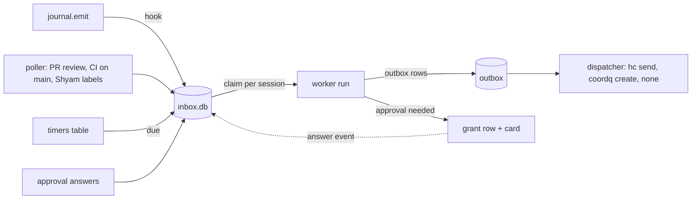
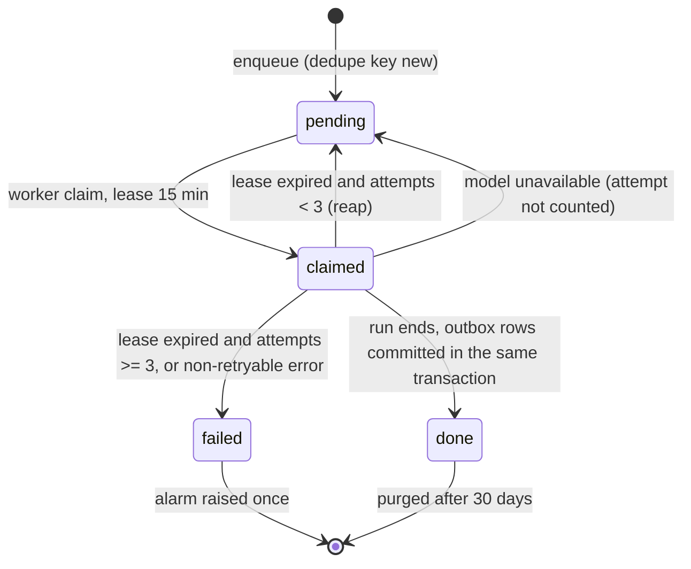

# Coordinator event inbox: wake on events, not on a clock

Design doc, 2026-11-23. Requested by Coder, approved by Shyam on 23 Nov. Nothing
in this document is built. This PR changes no live job, no queue, no journal and
no session.

## Summary

The Coordinator wakes today on a 30-minute clock. Most wakes find nothing to do.
This design replaces the clock with a durable inbox. Every reason to wake
becomes a row. One worker pulls the pending rows, drops duplicates, groups them
per session and starts one run. Every message the run wants to send goes through
an outbox, including an explicit "send nothing". A slow fallback tick (2 hours)
stays until the inbox has proved itself.

The inbox is a small SQLite file next to the journal, with one new module beside
`journal.py`. It needs no new service. The journal stays the append-only
history, and the inbox is the mutable work list.

## Intent, in order

- Replace the empty 30-minute polls with an event inbox.
- Wake sources are inbox rows: PR opened, merged or reviewed; CI status on
  `main` published by the Mac (there is no GitHub Actions and there never will
  be); Shyam's replies and approvals; due timers. Timers only enqueue.
- One worker claims pending rows, dedupes and batches per session. Claimed rows
  go back to pending if the worker crashes.
- A tool call that needs approval ends the run, saves the session, and returns
  as an inbox event.
- All sends go through an outbox, with an explicit send-nothing row.
- Keep a slow fallback tick until the inbox is proven.
- Measure wake count, event to action latency and the empty-tick share, before
  and after.
- Scope limit for this PR: a design doc only. No merge, no live job change, no
  contact with the live Coordinator session t56, no `coordq dispatch`, refill,
  lane, or `ticket start` or `close`.

## 1. How the Coordinator wakes today

Four paths exist. Only the first two run.

1. **Launchd tick.** `coordinator/launchd/dev.coordinator.tick.plist:19-20` sets
   `StartInterval` to 1800 seconds, with no `RunAtLoad`. It starts
   `coordinator/pi/bin/coord-tick`. The launcher takes one flock
   (`coord-tick:313-329`), runs the overnight selftest (`:347`), checks the
   model is offered (`:348`), then starts a fresh headless `pi -p --no-session`
   on `deepseek/deepseek-flash` inside the coordinator sandbox (`:254-267`). The
   prompt is fixed text (`:51-63`) that tells the run to read the whole board
   and reply `NOOP` or `ALERT:` lines. The launcher forwards each `ALERT:` line
   to the live Coordinator terminal with `hc send` (`:189-208`, lookup in
   `:155-173`). `NOOP` goes nowhere. The run is ephemeral, so nothing is saved
   between ticks.
2. **In-session idle wake.** `coordinator/pi/extensions/coordinator.ts:265-267`
   sets `WAKE_MIN` (default 30) and a prompt. The timer at `:349-361` checks
   every 60 seconds. When t56 has been idle for `WAKE_MIN` minutes it calls
   `pi.sendUserMessage(TICK_PROMPT)`. The headless tick sets `COORD_WAKE=0`
   (`coord-tick:106`) so the two do not stack. This path is a second clock
   inside t56.
3. **`coord-watch`.** `coordinator/bin/coord-watch` polls GitHub, T3 and logs
   every 30 seconds and prints `EVENT builder-stopped`, `EVENT gate-fail`,
   `EVENT lane-idle`, `EVENT run-long`, `EVENT rate-limit` and `EVENT traceback`
   lines (`coord-watch:226-337`). The only wake path from those lines is a
   `bgmon_watch` regex with `delivery: "wake"` and a 24-hour TTL
   (`coordinator/pi/README.md:28-37`). The coordinator guard blocks
   `bgmon_start` and every `bgmon_*` call except observation
   (`coordinator.ts:280-283`), so someone has to start the monitor during an
   authorized activation and renew the watch before it expires. It has no
   LaunchAgent and is not running. Its state lives in
   `~/.coordinator/coord-watch.json`. Its own doc budgets up to 2,880 GitHub
   requests per hour (`docs/coord-watch.md`, "Bounds and request budget").
4. **Other readers of state.** The decisions board
   (`~/Code/coordinator/decisions.json`) is what Shyam reads, and several
   writers rewrite it. On 22 Nov at 14:16 the tick log records one rewrite that
   dropped a card (`loop/ticks.log`, line starting `2026-11-22 14:16 PT`). The
   journal (`~/.local/state/coordinator/journal/events-YYYY-MM.jsonl`, written
   by `coordinator/bin/journal.py:110-128`) is append-only, one line per
   lifecycle event, under `flock`. It already records `gate_queued` (gatekeep),
   `gate_verdict`, `merged`, `merged_outside_lane`, `fix_sent` (lane driver,
   `coordinator/overnight/lane_driver.py:443-446,743`) and `alarm_raised`
   (alarms). Nothing reads the journal to wake anyone.

How a message reaches t56: `hc send <terminal> <text>` pastes the text and
presses Enter. `hc send --if idle` types only when the status is idle, and
`--json` gives machine output (`hc send --help`). `coord-tick` uses plain `hc
send` today.

### Ownership check

`/Users/shyamsivakumar/Code/CLAUDE.md` lists "Agent orchestration" under
`_archive/nexus/` and "Memory / learning storage" under `opc/`. Neither owns
factory wake events. The factory's own event owner is the journal in
`mac-ops/coordinator/bin/journal.py`, and its queue owner is `coordq`. This
design extends the journal (one hook) and adds one sibling module,
`coordinator/bin/inbox.py`. It does not add a parallel event store, because the
journal stays the only history. The ownership map in `AGENTS.md` of mac-ops
names no other owner for wake events.

### Why the inbox lives where it lives

- Journal file itself
  - Verdict: No
  - Reason: The journal is never rewritten (`journal.py:1-13`). A row needs a
    mutable status (pending, claimed, done). Deriving status by scanning 12,728
    lines per claim is slow and racy. The journal keeps the history; inbox
    transitions emit journal lines.
- `coordq` `queue.json`
  - Verdict: No
  - Reason: The queue dispatches work to T3 threads. `coordq` rewrites the whole
    file under `queue.lock` every 30 seconds (`refill`, 2,840 lines of code in
    `coordinator/bin/coordq`). Wake rows would contend with that lock and mix
    two meanings of "item".
- `decisions.json`
  - Verdict: No
  - Reason: It is Shyam's board. Several writers rewrite it and cards have been
    dropped. Wake rows are machine state, not asks.
- A new service
  - Verdict: No
  - Reason: A file and a lock do the job.
- SQLite file `~/.local/state/coordinator/inbox.db`
  - Verdict: Yes
  - Reason: The standard library has it. A `UNIQUE` column gives dedupe. One
    `UPDATE ... WHERE status='pending'` inside `BEGIN IMMEDIATE` gives an atomic
    claim. WAL mode lets producers write while the worker reads. It sits in the
    same state directory as the journal and follows the same override pattern
    (`COORD_INBOX_DIR`, like `COORD_JOURNAL_DIR`).

A flat JSON file with a lock would also work for one consumer, but each claim
would rewrite the whole file, and dedupe, lease expiry and the outbox join would
be hand-written. SQLite is the simpler choice at this size.

The inbox can be rebuilt from the journal. A backfill pass replays journal
lines through the same hook. Dedupe keys make the replay idempotent, so it can
start from the first line of the month and needs no cursor that could be lost
with the file. The worker runs this pass on every wake, which also covers an
enqueue that failed after its journal line was written. That is the reason
producers write through the journal.

## 2. Baseline from real data (read-only)

All numbers come from the scripts in `evidence/event-inbox-design/`. Commands
are listed so anyone can rerun them.

### Wake count

The launcher log `~/Library/Logs/coordinator/tick.log` has one `exit=` line per
run.

```sh
grep "exit=" ~/Library/Logs/coordinator/tick.log \
  | awk '{print $1}' | sort | uniq -c
```

| Day (local) | Launcher runs |
| --- | --- |
| 2026-11-21 | 23 (log starts 11:27) |
| 2026-11-22 | 44 |
| 2026-11-23 | 21 (log ends 15:53) |

That is 88 launcher runs in about 52 hours, near 41 a day against 48 nominal.
The log has no entries before 21 Nov 11:27, so the 7-day launcher count is not
available. The older summary log has 246 tick summaries for 16 to 22 Nov.

What those 88 runs did:

| Outcome | Runs | Share |
| --- | --- | --- |
| `pi exited 1`, `402 Insufficient Balance`, empty reply | 34 | 39% |
| exit 0, reply `NOOP` | 41 | 47% |
| exit 0, at least one `ALERT:` line (13 alert lines sent to t56) | 13 | 15% |

```sh
grep -c "Insufficient" ~/Library/Logs/coordinator/tick.log
grep "exit=0" ~/Library/Logs/coordinator/tick.log | grep -c "reply=NOOP"
grep -c "alert sent to" ~/Library/Logs/coordinator/tick.log
```

So 75 of 88 launcher wakes (85%) told t56 nothing. The tick has failed on every
run since 2026-11-22 17:47 EST because the DeepSeek account has no balance, and
`decisions.json` already carries a watchdog card, "tick failing (last exit code
1)". Every one of those wakes cost a selftest and a model check and produced no
work. This is a live example of the clock failing silently.

### Empty-tick share, from the tick's own summaries

The model writes one line per tick to `~/Code/coordinator/loop/ticks.log` (`tick
(launchd): 0 queue items added by me, 0 sends, ...`).
`evidence/event-inbox-design/empty_ticks.py` counts a tick as acting when its
leading count segment has a positive number of queue items, sends, launches,
gates, merges, repo writes, parks or cards, or says restored, re-cut or resent.

```sh
python3 evidence/event-inbox-design/empty_ticks.py
```

| Window | Ticks | No action | Share |
| --- | --- | --- | --- |
| 16 to 22 Nov, all lines | 246 | 193 | 78.5% |
| Count format era (19 Nov 13:39 to 22 Nov) | 106 | 56 | **52.8%** |
| Prose format era (16 to 19 Nov) | 140 | 137 | not reliable |

Use 53% as the baseline. The prose-era lines say "no starts, no gates" but also
describe narrative actions the script cannot see, so 78.5% is an upper bound.
The script is a heuristic. It was checked by hand on 14 random lines in each
direction. The log stops at 22 Nov 16:10 because the model could no longer run.
Ticks that acted still did mostly unalerted housekeeping, which is why the
launcher view (85% silent) and the summary view (53% empty) differ. Both are
reported after the switch.

### Event to action latency

`evidence/event-inbox-design/latency.py` joins GitHub (`gh pr list --json
number,createdAt,mergedAt`), journal events for the same PR, and the tick
summaries.

```sh
python3 evidence/event-inbox-design/latency.py
```

For 12 mac-ops PRs opened on 22 Nov (#851 to #887):

- PR opened to `gate_queued` (gatekeep, its own launchd job, journal)
  - Result: 0.5 to 5.4 minutes, median 2.2, with two outliers (#868 and #882, 27
    hours, held for a re-cut)
- PR opened to the first tick summary that names it
  - Result: 8.5 to 32.7 minutes, median 26.3
- PR merged to the next tick of any kind
  - Result: 4.5, 14.1, 15.1, 18.1, 30.7 minutes (mean 16.5)
- `gate_verdict` to `merged`
  - Result: 0.1 minutes when the lane merges on its own; 41 to 753 minutes when
    a PR waits for `merge:human-ok`

Event sources that already have a fast job (gatekeep, lane) react in minutes.
The Coordinator hears about the same event half an hour later, because the clock
is its only input. The long `gate_verdict` to `merged` gaps are waits for Shyam,
not clock latency, and the inbox cannot shorten them except by pushing the
approval request to Shyam sooner.

Gaps in the baseline, stated plainly: the in-session idle wake (path 2) leaves
no log, so its count is unknown. Tick time zones in `ticks.log` are labelled PT
or EST per line and the script trusts the label. The manifesto reference was not
found (see section 8). The baseline also mixes a broken period with a healthy
one: the 402 failures start on 22 Nov at 17:47 EST. The latency and
empty-summary numbers come from the healthy window (16 to 22 Nov, before the
failures). The launcher counts include the 34 failed runs and are shown
separately, so the after numbers are compared with the healthy window, and the
failed runs are not counted as an improvement.

## 3. Design

### 3.1 Parts



### 3.2 Inbox row

One table, `inbox`.

- `id`
  - Type: integer primary key
  - Meaning: order of arrival
- `ts`
  - Type: real
  - Meaning: event time (UTC epoch)
- `source`
  - Type: text
  - Meaning: `journal`, `poll`, `timer`, `shyam`, `approval`
- `kind`
  - Type: text
  - Meaning: `pr_opened`, `pr_new_head`, `pr_merged`, `pr_review`,
    `gate_verdict`, `ci_main`, `shyam_reply`, `approval_answer`, `timer_due`,
    `alarm`
- `dedupe_key`
  - Type: text, unique
  - Meaning: see below
- `session`
  - Type: text
  - Meaning: target session, default `coordinator`; `approval:<id>` for a grant run
- `repo`, `pr`, `head`
  - Type: text, int, text
  - Meaning: same field names as the journal
- `payload`
  - Type: json
  - Meaning: metadata only: ids, heads, labels, counts. No PR titles, bodies or
    comments.
- `status`
  - Type: text
  - Meaning: `pending`, `claimed`, `done`, `failed`
- `attempts`
  - Type: int
  - Meaning: claims that reached a model run
- `claimed_by`, `lease_until`, `run_id`
  - Type: text, real, text
  - Meaning: who holds the row and until when
- `done_ts`, `error`
  - Type: real, text
  - Meaning: end of life

Payload is metadata only because PR text and comments are untrusted input, and
the run reads details through the existing board tools, as `coord-tick` does
today.

**Dedupe key.** One stable key per real-world fact: `pr_opened:<repo>#<n>`,
`pr_new_head:<repo>#<n>:<head>`, `pr_merged:<repo>#<n>`,
`gate_verdict:<repo>#<n>:<head>`, `ci_main:<repo>:<sha>:<context>:<state>` (terminal states only: success, failure, error),
`pr_review:<repo>#<n>:<review id>`, `shyam_reply:<comment or label event id>`,
`timer_due:<timer id>:<due ts>`, `approval_answer:<approval id>`. `INSERT OR
IGNORE` on the unique column drops repeats, including a second poller seeing the
same event. The ignored count is kept in a `counters` row so the duplicate rate
is measurable. The `payload` of a done row is purged after 30 days, but its key
stays in a small `seen` table (key and time) with no expiry, so an old review or
an unchanged `main` status cannot come back as a new event. Poll watermarks live
in a `meta` table, and losing them only re-reads facts that `seen` drops.

### 3.3 Sources and writers

- Journal events
  - Kinds: `pr_new_head` and `pr_opened` (from gatekeep's `gate_queued`, which
    fires 0.5 to 5.4 minutes after a PR opens), `gate_verdict`, `pr_merged`
    (from `merged` and `merged_outside_lane`), `alarm`
  - Writer: A hook in `journal.emit`: a small map of journal event name to inbox
    kind, and one call to `inbox.enqueue` after the journal line is written.
    Lane and gatekeep code does not change. A failed enqueue prints to stderr
    and returns, as a failed journal write does.
- PR review and Shyam on GitHub
  - Kinds: `pr_review`, `shyam_reply` (review by Shyam, `merge:human-ok` label
    added)
  - Writer: One poll pass inside the worker, through `gh_gateway` with its ETag
    cache, so an unchanged PR list costs a 304. At most one call per open PR per
    5 minutes.
- CI on `main`
  - Kinds: `ci_main`
  - Writer: The same poll pass reads the combined commit status of each
    configured repo's default branch head and keeps only the contexts the Mac
    publishes (for example `srw/agent-check`). It never reads Actions or
    check-runs from workflows. If a repo's `main` has no Mac-published context,
    the source stays off for that repo.
- Shyam's messages
  - Kinds: `shyam_reply`
  - Writer: A message typed in t56 reaches the live session directly and stays
    direct. Inbox rows cover the asynchronous kinds: a resolved card on the
    decisions board, an `approve <id>` or `deny <id>` message parsed by the
    extension's `input` hook (`coordinator.ts:295-307`), and phone relay
    messages.
- Timers
  - Kinds: `timer_due`
  - Writer: A `timers` table in the same file (`id`, `due_ts`, `period`,
    `payload`). The worker, at the start of each pass, turns due timers into
    inbox rows. A timer never starts a run. The 2-hour fallback is one periodic
    timer.

### 3.4 Row lifecycle



Invariants:

1. A row is in exactly one state. Only `pending` rows can be claimed.
2. `claimed` implies `lease_until` is set. A run is killed at 600 seconds
   (`coord-tick:46`), and the lease is 900 seconds, so a live run never loses
   its rows.
3. `done` is written in the same SQL transaction that inserts the outbox rows
   for the run. A crash cannot leave a done row without its decision on record.
4. At most one worker claims at a time: an `flock` on `inbox.worker.lock` (the
   pattern `coord-tick` already uses, `:313-329`) plus the transactional claim.
5. The reap pass runs at the start of every worker pass, before the claim.
6. A model that is unavailable (balance, provider outage) puts rows back to
   pending without counting an attempt, and the worker backs off exponentially.
   Today's 402 failure must not burn attempts or drain rows into `failed`.
7. If the oldest pending row is older than 30 minutes, the worker raises one
   alarm (through the existing alarms module, one per head, not per pass).
   Alarms the inbox raises about itself (`inbox_*`) are never inbox kinds, so a
   failing source cannot wake a run whose only output is another alarm.
12. A watchdog independent of the worker reads `inbox.worker.heartbeat`, which
    the worker touches at the start and end of each pass. The hourly selftest
    (`EXPECTED` in `coordinator/bin/hourly_selftest.py`) alarms when the
    heartbeat is older than 10 minutes, and the worker sets a 15-minute
    `SIGALRM` for the whole pass, so a wedged pass cannot hold the lock.
8. A lease is reaped only when its `claimed_pid` is gone (`kill -0`) or the
   lease is more than one hour past due. A laptop that slept through a lease
   does not return rows from a run that was only frozen.
9. Timers are wall-clock. After sleep, a due timer fires once and the missed
   periods collapse into that one row.
10. A run budget caps cost: the worker waits 60 seconds after the first pending
    row so a burst joins one batch, starts at most 6 runs an hour, and leaves
    the rest pending. The `inbox_batch` line records the delay, so the latency
    target and the cap are measured against each other.
11. The database carries `PRAGMA user_version` for schema changes. Done rows and
    sent outbox rows are purged after 30 days, and the worker runs
    `wal_checkpoint(TRUNCATE)` once a day.

### 3.5 Claim, batch and run

One worker pass:

1. Take the worker flock. Reap expired leases. Turn due timers into rows. Run
   the poll pass.
2. In `BEGIN IMMEDIATE`, pick one session that has pending rows and claim up to
   50 of them (`UPDATE ... SET status='claimed', claimed_by=?, lease_until=?,
   attempts=attempts+1 ... RETURNING`).
3. Coalesce in memory: rows with the same repo, PR and kind collapse to one line
   with the newest state (a second `pr_new_head` replaces the first). Different
   kinds on one PR stay separate lines, so a failed gate followed by a review is
   two lines (opened plus merged is two lines on one PR). The batch prompt lists
   those lines and the row ids. A burst of ten events is one run, not ten.
4. Start the run. This reuses `coord-tick`'s sandbox, lock, timeout and model
   check (`run_tick`, `model_available`), with the batch prompt in place of the
   fixed tick prompt. The run stays ephemeral (`--no-session`), as today.
5. Parse the reply. A line `SEND <target>: <text>` becomes an outbox row. A line
   `NOTHING: <reason>` becomes a `none` row. A reply with neither is a failed
   run. That keeps today's `ALERT:` and `NOOP` convention (`coord-tick:176-186`)
   with one extra word.
6. In one transaction: insert the outbox rows, mark the batch rows `done`,
   journal an `inbox_batch` event.

Batching is per session. Rows for `coordinator` batch together. An
`approval_answer` row gets its own fresh run, carrying only that grant.

### 3.6 Approval round trip

The guard today is deny-only: nothing asks, because nobody watches the tab
(`coordinator.ts:1-4,288`). The new behavior for the small set of calls that
need Shyam (for example `gh pr merge`):

1. The guard blocks the call and records an `approval_request` (kind added to
   the outbox kinds) with an approval id. The grant row stores the approval id,
   the exact action (command hash), the repo and the PR head. The guard creates
   a card on the decisions board and tells the run to stop. The run ends.
2. Shyam answers: resolving the card, or sending `approve <id>` or `deny <id>`
   to t56. The worker observes card answers on its poll pass.
3. That answer becomes an inbox row `approval_answer:<id>`, and the grant row
   flips to `granted` or `denied`. A grant is single use.
4. The worker starts a fresh run for that row. The run repeats the call, and the
   guard consumes the grant only if the command hash, repo and head match
   exactly. A different action, or a head that moved, finds no grant and asks
   again, so a retry cannot loop on an old yes and cannot approve something
   else.
5. An approval with no answer in 24 hours becomes an `approval_expired` timer
   row (kind added to the inbox kinds) and the grant is marked expired.

Only the first answer counts: a second answer for the same approval hits the
unique `approval_answer:<id>` key and is ignored. Each row records the channel
it came from (card, t56 input, phone relay) so an approval can be traced to a
person's action.

Open point: how the extension ends a run from inside a `tool_call` handler is
not confirmed. The first fallback is the prompt contract (`NEEDS_APPROVAL <id>`
as the final line). The guard file needs Shyam's OK to change
(`coordinator.ts:4`), so the guard change is a separate ticket.

Saved-session resume (`pi --session <file>`, which `pi --help` lists) is not
needed for this design. A fresh run plus a grant avoids replay ambiguity and
stale sessions, so sessions stay `--no-session` as today. Resume is a later
option if a run's context ever proves too costly to rebuild from the board.

### 3.7 Outbox

Table `outbox`:

- `id`, `ts`
  - Meaning: order and time
- `run_id`
  - Meaning: the run that wrote it
- `kind`
  - Meaning: `hc_send`, `coordq_send`, `none`
- `target`
  - Meaning: a terminal for `hc_send` (resolved as `coord-tick` does today); the
    same arguments `coordq create` takes for `coordq_send`
- `body`
  - Meaning: text to send
- `reason`
  - Meaning: required for `none`
- `dedupe_key`
  - Meaning: `<run_id>:<index>`, unique
- `status`, `attempts`, `lease_until`, `sent_ts`
  - Meaning: `pending`, `sending`, `sent`, `failed`

The dispatcher runs at the end of every worker pass under the same worker lock.
A send that fails is retried on later passes with growing delay, three tries in
all, then marked `failed` with one alarm. `inbox.py outbox --drain` lets an
operator run a pass by hand. A dispatcher drains the outbox: claim, mark `sending`, send, mark sent. Delivery
depends on the kind. A `coordq_send` is at-least-once: a crash after the send
and before the mark resends once, and `coordq create` already refuses a repeated
`clientRequestId`. An `hc_send` is at-most-once: a row left in `sending` after a
crash is marked `unknown` and raised as one alarm, not resent, because a pasted
instruction acted on twice costs more than a lost alert, and the board plus the
fallback tick recover a lost alert. The body carries the dedupe key either way.
A `coordq_send` goes through `coordq create`, never around it. A `none` row is a recorded decision with a
reason. A run that writes no outbox row at all counts as failed (`no_decision`),
so a model that forgets to answer cannot silently drop events.

### 3.6a What replaces each existing wake

- `dev.coordinator.tick` every 30 minutes
  - After: A worker job (`dev.coordinator.inbox`) with `StartInterval` 60 and a
    `WatchPaths` ping file touched on enqueue. A pass with no pending rows is a
    local SQLite read and a process exit, with no model call.
- In-session 30-minute idle timer (`coordinator.ts:349-361`)
  - After: Turned off at cutover (`COORD_WAKE=0`, the switch the headless tick
    already uses), so the only fallback is the inbox timer.
- `coord-watch`
  - After: Retired. Its detectors map to existing journal events or alarms:
    `gate-fail` to `gate_verdict`, `builder-stopped` to coordq `thread_ended`,
    `run-long` to the turn-cap job (`dev.coordinator.turncap`), `rate-limit` and
    `traceback` to alarms. `lane-idle` is covered by the fallback tick until a
    lane event exists. The `bgmon` activation steps in
    `coordinator/pi/README.md` go with it. Deleting the file needs Shyam's yes,
    and `scripts/mac_ops_fast_check.py:32` lists it.
- Alerts to t56 by `hc send` in `coord-tick`
  - After: Outbox `hc_send` rows, same terminal lookup.

## 4. Fallback tick

The inbox starts with a periodic timer row every 7,200 seconds named `fallback`.
When it fires the worker runs the full board tick (today's prompt) as one batch.
It stays until the measurement below passes for 14 days, then drops to daily,
then goes away. Any fallback run that finds work the inbox did not announce is
logged as `fallback_acted`, with the PR or head, so a missing event class shows
up by name. At cutover the old launchd tick is unloaded (not slowed to 2 hours)
and the in-session idle wake is turned off, so exactly one fallback exists and
the three clocks cannot stack. The old plist stays on disk. Rollback is one
`launchctl bootstrap`.

## 5. Measurement plan

One script, `scripts/coord_wake_metrics.py`, reads `tick.log`, `loop/ticks.log`,
the journal and `inbox.db` and prints the table below for any window. Before
numbers are in section 2 and reproduced by the script on 16 to 22 Nov.

- Wake count
  - Before (measured): 41 model runs a day (88 in 52 h)
  - Definition after: `inbox_batch` journal lines with a started run, plus
    fallback runs
  - Pass criterion (7 consecutive days after cutover): at most 15 a day
- Empty-run share
  - Before (measured): 85% of launcher runs sent nothing; 53% of summaries acted
    on nothing
  - Definition after: runs whose outbox is only `none` rows or that failed,
    excluding the fallback
  - Pass criterion (7 consecutive days after cutover): at most 10%
- Event to action latency
  - Before (measured): PR opened to first tick that names it: median 26.3 min
  - Definition after: inbox row `ts` to its outbox row `sent_ts`
  - Pass criterion (7 consecutive days after cutover): median at most 3 min and
    p90 at most 10 min for `pr_opened`, `pr_new_head`, `gate_verdict`,
    `pr_merged`
- Lost events
  - Before (measured): not measurable
  - Definition after: rows not `done` or `failed` more than 2 hours after `ts`,
    plus `fallback_acted` events
  - Pass criterion (7 consecutive days after cutover): zero stuck rows; at most
    1 `fallback_acted` a week
- Duplicate rate
  - Before (measured): not measurable
  - Definition after: ignored inserts over total inserts
  - Pass criterion (7 consecutive days after cutover): reported, no target

Shadow mode comes first (section 6), and it carries its own pass criterion
before any behavior changes: over 7 days, for at least 95% of actions the
30-minute tick took on a PR or head (sends, launches, gates, merges, parks), an
inbox row for that PR existed at least one minute before the action. Rows with
no matching action are the extra wakes the inbox would have caused, and those
are counted too, so the shadow week also predicts the new wake count.

## 6. Migration

1. **Build the core** (inbox module, journal hook, outbox, dispatcher, metrics
   script). Nothing is loaded. Proofs run with a temporary `COORD_INBOX_DIR` and
   `COORD_JOURNAL_DIR`.
2. **Build every producer.** The poll pass (reviews, Shyam labels, CI on main),
   timers and the approval-request writer are built before shadow starts, so the
   shadow week covers every source that will go live.
3. **Shadow.** Enable the journal hook and load the worker job in `--shadow`: it
   claims nothing, makes no model call and sends nothing. It writes an
   `inbox_would_wake` journal line for every batch it would have started. The
   30-minute tick is unchanged. Run 7 days. Compare with the criterion in
   section 5.
4. **Switch.** Unload the old tick, turn the worker's shadow flag off and set
   `COORD_WAKE=0` for the in-session timer. This step needs Shyam's go. The
   change is a plist and env edit, listed in the cutover ticket.
5. **Approvals.** Ship the first version with grants and no session resume (see
   section 3.6). Add resume only after the spike. The guard file needs Shyam's
   OK.
6. **Retire `coord-watch`.** After 14 days on the inbox, remove the file, its
   fast-check entry and the README activation steps, each with Shyam's yes for
   the delete.

### Rollback

At any step: unload `dev.coordinator.inbox`, load `dev.coordinator.tick` with
its 1800-second interval, and set `COORD_WAKE` back on for the in-session timer.
The journal is untouched by the inbox (the hook only adds rows) and the hook can
be turned off with one environment variable. `inbox.db` can stay on disk. It
holds state the journal does not have (poll rows, timers, approvals, outbox
rows), but nothing outside the inbox reads it, and the 30-minute tick finds the
same work from the board.

## 7. Risks and how the design answers them

- **Model unavailable.** The current 402 failure shows a wake that does nothing
  and says nothing. Inbox rows survive it (invariant 6), and the age alarm
  (invariant 7) tells Shyam.
- **Producer outage.** A source that stops emitting is silent. The fallback tick
  and `fallback_acted` expose it.
- **Duplicate or reordered events.** Dedupe keys are facts (PR, head, review
  id), not times. Coalescing keeps the newest state per PR.
- **Prompt injection.** Payloads hold ids and heads only. The run reads PR text
  through the board tools, which already treat it as data.
- **Outbox repeats.** At-least-once for `coordq_send` (keyed by request id), at-most-once for `hc_send` (section 3.7).
- **Lock contention.** The inbox has its own file and its own worker lock,
  separate from `queue.lock`.
- **GitHub budget.** One ETag poll pass replaces `coord-watch`'s worst case of
  2,880 requests an hour, and conditional requests that return 304 are cheap.
- **Formal check.** The state machine is small enough for a crash-injection
  proof in the existing selftest. TLA+ is not worth it unless the outbox grows
  more states.

## 8. References

- Anthropic, "Building always-on agents",
  <https://claude.com/blog/building-always-on-agents>. Used for the inbox shape:
  every source writes an event row to an inbox and a worker picks it up, dedupe
  by source identifiers, timers in their own store that only enqueue ("A timer
  doesn't initiate a run on its own"), an outbox table for outgoing messages, a
  deferred tool call that ends the run, saves the session and resumes on the
  answer as a new event, batching of pending events, and a restarted worker
  reloading pending events first.
- waku-agent by ShenSeanChen, <https://github.com/ShenSeanChen/waku-agent> (also
  on PyPI as `waku-agent`). Its README describes an always-on layer that "sleeps
  until an event arrives: a message, a timer, your yes", with "every event is a
  row on disk first, so a crash loses nothing", an outbox that "sends once", and
  runs that pause for approval, in `waku/alwayson/`. The README does not
  document the queue, dedupe, lease or approval storage, and this author read
  only that page, not the source. The design above takes the shape from it and
  does not copy it.
- "Manifesto P13": searched `~/Code/llmwiki`, `~/Code/coordinator` and
  `~/Code/mac-ops` for `P13` and `manifesto`. The only hit is a log line in
  `~/Code/coordinator/notes.md` ("start labeling per manifesto plan", 22 Nov
  15:45), with no numbered principle. P13 was not found, so this design does not
  claim to satisfy it. Coder should point to the text so the design can be
  checked against it.

## 9. Critiques

Two reviewers outside the Anthropic family read this document: DeepSeek V4.1
Flash (`morph-dsv41flash`) and Kimi K3.1 (`morph-kimik31`), both through Morph
and `pi -p`, asked for omissions, failure modes and simpler alternatives. Each
point is answered below. Section numbers refer to the reviewed draft.

### DeepSeek V4.1 Flash

Omissions

1. Baseline measured on a broken system (39% of launcher runs failed on 402). **Accepted.** Section 2 now says the latency and empty-summary numbers come from the healthy window and the launcher counts show failed runs separately.
2. Where the journal replay cursor lives. **Accepted.** Replay is idempotent through dedupe keys, so it needs no cursor and starts from the first line of the month (section 1).
3. Approvals have no attribution. **Accepted.** Each answer row records its channel, and only the first answer counts (section 3.6).
4. The run-ending mechanism in the guard is unproven. **Accepted as emphasis.** The first version ships without resume, and a spike comes first in T11 (section 3.6).
5. No throughput or cost cap. **Accepted.** Invariant 10 adds a 60-second burst window and at most 6 runs an hour.
6. No schema version, retention or WAL growth rule. **Accepted.** Invariant 11 adds `user_version`, a 30-day purge for done and sent rows, and a daily checkpoint.

Failure modes

1. Alarm rows manufacturing wakes about alarms. **Accepted.** `inbox_*` alarms are never inbox kinds (invariant 7).
2. A hook write that fails leaves the row behind the producer. **Accepted.** The worker's idempotent journal replay on every wake repairs it (section 1).
3. At-least-once `hc send` can be acted on twice. **Accepted for `hc_send`.** It becomes at-most-once with an alarm for an unknown state; `coordq_send` stays at-least-once because `coordq create` refuses a repeated request id (section 3.7).
4. A force-push back to an older head is dropped by the dedupe key. **Accepted as a known limit.** The gate pins heads, so it is rare, and the fallback tick catches it. It is not worth a counter in the key.
5. Two answers to one approval resume one session twice. **Rejected as stated, clarified.** The unique `approval_answer:<id>` key already makes the second answer a no-op (section 3.6).
6. Sleeping laptop breaks timers and leases. **Accepted.** Invariants 8 and 9 (pid check, collapsed missed timers).

Simpler alternatives

1. A precheck in front of the existing tick. **Accepted as T0 and rejected as a replacement.** It removes empty wakes cheaply but keeps the 30-minute latency, which is the second goal.
2. Fix `coord-watch` instead. **Rejected.** It polls on a 30-second cycle with a budget of 2,880 GitHub requests an hour, has no acknowledge or lease, repeats events when its state is lost (its own doc says so), and its wake path needs a monitor started in an authorized session plus a watch renewed every 24 hours. Its detectors are kept as journal and alarm mappings.
3. A spool directory with rename-to-claim. **Rejected.** It works for one consumer, but dedupe across done rows, batch queries, lease reaping and counters become directory scans. SQLite in the standard library has all of them. This stays the fallback if SQLite causes trouble.
4. Drop session resume. **Accepted as the first version** (section 3.6).
5. Send inline and journal afterwards (no outbox). **Rejected, partly adopted.** The outbox is what makes send-nothing and `no_decision` visible, which Coder asked for. The at-most-once rule for `hc_send` takes the useful part of the idea.

### Kimi K3.1

Omissions

1. Approval grant is not bound to the action, and `approval_request` and `approval_expired` are not declared kinds. **Accepted.** Section 3.6 now has a single-use grant bound to command hash, repo and head, with both kinds named. Resume is dropped from the first design (see alternative 3 below), which also removes the approve-forever loop.
2. Recovery is asserted, and the rollback line that "the journal holds all inbox state" is false for polls, timers, approvals and the outbox. **Partly accepted.** The rollback wording is corrected (section 6). The replay needs no cursor because dedupe keys make it idempotent, and the worker runs it on every wake. Poll watermarks now live in a `meta` table and the permanent `seen` table covers the rest.
3. The outbox dispatcher has no launch path, retry policy or drain procedure. **Accepted.** Section 3.7 now runs it at the end of each worker pass, three tries with growing delay, then `failed` plus one alarm, and `outbox --drain` by hand.
4. Metrics cannot show zero lost events, and latency is measured from row creation, which hides a late producer. **Accepted.** `ts` is the source event time (PR `createdAt`, journal time), and the metrics script compares GitHub's PR list with inbox rows each week to count events never enqueued. Failed rows count as lost.
5. Shadow ends before reviews, labels, CI and timers exist, and approvals ship after cutover. **Accepted.** Migration step 2 now builds every producer before the shadow week. Approvals ship as a grant without resume.

Failure modes

1. A wedged worker holding the lock blocks reaping and its own age alarm. **Accepted.** Invariant 12 adds a heartbeat file read by the hourly selftest, plus a 15-minute `SIGALRM` for the whole pass.
2. A crash between the journal append and `inbox.enqueue` loses the wake. **Rejected as stated.** The worker's replay on every wake is the reconciler, and idempotent keys make it safe (section 1).
3. A retried run repeats a mutation made before the final transaction. **Accepted as a known limit.** The mutating verbs are already keyed: `coordq create` refuses a repeated request id and gates are keyed by head. Attempts are capped at 3.
4. `ci_main` key omits the status, so `pending` can hide the later result. **Accepted.** The key now ends in the terminal state, and pending states are not enqueued.
5. A purged done row lets an old review or an old `main` status return as new. **Accepted.** Keys now live forever in a small `seen` table, and only payloads are purged.
6. Coalescing by repo and PR erases an older but still actionable kind. **Accepted.** Coalescing is by repo, PR and kind.
7. Cutover can leave three two-hour fallbacks. **Accepted.** At cutover the old tick is unloaded and the in-session wake is off, leaving one fallback (section 4).

Simpler alternatives

1. Keep the journal as the store, advance a byte offset after a successful tick, trigger with `WatchPaths`. **Rejected, partly adopted as T0.** It has no home for poll events, timers or grants, no per-session batching and no outbox. Offset-after-success also cannot express a failed batch separately from a pending one without rebuilding the row states.
2. Use only `pending` and `done` under the whole-pass lock. **Rejected, with a note.** Coder's request names claim, lease and crash return. A `claimed` state is about 15 lines and gives metrics an in-flight count and the dispatcher something to reap. If T1 shows it is more than that, drop it.
3. Replace saved-session resume with a fresh run and a one-time grant. **Accepted.** It is now the design (section 3.6). It matches DeepSeek's alternative 4.


## 10. Ticket cut

Each ticket stays within 150 code lines and 3 code files. Tests extend
`coordinator/overnight/selftest.py` or `EXPECTED` in
`coordinator/bin/hourly_selftest.py`; no new test files. None are opened by this
PR.

- T1
  - Ticket: Inbox core: schema, `enqueue` with dedupe, `claim`, `ack`, `reap`,
    lease
  - Files: `coordinator/bin/inbox.py`, `coordinator/overnight/selftest.py`
  - Blocked by: none
  - Proof idea: Temp `COORD_INBOX_DIR`. Enqueue the same key twice (one row).
    Claim, kill the claimer, advance the clock, reap (row is `pending`, attempts
    1). Third lease expiry gives `failed`.
- T2
  - Ticket: Journal hook: event-to-kind map, `inbox.enqueue` after the journal
    write, off switch
  - Files: `coordinator/bin/journal.py`, `coordinator/overnight/selftest.py`
  - Blocked by: T1
  - Proof idea: Temp dirs. `journal.emit("gate_verdict", ...)` twice gives one
    row. With the switch off, zero rows and the same journal bytes. An
    unwritable inbox still writes the journal line.
- T3
  - Ticket: Outbox table and dispatcher (`hc_send`, `coordq_send`, `none`,
    `no_decision`)
  - Files: `coordinator/bin/inbox.py`, `coordinator/overnight/selftest.py`
  - Blocked by: T1
  - Proof idea: Fake `hc` on `PATH`. Crash between send and mark gives one
    resend with the same key. A run with no outbox rows is recorded as failed.
- T4
  - Ticket: Shadow worker pass: per-session batch and coalesce,
    `inbox_would_wake` journal line, no model, no send; launchd job file
  - Files: `coordinator/bin/inbox.py`,
    `coordinator/launchd/dev.coordinator.inbox.plist`, `install_coordinator.py`
  - Blocked by: T2
  - Proof idea: Fill a temp inbox with 12 events on 5 PRs. The pass prints 1
    batch of 5 lines and sends nothing. Load the plist only in a throwaway
    `launchctl` domain, or lint it with `plutil`.
- T5
  - Ticket: Metrics script: wake count, empty share, latency, lost events,
    duplicate rate
  - Files: `scripts/coord_wake_metrics.py`
  - Blocked by: none
  - Proof idea: Run on 16 to 22 Nov and reproduce 53% and the 26.3 minute median
    in this doc.
- T6
  - Ticket: Timers table and the 2-hour `fallback` timer; timers only enqueue
  - Files: `coordinator/bin/inbox.py`, `coordinator/overnight/selftest.py`
  - Blocked by: T1
  - Proof idea: A timer due now gives one `timer_due` row once. A second pass
    gives no new row. Advance by the period and get a new row.
- T7
  - Ticket: Poll pass: `pr_review` and Shyam label events via `gh_gateway` ETag
  - Files: `coordinator/bin/inbox.py`, `coordinator/bin/gh_gateway.py`
  - Blocked by: T2
  - Proof idea: Fake gh fixture: a review appears once, a repeat poll returns
    304 and adds no row. Request count per pass logged and at most one per open
    PR.
- T8
  - Ticket: Poll pass: `ci_main` from Mac-published statuses only
  - Files: `coordinator/bin/inbox.py`
  - Blocked by: T7
  - Proof idea: Fake status fixture with a Mac context and a non-Mac context.
    Only the Mac one produces a row. A repo with no Mac context is skipped and
    logged.
- T9
  - Ticket: Worker run: batch prompt into `coord-tick`'s runner, parse `SEND`
    and `NOTHING`, one transaction for outbox plus `done`, model-unavailable
    returns rows to pending uncounted
  - Files: `coordinator/pi/bin/coord-tick`, `coordinator/bin/inbox.py`
  - Blocked by: T3, T4
  - Proof idea: `COORD_TICK_PROMPT_OVERRIDE` with a fake `pi` script that prints
    each reply shape (send, nothing, garbage, 402). Rows end done, done, pending
    (failed run counted), pending (not counted).
- T10
  - Ticket: Grant table and approval answer events: `approval_request`,
    `approval_answer`, `approval_expired`, single-use grant bound to command
    hash, repo and head; card answers read on the poll pass
  - Files: `coordinator/bin/inbox.py`, `coordinator/overnight/selftest.py`
  - Blocked by: T9
  - Proof idea: Create a grant, answer it twice (second ignored), consume it
    with a matching hash (ok), again (refused), with another head (refused), and
    after 24 simulated hours (expired).
- T11
  - Ticket: Guard deferral: spike that a `tool_call` handler can end the run (or
    use the `NEEDS_APPROVAL` line), write the request and card, consume a grant.
    Needs Shyam's OK for the guard file.
  - Files: `coordinator/pi/extensions/coordinator.ts`,
    `coordinator/bin/inbox.py`
  - Blocked by: T10
  - Proof idea: Call `checkBash` with `gh pr merge`: result is a deferral with
    an id and one request row. After a fake `approve <id>` input the same call
    passes once and is blocked the second time.
- T12
  - Ticket: Cutover config: unload the old tick, `COORD_WAKE=0` for the
    in-session timer, worker out of shadow. Needs Shyam's go.
  - Files: `coordinator/launchd/dev.coordinator.tick.plist`,
    `coordinator/launchd/dev.coordinator.inbox.plist`,
    `docs/coordinator-event-inbox-design.md`
  - Blocked by: T5 to T10, and 7 shadow days (run with every producer on) meeting the shadow criterion
  - Proof idea: `plutil -lint`; metrics script after 7 days against the pass
    table.
- T13
  - Ticket: Retire `coord-watch`: remove the script, the fast-check entry,
    `docs/coord-watch.md` and the README activation steps. Deleting needs
    Shyam's yes.
  - Files: `coordinator/bin/coord-watch`, `scripts/mac_ops_fast_check.py`,
    `coordinator/pi/README.md`
  - Blocked by: T12 plus 14 days on the inbox
  - Proof idea: Fast check passes with the entry gone; `grep -r coord-watch`
    shows only history.

T0 is an optional interim step that can ship first and stands alone: a
precheck in `coord-tick` that reads the journal past a saved offset and exits
before the selftest and the model call when no wake-class event is new. It
removes the empty wakes for a few dozen lines but leaves the 30-minute latency,
so it does not replace the inbox. Files: `coordinator/pi/bin/coord-tick` and
one small helper. Blocked by: none. Proof: run with a temp journal holding no
new event (exit before `pi`) and one `gate_verdict` (reaches `pi`).

Order of work: T1, then T2, T3, T5, T6 in parallel, then T4, T7, then T8, T9,
then T10, T11, then T12 after the shadow week, then T13.
