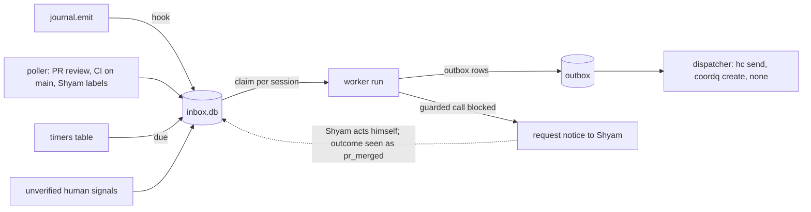
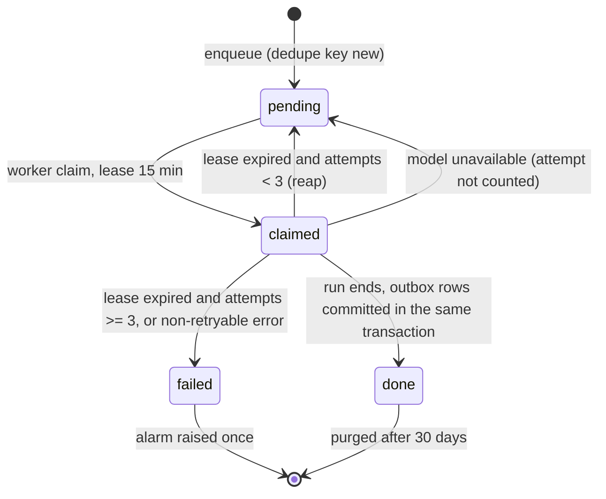

# Coordinator event inbox: wake on events, not on a clock

Design doc, 2026-11-23, revision 2 after the Coordinator's review of PR #897. Requested by Coder, approved by Shyam on 23 Nov. Nothing
in this document is built. This PR changes no live job, no queue, no journal and
no session.

## Summary

The Coordinator wakes today on a 30-minute clock. Most wakes find nothing to do.
This design replaces the clock with a durable inbox. Every reason to wake
becomes a row. One worker pulls the pending rows, drops duplicates, groups them
per session and starts one run. Every message the run wants to send goes through
an outbox, including an explicit "send nothing". A slow fallback tick (2 hours)
stays until the inbox has proved itself.

The inbox is a small SQLite file next to the journal, with one new module beside
`journal.py`. It needs no new service. The journal stays the append-only
history, and the inbox is the mutable work list.

## Intent, in order

- Replace the empty 30-minute polls with an event inbox.
- Wake sources are inbox rows: PR opened, merged or reviewed; CI status on
  `main` published by the Mac (there is no GitHub Actions and there never will
  be); Shyam's replies and approvals; due timers. Timers only enqueue.
- One worker claims pending rows, dedupes and batches per session. Claimed rows
  go back to pending if the worker crashes.
- A tool call that needs approval ends the run with a request notice to Shyam.
  Shyam performs the guarded action himself and the inbox sees the result. Review
  changed this bullet: no grant ever unlocks a guarded call (section 3.6).
- All sends go through an outbox, with an explicit send-nothing row.
- Keep a slow fallback tick until the inbox is proven.
- Measure wake count, event to action latency and the empty-tick share, before
  and after.
- Scope limit for this PR: a design doc only. No merge, no live job change, no
  contact with the live Coordinator session t56, no `coordq dispatch`, refill,
  lane, or `ticket start` or `close`.

## 1. How the Coordinator wakes today

Four paths exist. Only the first two run.

1. **Launchd tick.** `coordinator/launchd/dev.coordinator.tick.plist:19-20` sets
   `StartInterval` to 1800 seconds, with no `RunAtLoad`. It starts
   `coordinator/pi/bin/coord-tick`. The launcher takes one flock
   (`coord-tick:313-329`), runs the overnight selftest (`:347`), checks the
   model is offered (`:348`), then starts a fresh headless `pi -p --no-session`
   on `deepseek/deepseek-flash` inside the coordinator sandbox (`:254-267`). The
   prompt is fixed text (`:51-63`) that tells the run to read the whole board
   and reply `NOOP` or `ALERT:` lines. The launcher forwards each `ALERT:` line
   to the live Coordinator terminal with `hc send` (`:189-208`, lookup in
   `:155-173`). `NOOP` goes nowhere. The run is ephemeral, so nothing is saved
   between ticks.
2. **In-session idle wake.** `coordinator/pi/extensions/coordinator.ts:265-267`
   sets `WAKE_MIN` (default 30) and a prompt. The timer at `:349-361` checks
   every 60 seconds. When t56 has been idle for `WAKE_MIN` minutes it calls
   `pi.sendUserMessage(TICK_PROMPT)`. The headless tick sets `COORD_WAKE=0`
   (`coord-tick:106`) so the two do not stack. This path is a second clock
   inside t56.
3. **`coord-watch`.** `coordinator/bin/coord-watch` polls GitHub, T3 and logs
   every 30 seconds and prints `EVENT builder-stopped`, `EVENT gate-fail`,
   `EVENT lane-idle`, `EVENT run-long`, `EVENT rate-limit` and `EVENT traceback`
   lines (`coord-watch:226-337`). The only wake path from those lines is a
   `bgmon_watch` regex with `delivery: "wake"` and a 24-hour TTL
   (`coordinator/pi/README.md:28-37`). The coordinator guard blocks
   `bgmon_start` and every `bgmon_*` call except observation
   (`coordinator.ts:280-283`), so someone has to start the monitor during an
   authorized activation and renew the watch before it expires. It has no
   LaunchAgent and is not running. Its state lives in
   `~/.coordinator/coord-watch.json`. Its own doc budgets up to 2,880 GitHub
   requests per hour (`docs/coord-watch.md`, "Bounds and request budget").
4. **Other readers of state.** The decisions board
   (`~/Code/coordinator/decisions.json`) is what Shyam reads, and several
   writers rewrite it. On 22 Nov at 14:16 the tick log records one rewrite that
   dropped a card (`loop/ticks.log`, line starting `2026-11-22 14:16 PT`). The
   journal (`~/.local/state/coordinator/journal/events-YYYY-MM.jsonl`, written
   by `coordinator/bin/journal.py:110-128`) is append-only, one line per
   lifecycle event, under `flock`. It already records `gate_queued` (gatekeep),
   `gate_verdict`, `merged`, `merged_outside_lane`, `fix_sent` (lane driver,
   `coordinator/overnight/lane_driver.py:443-446,743`) and `alarm_raised`
   (alarms). Nothing reads the journal to wake anyone.

How a message reaches t56: `hc send <terminal> <text>` pastes the text and
presses Enter. `hc send --if idle` types only when the status is idle, and
`--json` gives machine output (`hc send --help`). `coord-tick` uses plain `hc
send` today.

### Ownership check

`/Users/shyamsivakumar/Code/CLAUDE.md` lists "Agent orchestration" under
`_archive/nexus/` and "Memory / learning storage" under `opc/`. Neither owns
factory wake events. The factory's own event owner is the journal in
`mac-ops/coordinator/bin/journal.py`, and its queue owner is `coordq`. This
design extends the journal (one hook) and adds one sibling module,
`coordinator/bin/inbox.py`. It does not add a parallel event store, because the
journal stays the only history. The ownership map in `AGENTS.md` of mac-ops
names no other owner for wake events.

### Why the inbox lives where it lives

- Journal file itself
  - Verdict: No
  - Reason: The journal is never rewritten (`journal.py:1-13`). A row needs a
    mutable status (pending, claimed, done). Deriving status by scanning 12,728
    lines per claim is slow and racy. The journal keeps the history; inbox
    transitions emit journal lines.
- `coordq` `queue.json`
  - Verdict: No
  - Reason: The queue dispatches work to T3 threads. `coordq` rewrites the whole
    file under `queue.lock` every 30 seconds (`refill`, 2,840 lines of code in
    `coordinator/bin/coordq`). Wake rows would contend with that lock and mix
    two meanings of "item".
- `decisions.json`
  - Verdict: No
  - Reason: It is Shyam's board. Several writers rewrite it and cards have been
    dropped. Wake rows are machine state, not asks.
- A new service
  - Verdict: No
  - Reason: A file and a lock do the job.
- SQLite file `~/.local/state/coordinator/inbox.db`
  - Verdict: Yes
  - Reason: The standard library has it. A `UNIQUE` column gives dedupe. One
    `UPDATE ... WHERE status='pending'` inside `BEGIN IMMEDIATE` gives an atomic
    claim. WAL mode lets producers write while the worker reads. It sits in the
    same state directory as the journal and follows the same override pattern
    (`COORD_INBOX_DIR`, like `COORD_JOURNAL_DIR`).

A flat JSON file with a lock would also work for one consumer, but each claim
would rewrite the whole file, and dedupe, lease expiry and the outbox join would
be hand-written. SQLite is the simpler choice at this size.

The inbox can be rebuilt from the journal, with three rules so that a replay
cannot flood it.

1. **Activation watermark.** The first time the hook is enabled it writes
   `activated_at` to the `meta` table. Journal lines older than that go straight
   into `seen` and never become pending rows. Without it, a replay from the
   start of this month would enqueue 1,461 old facts (425 on 21 Nov, 699 on
   22 Nov, 337 on 23 Nov; `evidence/event-inbox-design/replay_wakes.out`) and
   start a wake storm.
2. **Per-file offset cursor.** `meta` keeps `(journal file name, byte offset)`.
   Replay seeks to the offset, reads to the end of that file, then reads every
   later `events-YYYY-MM.jsonl` file in name order from its start, and moves the
   cursor into the new file. A month change therefore loses nothing: late lines
   in the old month are read before the cursor moves on. A line that does not
   parse is skipped.
3. **Replay is a repair, not the main path.** The hook enqueues live. The worker
   replays on startup and once an hour, from the saved offset, to catch a hook
   write that failed. It never parses the whole month file every 60 seconds
   (the file is 6 MB and grows about 2 MB a day). Idempotent dedupe keys make a
   repeated replay harmless.

If `inbox.db` is lost, the cursor is lost with it. The rebuild then starts at a
fresh `activated_at`, and any events between the loss and the rebuild are
covered by the fallback tick.

## 2. Baseline from real data (read-only)

All numbers come from the scripts in `evidence/event-inbox-design/`. Commands
are listed so anyone can rerun them.

### Wake count

The launcher log `~/Library/Logs/coordinator/tick.log` has one `exit=` line per
run.

```sh
grep "exit=" ~/Library/Logs/coordinator/tick.log \
  | awk '{print $1}' | sort | uniq -c
```

| Day (local) | Launcher runs |
| --- | --- |
| 2026-11-21 | 23 (log starts 11:27) |
| 2026-11-22 | 44 |
| 2026-11-23 | 21 (log ends 15:53) |

That is 88 launcher runs in about 52 hours, near 41 a day against 48 nominal.
The log has no entries before 21 Nov 11:27, so the 7-day launcher count is not
available. The older summary log has 246 tick summaries for 16 to 22 Nov.

What those 88 runs did:

| Outcome | Runs | Share |
| --- | --- | --- |
| `pi exited 1`, `402 Insufficient Balance`, empty reply | 34 | 39% |
| exit 0, reply `NOOP` | 41 | 47% |
| exit 0, at least one `ALERT:` line (13 alert lines sent to t56) | 13 | 15% |

```sh
grep -c "Insufficient" ~/Library/Logs/coordinator/tick.log
grep "exit=0" ~/Library/Logs/coordinator/tick.log | grep -c "reply=NOOP"
grep -c "alert sent to" ~/Library/Logs/coordinator/tick.log
```

So 75 of 88 launcher wakes (85%) told t56 nothing. The tick has failed on every
run since 2026-11-22 17:47 EST because the DeepSeek account has no balance, and
`decisions.json` already carries a watchdog card, "tick failing (last exit code
1)". Every one of those wakes cost a selftest and a model check and produced no
work. This is a live example of the clock failing silently.

### Empty-tick share, from the tick's own summaries

The model writes one line per tick to `~/Code/coordinator/loop/ticks.log` (`tick
(launchd): 0 queue items added by me, 0 sends, ...`).
`evidence/event-inbox-design/empty_ticks.py` counts a tick as acting when its
leading count segment has a positive number of queue items, sends, launches,
gates, merges, repo writes, parks or cards, or says restored, re-cut or resent.

```sh
python3 evidence/event-inbox-design/empty_ticks.py
```

| Window | Ticks | No action | Share |
| --- | --- | --- | --- |
| 16 to 22 Nov, all lines | 246 | 193 | 78.5% |
| Count format era (19 Nov 13:39 to 22 Nov) | 106 | 56 | **52.8%** |
| Prose format era (16 to 19 Nov) | 140 | 137 | not reliable |

Use 53% as the baseline. The prose-era lines say "no starts, no gates" but also
describe narrative actions the script cannot see, so 78.5% is an upper bound.
The script is a heuristic. It was checked by hand on 14 random lines in each
direction. The log stops at 22 Nov 16:10 because the model could no longer run.
Ticks that acted still did mostly unalerted housekeeping, which is why the
launcher view (85% silent) and the summary view (53% empty) differ. Both are
reported after the switch.

### Event to action latency

`evidence/event-inbox-design/latency.py` joins GitHub (`gh pr list --json
number,createdAt,mergedAt`), journal events for the same PR, and the tick
summaries.

```sh
python3 evidence/event-inbox-design/latency.py
```

For 12 mac-ops PRs opened on 22 Nov (#851 to #887):

- PR opened to `gate_queued` (gatekeep, its own launchd job, journal)
  - Result: 0.5 to 5.4 minutes, median 2.2, with two outliers (#868 and #882, 27
    hours, held for a re-cut)
- PR opened to the first tick summary that names it
  - Result: 8.5 to 32.7 minutes, median 26.3
- PR merged to the next tick of any kind
  - Result: 4.5, 14.1, 15.1, 18.1, 30.7 minutes (mean 16.5)
- `gate_verdict` to `merged`
  - Result: 0.1 minutes when the lane merges on its own; 41 to 753 minutes when
    a PR waits for `merge:human-ok`

Event sources that already have a fast job (gatekeep, lane) react in minutes.
The Coordinator hears about the same event half an hour later, because the clock
is its only input. The long `gate_verdict` to `merged` gaps are waits for Shyam,
not clock latency, and the inbox cannot shorten them except by pushing the
approval request to Shyam sooner.

### Event volume and the wake rules it allows

The first draft set at most 15 wakes a day and a median latency of 3 minutes
without measuring how many events arrive. The Coordinator's review counted
ten-minute windows with at least one `gate_queued`, `gate_verdict`, `merged`,
`merged_outside_lane` or `alarm_raised` line. Re-counted from the journal at the
time of that review, in US Eastern days: 73 windows on 21 Nov (partial), 137 on
22 Nov, 61 on 23 Nov (partial). The counts match. Raw lines of those kinds on
those days: 404, 707 and 342. The journal is live, so figures below that come
from the replay scripts use the journal as read on 23 Nov at 22:39 UTC (a window
of 54.5 hours from 21 Nov 16:07 UTC). By kind over the window: 474 `gate_queued`,
375 `alarm_raised`, 310 `gate_verdict` (185 PASS, 125 FAIL), 170 `merged` and 129
`merged_outside_lane`. 226 of the 299 merges are in `strategy-replay-workbench`
(SRW), 52 in mac-ops.

`evidence/event-inbox-design/replay_wakes.py` replays the journal through the
proposed rules (60-second debounce, a minimum gap between runs, a fallback only
when no run happened for 2 hours). Runs a day on 21, 22 and 23 Nov (the first
and last are partial days):

- Variant A, all five kinds wake: 74, 134 and 59 runs with a 10-minute gap; 26,
  48 and 25 with a 30-minute gap (99 in all).
- Variant B, only kinds that need Coordinator judgment wake (`alarm_raised` as a
  new generation, `round_cap`, `merge_held`, `close_failed`, `launch_failed`,
  `recut`), and `gate_queued`, `gate_verdict`, `merged` and
  `merged_outside_lane` ride along in the next batch: 41, 65 and 32 runs with a
  10-minute gap (138 in all); **22, 40 and 20 with a 30-minute gap (82 in all)**;
  13, 23 and 14 with a 60-minute gap (50 in all).
- Variant C, B plus merges and verdicts outside SRW: 26, 40 and 20 with a
  30-minute gap (86 in all), about 5% more runs than B.

#### What the saving really is

The comparison that matters is against the clock as it ran, not against 48 a
day. The measured launcher count is 88 runs in about 52 hours (41 a day, 1.7 an
hour), and 34 of those were failed 402 runs. Variant B at a 30-minute gap
replays to 82 runs in 54.5 hours (36 a day, 1.5 an hour). That is **about 11%
fewer runs than measured**, not the 25% that the nominal 48 a day would suggest.
Against 48 nominal it is 25% fewer, but the clock did not run 48 a day. A target
of a mean of 36 a day and no day above 48 must be read next to the measured 41
a day: it asks for about 11% fewer runs, and the cap of 48 is the nominal clock,
a ceiling and not a saving.

The delay figures are not the same measurement and must not be compared as a
before and after. The 26.3 minutes is the time from a PR opening to the first
tick summary that names it, on 12 PRs, and includes the tick's own run time and
the PR-specific fact. The 14.1 minutes is the replayed wait from a wake-class
journal row to the start of the next run, over 330 rows. The like-for-like figure
for the clock is the T0 replay below, where a wake-class row waits a median of
16.2 minutes (p90 26.6) for the next clock tick. So at a 30-minute gap the inbox
shortens the wait by about 2 minutes at the median (14.1 against 16.2, p90 25.9
against 26.6). Its real latency gain is for rows that arrive after at least 30
quiet minutes: 40 of the 330 wake rows start a run in about 1 minute, where a
clock tick waits up to 30. A 10-minute gap gives a median of 1.1 minutes but 138
runs, which is more than the clock made. At this volume, wake count and latency
trade against each other.

#### T0 replay: skip the tick when nothing wake-class is new

`evidence/event-inbox-design/t0_replay.py` keeps the 30-minute clock and skips a
tick when no wake-class fact is newer than the last tick that ran, with a tick
forced if none ran for 2 hours. Over the same 54.5 hours (109 clock ticks, 48 a
day):

- With the variant B wake kinds: **78 of 109 ticks run (34.3 a day), 31 skipped
  (28%)**. That is about 15% fewer runs per hour than the measured clock (1.43
  against 1.69 an hour), and it is fewer than the inbox's 82 runs under variant
  B. A wake-class row waits a median of 16.2 and p90 of 26.6 minutes.
- With all five kinds: 95 of 109 run (41.8 a day), 14 skipped (13%), which is
  the same as the measured clock. Skipping only works when the wake set is
  narrow.

Reading it plainly: at this volume T0 captures about all of the run-count saving
that the inbox replays to, in a few dozen lines and with no new store, because
events bunch and the clock batches them. What T0 does not give is the roughly
1-minute response to a row after a quiet spell, the durable rows, per-session
batching, the outbox and the lost-event accounting. Those are the inbox's
reasons to exist, and the run count is not one of them. T0 is therefore worth
shipping first, and the inbox's pass criteria in section 5 do not claim a larger
run-count win than the replay shows.

#### Alarms drive the wake rows

`evidence/event-inbox-design/alarm_breakdown.py` counts the 330 wake rows of
variant B: 165 `alarm_raised`, 70 `close_failed`, 62 `recut`, 19 `round_cap`, 13
`merge_held` and 1 `launch_failed`. Alarm rows are 50% of wake rows. The
`close_failed` and `recut` events repeat alarm families (`lane-close-failed-*`,
`recut-*`), so with them the alarm-driven share is 90%. By alarm family, raise
lines against distinct episodes (generations, which are the wake rows):

- `lane-gate-rounds-SRW-N`: 130 raises, 20 episodes (20 names). Repeated raises
  of one alarm each round.
- `factory-watchdog`: 73 raises, 2 episodes. A flapping alarm, so dedupe by name
  until withdrawn takes 73 rows to 2.
- `recut-SRW-N`: 60 raises, 44 episodes.
- `lane-close-failed-SRW-N`: 54 raises, 54 episodes, one per ticket.
- `lane-close-failed-MO-N`: 14 and 14. `herdr-build-MO-N`: 12 raises, 6 episodes.
  `prompt-merge-MO-N`: 10 and 10. `factory-zero-merge`: 9 raises, 5 episodes.
- Under 5 each: `factory-overnight-stall`, `lane-close-failed-FFBT-N`,
  `lane-merged-unreviewed-SRW-N`, `prompt-merge-LMW-N`, `recut-MO-N`,
  `lane-close-failed-LMW-N`, `closed-not-planned-SRW-N`.

The biggest raise-line sources, `lane-gate-rounds` and `factory-watchdog`, are
cut by generation dedupe (203 raise lines to 22 episodes). What is left is
`lane-close-failed` and `recut`, which each fire once per ticket and are also
journaled as `close_failed` and `recut` events. Merging each alarm with its event
is the first lever for a smaller urgent set, worth up to 130 of the 330 wake
rows. The kinds `ci_main`, `pr_review` and the human signal have no journal
history, so the replay cannot size them. The shadow week measures them, and the
targets below are checked again after it.

Gaps in the baseline, stated plainly: the in-session idle wake (path 2) leaves
no log, so its count is unknown. Tick time zones in `ticks.log` are labelled PT
or EST per line and the script trusts the label. The manifesto reference was not
found (see section 8). The baseline also mixes a broken period with a healthy
one: the 402 failures start on 22 Nov at 17:47 EST. The latency and
empty-summary numbers come from the healthy window (16 to 22 Nov, before the
failures). The launcher counts include the 34 failed runs and are shown
separately, so the after numbers are compared with the healthy window, and the
failed runs are not counted as an improvement.

## 3. Design

### 3.1 Parts



### 3.2 Inbox row

One table, `inbox`.

- `id`
  - Type: integer primary key
  - Meaning: order of arrival
- `ts`
  - Type: real
  - Meaning: event time (UTC epoch)
- `source`
  - Type: text
  - Meaning: `journal`, `poll`, `timer`, `human`
- `kind`
  - Type: text
  - Meaning: `pr_opened`, `pr_new_head`, `pr_merged`, `pr_review`,
    `gate_verdict`, `gate_queued`, `ci_main`, `human_signal`, `timer_due`,
    `alarm`, `round_cap`, `merge_held`, `close_failed`, `recut`
- `dedupe_key`
  - Type: text, unique
  - Meaning: see below
- `session`
  - Type: text
  - Meaning: target session, default `coordinator`
- `repo`, `pr`, `head`
  - Type: text, int, text
  - Meaning: same field names as the journal
- `payload`
  - Type: json
  - Meaning: metadata only: ids, heads, labels, counts. No PR titles, bodies or
    comments.
- `status`
  - Type: text
  - Meaning: `pending`, `claimed`, `done`, `failed`
- `attempts`
  - Type: int
  - Meaning: claims that reached a model run
- `claimed_by`, `claimed_pid`, `lease_until`, `run_id`
  - Type: text, int, real, text
  - Meaning: who holds the row, its process, and until when
- `tier`
  - Type: text
  - Meaning: `wake` or `batch`, set at enqueue from the wake-kind setting (section
    3.3a)
- `done_ts`, `error`
  - Type: real, text
  - Meaning: end of life

Payload is metadata only because PR text and comments are untrusted input, and
the run reads details through the existing board tools, as `coord-tick` does
today.

**Dedupe key.** One stable key per real-world fact: `pr_opened:<repo>#<n>`,
`pr_new_head:<repo>#<n>:<head>`, `pr_merged:<repo>#<n>`,
`gate_verdict:<repo>#<n>:<head>`, `ci_main:<repo>:<sha>:<context>:<state>` (terminal states only: success, failure, error),
`pr_review:<repo>#<n>:<review id>`, `human_signal:<comment, review or label event id>`,
`timer_due:<timer id>:<due ts>`, `alarm:<name>:<generation>` (the generation
increments on `alarm_withdrawn`, so a flapping alarm is one row per episode). `INSERT OR
IGNORE` on the unique column drops repeats, including a second poller seeing the
same event. The ignored count is kept in a `counters` row so the duplicate rate
is measurable. The `payload` of a done row is purged after 30 days, but its key
stays in a small `seen` table (key and time) with no expiry, so an old review or
an unchanged `main` status cannot come back as a new event. Poll watermarks live
in a `meta` table, and losing them only re-reads facts that `seen` drops.

### 3.3 Sources and writers

- Journal events
  - Kinds: `gate_queued`, `gate_verdict`, `pr_merged` (from `merged` and
    `merged_outside_lane`), `alarm`, `round_cap`, `merge_held`, `close_failed`,
    `recut`
  - Writer: A hook in `journal.emit`: a small map of journal event name to inbox
    kind, and one call to `inbox.enqueue` after the journal line is written.
    Lane and gatekeep code does not change. A failed enqueue prints to stderr
    and returns, as a failed journal write does. `gate_queued` is a batch kind
    only. It is not used as the PR opened event, because it misses held, draft
    and ungated PRs (#868 and #882 were queued 27 hours after they opened).
- PR opened, new head, review, label and comment events
  - Kinds: `pr_opened`, `pr_new_head`, `pr_review`, `human_signal`
  - Writer: One poll pass inside the worker, through `gh_gateway` with its ETag
    cache. It lists open PRs per configured repo (one conditional call per repo,
    a 304 when nothing changed, every 2 minutes) and reads reviews and comments
    only for PRs whose list entry changed. This is the real source of `pr_opened`
    for every PR, draft or held or not. The cost is up to 2 minutes of detection
    lag, and `pr_opened` is a batch kind, so it adds no wake. Until T7 ships the
    kind does not exist, and the doc does not claim it.
  - Human signals are hints. A review, comment or `merge:human-ok` label made by
    the `shyamsivakumar` login is recorded as `human_signal` with the payload
    `login=shyamsivakumar, verified=false`. Agents also act under that GitHub
    account, so the login proves no person. The Coordinator treats the row as a
    cue to look at the PR, never as authority to act.
- CI on `main`
  - Kinds: `ci_main`
  - Writer: The same poll pass reads the combined commit status of each
    configured repo's default branch head and keeps only the contexts the Mac
    publishes (for example `srw/agent-check`) and only terminal states. It never
    reads Actions or check-runs from workflows. If a repo's `main` has no
    Mac-published context, the source stays off for that repo.
- Messages to the live session
  - A message typed in t56 reaches the live session directly and stays direct.
    The inbox does not parse `approve` or `deny` text from t56. Any agent can
    `hc send t56 "..."`, and the pi input hook cannot tell it from Shyam.
- Timers
  - Kinds: `timer_due`
  - Writer: A `timers` table in the same file (`id`, `due_ts`, `period`,
    `payload`). The worker, at the start of each pass, turns due timers into
    inbox rows. A timer never starts a run. The 2-hour fallback is one periodic
    timer that is enqueued only when no run happened for 2 hours.

### 3.3a Which kinds wake the Coordinator

A row has a tier, set in the same small map as the journal hook, in one place.

- Wake (starts a run after the 60-second debounce): `alarm` (a new generation),
  `round_cap`, `merge_held`, `close_failed`, `launch_failed`, `recut`,
  `ci_main` (a failure), `human_signal`, `timer_due` (the fallback).
- Batch only (waits for the next run, and the fallback bounds the wait to 2
  hours): `gate_queued`, `gate_verdict`, `pr_merged`, `pr_opened`,
  `pr_new_head`, `pr_review`, `ci_main` (a success).

This is variant B in section 2. Moving a kind between tiers is one line, and the
replay prices the change. Coder asked for PR opened, merged and review to be
wake sources. They are inbox rows and appear in every batch, but at the volume
measured in section 2 they cannot each start a run and meet a wake target.
That is open question 2. `pr_review` and `human_signal` are placed from reasoning
and not from data, and the shadow week confirms or changes the tiers.

### 3.4 Row lifecycle



Invariants:

1. A row is in exactly one state. Only `pending` rows can be claimed.
2. `claimed` implies `lease_until` is set. A run is killed at 600 seconds
   (`coord-tick:46`), and the lease is 900 seconds, so a live run never loses
   its rows.
   Each claim stores a fresh token (`run_id`) on its rows. `ack` and `release`
   take the claimed rows and match on id and token, so a late call from a reaped
   claim changes nothing.
3. `done` is written in the same SQL transaction that inserts the outbox rows
   for the run. A crash cannot leave a done row without its decision on record.
4. At most one worker claims at a time: an `flock` on `inbox.worker.lock` (the
   pattern `coord-tick` already uses, `:313-329`) plus the transactional claim.
5. The reap pass runs at the start of every worker pass, before the claim.
6. A model that is unavailable (balance, provider outage) puts rows back to
   pending without counting an attempt, and the worker backs off exponentially.
   Today's 402 failure must not burn attempts or drain rows into `failed`.
7. If the oldest wake-tier pending row is older than 45 minutes, the worker
   raises one alarm (through the existing alarms module, one per head, not per
   pass). Alarms the inbox raises about itself (`inbox_*`) are never inbox
   kinds, so a failing source cannot wake a run whose only output is another
   alarm.
8. A lease is reaped only when its `claimed_pid` is gone (`kill -0`) or the
   lease is more than one hour past due. A laptop that slept through a lease
   does not return rows from a run that was only frozen.
9. Timers are wall-clock. After sleep, a due timer fires once and the missed
   periods collapse into that one row.
10. A run budget caps cost: the worker waits 60 seconds after the first wake-tier
    row so a burst joins one batch and starts a run no sooner than 30 minutes
    after the previous run ended. The rest stays pending. The `inbox_batch` line
    records the delay, so the latency targets and the cap are measured against
    each other (section 2 prices the 30-minute choice).
11. The database carries `PRAGMA user_version` for schema changes. Done rows and
    sent outbox rows have their payload purged after 30 days (keys stay in
    `seen`), and the worker runs `wal_checkpoint(TRUNCATE)` once a day.
12. Liveness is judged one way at a time, so a legal 10-minute run never alarms.
    The worker touches `inbox.worker.heartbeat` every 30 seconds from a timer
    thread for as long as a pass runs, and once at pass end. A model run is killed
    at 600 seconds (`coord-tick:46`), so a healthy pass ends within about 11
    minutes, and the worker sets a 20-minute `SIGALRM` on the whole pass so a
    wedged pass cannot hold the lock. The watchdog is `lane_driver.py`, which
    already raises `factory-watchdog` and runs every 180 seconds
    (`dev.coordinator.lanes.plist`, `StartInterval` 180).
    - While the worker lock is held, the watchdog judges by heartbeat age only:
      it alarms when the heartbeat is more than 4 minutes old. Pass age is not
      looked at, because a pass may legally run 10 minutes.
    - While the lock is free, the watchdog judges by pass age only: it alarms
      when the last finished pass is more than 5 minutes old, and only when the
      setting `COORD_INBOX_EXPECT_PASSES` is on (default off in shadow, where
      passes are run by hand).
    - A free lock with no heartbeat file means the worker never ran and raises
      nothing.
    Worst case detection of a wedged run is 4 minutes plus one 180-second
    watchdog cycle, about 7 minutes. The hourly selftest is not used for this,
    because its cadence cannot give a minutes-level alarm.

### 3.5 Claim, batch and run

One worker pass:

1. Take the worker flock. Reap expired leases. Turn due timers into rows. Run
   the poll pass.
2. In `BEGIN IMMEDIATE`, pick one session that has pending rows and claim up to
   50 of them (`UPDATE ... SET status='claimed', claimed_by=?, lease_until=?,
   attempts=attempts+1 ... RETURNING`).
3. Coalesce in memory: rows with the same repo, PR and kind collapse to one line
   with the newest state (a second `pr_new_head` replaces the first). Different
   kinds on one PR stay separate lines, so a failed gate followed by a review is
   two lines (opened plus merged is two lines on one PR). The batch prompt lists
   those lines and the row ids. A burst of ten events is one run, not ten.
4. Start the run. This reuses `coord-tick`'s sandbox, lock, timeout and model
   check (`run_tick`, `model_available`), with the batch prompt in place of the
   fixed tick prompt. The run stays ephemeral (`--no-session`), as today.
5. Parse the reply. A line `SEND <target>: <text>` becomes an outbox row. A line
   `NOTHING: <reason>` becomes a `none` row. A reply with neither is a failed
   run. That keeps today's `ALERT:` and `NOOP` convention (`coord-tick:176-186`)
   with one extra word.
6. In one transaction: insert the outbox rows, mark the batch rows `done`,
   journal an `inbox_batch` event.

Batching is per session. All rows are for the `coordinator` session today, and
the `session` column is kept so a second consumer can be added without a schema
change.

### 3.6 Approvals: the inbox never carries a grant

The first draft had the inbox issue a single-use grant that the guard would
consume to allow a blocked call. The review found that unsafe, and it is removed.

- Any agent can run `hc send t56 "approve <id>"`, and the pi input hook sees it
  as text from a person. `decisions.json` has several agent writers, so a card
  resolution proves no person either. A grant created from either channel would
  let an agent approve its own `gh pr merge`.
- GitHub actions by agents run under Shyam's account, so a label or review by
  that login is not proof of a person.
- A grant that unlocks a guarded call widens the permissions of a deny-only
  guard. The standing rule is no widened permissions, and relayed approvals must
  be verified.

What the design does instead:

1. The guard stays deny-only and does not change (`coordinator.ts` is not
   touched). A blocked call returns its reason, as today (`coordinator.ts:288`).
2. The run ends its reply with a request line. The dispatcher writes a
   `request_notice` outbox row, which goes to Shyam through the existing card
   path the Coordinator already uses to park a decision. The row names the PR,
   the head and the action wanted, and carries no authority.
3. Shyam performs the guarded action himself (for example merges the PR).
4. The inbox sees the result as a normal fact: `pr_merged`, a new head, a closed
   issue. That row closes the request notice and wakes a run only if its kind is
   a wake kind.
5. A request with no result in 24 hours becomes a `timer_due` row and the notice
   is raised again once.

The inbox may carry the request and the notice of an outcome. It never carries
anything the guard accepts as permission. The Coder's original wish, that an
approval-needed call ends the run and comes back as an event, holds in this
form: the run ends and the outcome returns as an event. No session is saved, no
resume exists, and sessions stay `--no-session`.

Open question 1 (for Shyam) offers an authenticated channel, in section 9.

### 3.7 Outbox

Table `outbox`:

- `id`, `ts`
  - Meaning: order and time
- `run_id`
  - Meaning: the run that wrote it
- `kind`
  - Meaning: `hc_send`, `coordq_send`, `request_notice`, `none`
- `target`
  - Meaning: a terminal for `hc_send` (resolved as `coord-tick` does today); the
    same arguments `coordq create` takes for `coordq_send`
- `body`
  - Meaning: text to send
- `reason`
  - Meaning: required for `none`
- `dedupe_key`
  - Meaning: `<run_id>:<index>`, unique
- `status`, `attempts`, `lease_until`, `sent_ts`
  - Meaning: `pending`, `sending`, `sent`, `failed`

The dispatcher runs at the end of every worker pass under the same worker lock.
A send that fails is retried on later passes with growing delay, three tries in
all, then marked `failed` with one alarm. `inbox.py outbox --drain` lets an
operator run a pass by hand. A dispatcher drains the outbox: claim, mark `sending`, send, mark sent. Delivery
depends on the kind. A `coordq_send` is at-least-once: a crash after the send
and before the mark resends once, and `coordq create` already refuses a repeated
`clientRequestId`. An `hc_send` is at-most-once: a row left in `sending` after a
crash is marked `unknown` and raised as one alarm, not resent, because a pasted
instruction acted on twice costs more than a lost alert, and the board plus the
fallback tick recover a lost alert. The body carries the dedupe key either way.
A `coordq_send` goes through `coordq create`, never around it. A `none` row is a recorded decision with a
reason. A run that writes no outbox row at all counts as failed (`no_decision`),
so a model that forgets to answer cannot silently drop events.

### 3.6a What replaces each existing wake

- `dev.coordinator.tick` every 30 minutes
  - After: A worker job (`dev.coordinator.inbox`) with `StartInterval` 60 and a
    `WatchPaths` ping file touched on enqueue. A pass with no pending rows is a
    local SQLite read and a process exit, with no model call.
- In-session 30-minute idle timer (`coordinator.ts:349-361`)
  - After: Turned off at cutover (`COORD_WAKE=0`, the switch the headless tick
    already uses), so the only fallback is the inbox timer.
- `coord-watch`
  - After: Retired. Its detectors map to existing journal events or alarms:
    `gate-fail` to `gate_verdict`, `builder-stopped` to coordq `thread_ended`,
    `run-long` to the turn-cap job (`dev.coordinator.turncap`), `rate-limit` and
    `traceback` to alarms. `lane-idle` is covered by the fallback tick until a
    lane event exists. The `bgmon` activation steps in
    `coordinator/pi/README.md` go with it. Deleting the file needs Shyam's yes,
    and `scripts/mac_ops_fast_check.py:32` lists it.
- Alerts to t56 by `hc send` in `coord-tick`
  - After: Outbox `hc_send` rows, same terminal lookup.

## 4. Fallback tick

The inbox has a timer named `fallback` that is enqueued only when no run has happened for 7,200 seconds, so it never adds a run on a busy day.
When it fires the worker runs the full board tick (today's prompt) as one batch.
It stays until the measurement below passes for 14 days, then drops to daily,
then goes away. Any fallback run that finds work the inbox did not announce is
logged as `fallback_acted`, with the PR or head, so a missing event class shows
up by name. At cutover the old launchd tick is unloaded (not slowed to 2 hours)
and the in-session idle wake is turned off, so exactly one fallback exists and
the three clocks cannot stack. The old plist stays on disk. Rollback is one
`launchctl bootstrap`.

## 5. Measurement plan

One script, `scripts/coord_wake_metrics.py`, reads `tick.log`, `loop/ticks.log`,
the journal and `inbox.db` and prints the table below for any window. Before
numbers are in section 2 and reproduced by the script on 16 to 22 Nov.

- Event volume (new)
  - Before (measured): 404, 707 and 342 raw wake-kind lines on 21, 22 and 23 Nov
    (73, 137 and 61 ten-minute windows at the time of review); 1,461 distinct facts
    after alarm
    generations
  - Definition after: inbox rows enqueued per day, by kind and tier, plus
    ignored duplicates
  - Pass criterion: reported only. It is the input that the wake and latency
    targets are set from, and the shadow week re-prices them.
- Wake count (runs a day)
  - Before (measured): 41 model runs a day on the clock (88 in 52 h, 1.7 an
    hour, 34 of them failed 402 runs); 48 a day is the nominal clock, not what ran
  - Definition after: `inbox_batch` journal lines with a started run, plus
    fallback runs. Runs that failed on the model (a 402, a timeout) are listed
    separately and never counted as saved wakes.
  - Replay prediction (section 2, variant B, 30-minute gap): 82 runs in 54.5
    hours, about 36 a day (22, 40 and 20 on the three partial days), 1.5 an
    hour. The T0 replay predicts 78 runs (34 a day) with no new store.
  - Pass criterion (7 consecutive days after cutover): mean at most 36 a day,
    read next to the measured 41 a day, which is about 11% fewer runs and not
    more. No day above 48 (the nominal clock, a ceiling and not a saving). The
    criterion does not claim the 25% that 48 a day would suggest.
- Run outcome split (replaces the single empty-run share). Every run falls in
  exactly one bucket.
  - Bucket 1, no events: a fallback run whose batch holds only the timer row.
    Before (measured): not separable. Pass criterion: at most 2 a day.
  - Bucket 2, events and no action needed: a run with real rows whose outbox is
    `none` with a reason. This is a correct and useful outcome, for example a
    merge that needs nothing. It is reported with its reasons and has no target,
    except that a rising share points at rows that should be batch-only.
  - Bucket 3, failed: model unavailable (a 402), timeout, no decision. Before
    (measured): 34 of 88 launcher runs (39%) on 21 to 23 Nov. Pass criterion:
    zero runs lost silently, meaning every failed run has an alarm and its rows
    are still pending.
  - Bucket 4, events and action: the rest. Reported.
  - Baseline comparison: the clock's 85% silent launcher runs and 53% empty
    summaries both mix buckets 1, 2 and 3, so the after numbers are compared
    bucket by bucket, not as one share.
- Event to action latency
  - Before (measured): PR opened to first tick that names it: median 26.3 min
  - Definition after: row `ts` (the source event time, such as the PR
    `createdAt`, not the row creation time) to its outbox row `sent_ts`
  - Replay prediction (variant B, 30-minute gap): wake rows median 14.1 min, p90
    25.9; rows after a quiet 30 minutes about 1 min; batch-only rows median
    15.5, p90 29.6. The like-for-like clock figure is the T0 replay: median 16.2,
    p90 26.6. The 26.3 minute baseline above measures PR open to the first
    tick that names it, which is a different quantity, so it is not the
    comparison.
  - Pass criterion (7 consecutive days after cutover): wake rows median at most
    15 min and p90 at most 30 min; rows after a quiet 30 minutes p90 at most 2
    min; batch-only rows p90 at most 60 min. Each is within 20% of the replay and
    below the 16.2 min the clock gives for the same rows.
- Lost events
  - Before (measured): not measurable
  - Definition after: rows not `done` more than 2 hours after `ts` (`failed`
    rows count as lost), plus `fallback_acted` events, plus a weekly
    reconciliation of GitHub's PR list against `pr_opened` rows to find facts
    that were never enqueued
  - Pass criterion (7 consecutive days after cutover): zero stuck or failed
    rows, zero never-enqueued PRs, at most 1 `fallback_acted` a week
- Duplicate rate
  - Before (measured): not measurable
  - Definition after: ignored inserts over total inserts
  - Pass criterion (7 consecutive days after cutover): reported, no target

Shadow mode comes first (section 6), and it carries its own pass criterion
before any behavior changes: over 7 days, for at least 95% of actions the
30-minute tick took on a PR or head (sends, launches, gates, merges, parks), an
inbox row for that PR existed at least one minute before the action. Rows with
no matching action are the extra wakes the inbox would have caused, and those
are counted too, so the shadow week also predicts the new wake count.

## 6. Migration

1. **Build the core** (inbox module, journal hook, outbox, dispatcher, metrics
   script). Nothing is loaded. Proofs run with a temporary `COORD_INBOX_DIR` and
   `COORD_JOURNAL_DIR`.
2. **Build every producer.** The poll pass (reviews, Shyam labels, CI on main),
   timers and the request-notice writer are built before shadow starts, so the
   shadow week covers every source that will go live.
3. **Shadow.** Enable the journal hook and run the worker pass in shadow: it
   makes no model call and sends nothing. It writes an `inbox_would_wake`
   journal line for every batch it would have started, runs the batch through a
   shadow runner that answers `NOTHING: shadow`, and consumes the rows. No
   shipped ticket adds a launchd job, because the installer loads every plist
   in `coordinator/launchd`. The shadow passes are run by hand, or by a worker
   plist that Shyam adds and loads himself for the week. The 30-minute tick is
   unchanged. Run 7 days. Compare with the criterion in section 5.
4. **Switch.** Unload the old tick, turn the worker's shadow flag off and set
   `COORD_WAKE=0` for the in-session timer. This step needs Shyam's go. The
   change is a plist and env edit, listed in the cutover ticket.
5. **Request notices.** The run ends a blocked call with a request line, and
   the dispatcher writes a `request_notice`. The guard and its file do not
   change. No grant exists in any step.
6. **Retire `coord-watch`.** After 14 days on the inbox, remove the file, its
   fast-check entry and the README activation steps, each with Shyam's yes for
   the delete.

### Rollback

At any step: unload `dev.coordinator.inbox`, load `dev.coordinator.tick` with
its 1800-second interval, and set `COORD_WAKE` back on for the in-session timer.
The journal is untouched by the inbox (the hook only adds rows) and the hook can
be turned off with one environment variable. `inbox.db` can stay on disk. It
holds state the journal does not have (poll rows, timers, request notices,
outbox rows), but nothing outside the inbox reads it, and the 30-minute tick finds the
same work from the board.

## 7. Risks and how the design answers them

- **Model unavailable.** The current 402 failure shows a wake that does nothing
  and says nothing. Inbox rows survive it (invariant 6), and the age alarm
  (invariant 7) tells Shyam.
- **Producer outage.** A source that stops emitting is silent. The fallback tick
  and `fallback_acted` expose it.
- **Duplicate or reordered events.** Dedupe keys are facts (PR, head, review
  id), not times. Coalescing keeps the newest state per PR.
- **Prompt injection.** Payloads hold ids and heads only. The run reads PR text
  through the board tools, which already treat it as data.
- **Outbox repeats.** At-least-once for `coordq_send` (keyed by request id), at-most-once for `hc_send` (section 3.7).
- **Lock contention.** The inbox has its own file and its own worker lock,
  separate from `queue.lock`.
- **GitHub budget.** One ETag poll pass replaces `coord-watch`'s worst case of
  2,880 requests an hour. At 12 repos and a 2-minute cycle the list calls are
  about 360 an hour, most of them 304s, plus reads for PRs whose entry changed.
- **Forged signals.** Any agent can message t56 and act as Shyam's GitHub login.
  The inbox treats those as unverified hints and issues no authority (section
  3.6).
- **Formal check.** The state machine is small enough for a crash-injection
  proof in the existing selftest. TLA+ is not worth it unless the outbox grows
  more states.

## 8. References

- Anthropic, "Building always-on agents",
  <https://claude.com/blog/building-always-on-agents>. Used for the inbox shape:
  every source writes an event row to an inbox and a worker picks it up, dedupe
  by source identifiers, timers in their own store that only enqueue ("A timer
  doesn't initiate a run on its own"), an outbox table for outgoing messages, a
  deferred tool call that ends the run, saves the session and resumes on the
  answer as a new event, batching of pending events, and a restarted worker
  reloading pending events first.
- waku-agent by ShenSeanChen, <https://github.com/ShenSeanChen/waku-agent> (also
  on PyPI as `waku-agent`). Its README describes an always-on layer that "sleeps
  until an event arrives: a message, a timer, your yes", with "every event is a
  row on disk first, so a crash loses nothing", an outbox that "sends once", and
  runs that pause for approval, in `waku/alwayson/`. The README does not
  document the queue, dedupe, lease or approval storage, and this author read
  only that page, not the source. The design above takes the shape from it and
  does not copy it.
- "Manifesto P13": searched `~/Code/llmwiki`, `~/Code/coordinator` and
  `~/Code/mac-ops` for `P13` and `manifesto`. The only hit is a log line in
  `~/Code/coordinator/notes.md` ("start labeling per manifesto plan", 22 Nov
  15:45), with no numbered principle. P13 was not found, so this design does not
  claim to satisfy it. Coder should point to the text so the design can be
  checked against it.

## 9. Open questions for Shyam

1. **Authenticated approval channel.** This design carries no approval. If Shyam
   wants one, it needs a channel an agent cannot use: for example a local
   command that asks for a Touch ID or password prompt in a terminal a person
   holds and writes a signed, single-use, action-bound grant that the guard
   verifies, or a hardware-key signature. That widens the guard's permissions,
   so it is a separate decision with its own review, and it is not part of any
   ticket here.
2. **Which kinds wake.** Variant B (section 3.3a) lets only judgment events wake
   a run and batches PR opened, merged, gate verdicts and reviews. Variant C adds
   merges and verdicts outside SRW for about 5% more runs. Coder asked for PR
   events as wake sources, and at SRW volume all of them cannot wake and meet a
   wake target.
3. **Minimum gap between runs.** 10 minutes gives a median wake latency of 1
   minute and 138 runs over the replay window, more than the clock. 30 minutes
   gives 14 minutes and 82 runs (the measured clock made 88 in about 52 hours). 60 minutes gives 29 minutes and 50 runs. The
   design uses 30.

## 10. Critiques

Two reviewers outside the Anthropic family read this document: DeepSeek V4.1
Flash (`morph-dsv41flash`) and Kimi K3.1 (`morph-kimik31`), both through Morph
and `pi -p`, asked for omissions, failure modes and simpler alternatives. Each
point is answered below. Section numbers refer to the reviewed draft. Replies
that mention a grant, `approve` text or session resume are superseded by
revision 2 (the Coordinator's review, below): the inbox carries no grant.

### Coordinator review of PR #897 (23 Nov), revision 2

1. **Critical: approvals can be forged (3.6).** **Accepted.** Any agent can
   `hc send t56 "approve <id>"`, `decisions.json` has several agent writers, and
   GitHub actions by agents run under Shyam's login, so none of those proves a
   person. Redesigned: no grant, no `approve` parsing, guard unchanged. The inbox
   carries a request notice and sees the outcome (a merge). An authenticated
   channel is open question 1. T10 and T11 are rewritten.
2. **Major: targets conflict with volume.** **Accepted, and the counts were
   verified.** 73, 137 and 61 ten-minute windows match in Eastern days. The
   replay prices three variants and three gaps (section 2). Kinds are split into
   wake and batch-only (3.3a), and the targets are set from the replay (section
   5): at most 15 a day and 3 minutes are dropped as unattainable.
3. **Major: first replay floods.** **Accepted.** An activation watermark sends
   older facts to `seen`, a per-file offset cursor crosses the month boundary,
   and replay runs at startup and hourly from the offset (section 1). Without
   the watermark the replay would enqueue 1,461 pending rows.
4. **Major: `pr_opened` is not PR opened.** **Accepted.** `gate_queued` is now a
   batch kind. `pr_opened` and `pr_new_head` come from the poll pass over the
   open PR list (section 3.3), with a stated detection lag of up to 2 minutes.
5. **Major: heartbeat numbers.** **Accepted.** Heartbeat every 30 seconds during
   a pass, a 20-minute pass alarm, a 4-minute stale limit, and the check lives in
   `lane_driver.py` (every 180 seconds), not in the hourly selftest. Worst case
   detection is about 7 minutes (invariant 12).
6. **Major: empty-run metric.** **Accepted.** Four buckets replace one share:
   no events, events and no action needed (useful), failed (the 402 runs), and
   events and action (section 5).
7. **Minor: invariant order and T12.** **Accepted.** Invariants are numbered in
   order, and T12 references the new targets.

The review also asked to keep "not found" for manifesto P13. Section 8 still says
so.

### DeepSeek V4.1 Flash

Omissions

1. Baseline measured on a broken system (39% of launcher runs failed on 402). **Accepted.** Section 2 now says the latency and empty-summary numbers come from the healthy window and the launcher counts show failed runs separately.
2. Where the journal replay cursor lives. **Accepted.** Replay is idempotent through dedupe keys, so it needs no cursor and starts from the first line of the month (section 1).
3. Approvals have no attribution. **Accepted.** Each answer row records its channel, and only the first answer counts (section 3.6). **Superseded in revision 2: no grant exists, and sessions stay ephemeral.**
4. The run-ending mechanism in the guard is unproven. **Accepted as emphasis.** The first version ships without resume, and a spike comes first in T11 (section 3.6). **Superseded in revision 2: no grant exists, and sessions stay ephemeral.**
5. No throughput or cost cap. **Accepted.** Invariant 10 adds a 60-second burst window and at most 6 runs an hour.
6. No schema version, retention or WAL growth rule. **Accepted.** Invariant 11 adds `user_version`, a 30-day purge for done and sent rows, and a daily checkpoint.

Failure modes

1. Alarm rows manufacturing wakes about alarms. **Accepted.** `inbox_*` alarms are never inbox kinds (invariant 7).
2. A hook write that fails leaves the row behind the producer. **Accepted.** The worker's idempotent journal replay on every wake repairs it (section 1).
3. At-least-once `hc send` can be acted on twice. **Accepted for `hc_send`.** It becomes at-most-once with an alarm for an unknown state; `coordq_send` stays at-least-once because `coordq create` refuses a repeated request id (section 3.7).
4. A force-push back to an older head is dropped by the dedupe key. **Accepted as a known limit.** The gate pins heads, so it is rare, and the fallback tick catches it. It is not worth a counter in the key.
5. Two answers to one approval resume one session twice. **Rejected as stated, clarified.** The unique `approval_answer:<id>` key already makes the second answer a no-op (section 3.6). **Superseded in revision 2: no grant exists, and sessions stay ephemeral.**
6. Sleeping laptop breaks timers and leases. **Accepted.** Invariants 8 and 9 (pid check, collapsed missed timers).

Simpler alternatives

1. A precheck in front of the existing tick. **Accepted as T0 and rejected as a replacement.** It removes empty wakes cheaply but keeps the 30-minute latency, which is the second goal.
2. Fix `coord-watch` instead. **Rejected.** It polls on a 30-second cycle with a budget of 2,880 GitHub requests an hour, has no acknowledge or lease, repeats events when its state is lost (its own doc says so), and its wake path needs a monitor started in an authorized session plus a watch renewed every 24 hours. Its detectors are kept as journal and alarm mappings.
3. A spool directory with rename-to-claim. **Rejected.** It works for one consumer, but dedupe across done rows, batch queries, lease reaping and counters become directory scans. SQLite in the standard library has all of them. This stays the fallback if SQLite causes trouble.
4. Drop session resume. **Accepted as the first version** (section 3.6). **Superseded in revision 2: no grant exists, and sessions stay ephemeral.**
5. Send inline and journal afterwards (no outbox). **Rejected, partly adopted.** The outbox is what makes send-nothing and `no_decision` visible, which Coder asked for. The at-most-once rule for `hc_send` takes the useful part of the idea.

### Kimi K3.1

Omissions

1. Approval grant is not bound to the action, and `approval_request` and `approval_expired` are not declared kinds. **Accepted.** Section 3.6 now has a single-use grant bound to command hash, repo and head, with both kinds named. Resume is dropped from the first design (see alternative 3 below), which also removes the approve-forever loop. **Superseded in revision 2: no grant exists, and sessions stay ephemeral.**
2. Recovery is asserted, and the rollback line that "the journal holds all inbox state" is false for polls, timers, approvals and the outbox. **Partly accepted.** The rollback wording is corrected (section 6). The replay needs no cursor because dedupe keys make it idempotent, and the worker runs it on every wake. Poll watermarks now live in a `meta` table and the permanent `seen` table covers the rest.
3. The outbox dispatcher has no launch path, retry policy or drain procedure. **Accepted.** Section 3.7 now runs it at the end of each worker pass, three tries with growing delay, then `failed` plus one alarm, and `outbox --drain` by hand.
4. Metrics cannot show zero lost events, and latency is measured from row creation, which hides a late producer. **Accepted.** `ts` is the source event time (PR `createdAt`, journal time), and the metrics script compares GitHub's PR list with inbox rows each week to count events never enqueued. Failed rows count as lost.
5. Shadow ends before reviews, labels, CI and timers exist, and approvals ship after cutover. **Accepted.** Migration step 2 now builds every producer before the shadow week. Approvals are no longer a producer (revision 2).

Failure modes

1. A wedged worker holding the lock blocks reaping and its own age alarm. **Accepted.** Invariant 12 adds a heartbeat file read by the hourly selftest, plus a 15-minute `SIGALRM` for the whole pass.
2. A crash between the journal append and `inbox.enqueue` loses the wake. **Rejected as stated.** The worker's replay on every wake is the reconciler, and idempotent keys make it safe (section 1).
3. A retried run repeats a mutation made before the final transaction. **Accepted as a known limit.** The mutating verbs are already keyed: `coordq create` refuses a repeated request id and gates are keyed by head. Attempts are capped at 3.
4. `ci_main` key omits the status, so `pending` can hide the later result. **Accepted.** The key now ends in the terminal state, and pending states are not enqueued.
5. A purged done row lets an old review or an old `main` status return as new. **Accepted.** Keys now live forever in a small `seen` table, and only payloads are purged.
6. Coalescing by repo and PR erases an older but still actionable kind. **Accepted.** Coalescing is by repo, PR and kind.
7. Cutover can leave three two-hour fallbacks. **Accepted.** At cutover the old tick is unloaded and the in-session wake is off, leaving one fallback (section 4).

Simpler alternatives

1. Keep the journal as the store, advance a byte offset after a successful tick, trigger with `WatchPaths`. **Rejected, partly adopted as T0.** It has no home for poll events, timers or grants, no per-session batching and no outbox. Offset-after-success also cannot express a failed batch separately from a pending one without rebuilding the row states.
2. Use only `pending` and `done` under the whole-pass lock. **Rejected, with a note.** Coder's request names claim, lease and crash return. A `claimed` state is about 15 lines and gives metrics an in-flight count and the dispatcher something to reap. If T1 shows it is more than that, drop it.
3. Replace saved-session resume with a fresh run and a one-time grant. **Accepted.** It is now the design (section 3.6). It matches DeepSeek's alternative 4. **Superseded in revision 2: no grant exists, and sessions stay ephemeral.**


## 11. Ticket cut

Ready-to-file bodies for T1 to T11 are in `evidence/event-inbox-design/tickets/`,
one file each, in the format of issue #900. T12 (cutover) and T13 (retire
`coord-watch`) are listed below and have no body yet, because each needs Shyam's
go. None of the tickets is opened by this PR.

Every ticket is shadow mode only: none makes a model call, sends a message, loads
a live job, or touches t56, the guard or the tick. Specifically, no ticket adds a
plist under `coordinator/launchd`, because `install_coordinator.py` loads every
plist in that folder, and no ticket edits `coord-tick`, `coordinator.ts` or
`dev.coordinator.tick.plist`. A shadow pass is therefore run by hand
(`python3 coordinator/bin/inbox_worker.py`) until the cutover ticket adds the
worker job. Settings carry the open questions: `COORD_INBOX_WAKE_KINDS` (which
kinds wake, default variant B), `COORD_INBOX_MIN_GAP` (default 1800 seconds),
`COORD_INBOX_SHADOW` (default on). The authenticated approval channel is not
built, and no ticket creates a grant.

Each ticket is within 150 code lines and 3 code files. Tests extend the `inbox`
eval in `coordinator/overnight/selftest.py` (added to `EXPECTED` in
`coordinator/bin/hourly_selftest.py` by T1); there are no new test files. Each
proof is one command that is HOME independent (`HOME=/nonexistent`, temp
`COORD_INBOX_DIR`), red on main, with one expected red signature. Proof status:
T1's proof was run green against a throwaway prototype and red on the current
main. T3, T4, T7 and T9 were run red on the current main with their stated
signature. T2, T6, T8, T10 and T11 are red with the stated signature only once
their blockers have merged (they fail earlier with a missing module until
then), and T5 is red on a missing script. The remaining proofs compile and have
been read through, but were not run green.

- T1 (`inbox.py`, `selftest.py`, `hourly_selftest.py`): tables, `enqueue` with
  dedupe and a closed kind set, `claim`, `ack`, `reap`, tier setting. Blocked by:
  none.
- T2 (`journal.py`, `inbox.py`, `selftest.py`): the journal hook and
  `from_journal`, with alarm generations. Blocked by: T1.
- T3 (`inbox_outbox.py`, `selftest.py`): outbox writer and shadow-safe
  dispatcher. Blocked by: T1.
- T4 (`inbox_replay.py`, `selftest.py`): activation watermark and replay across
  month files. Blocked by: T1, T2.
- T5 (`scripts/coord_wake_metrics.py`, fixtures): the metrics script. Blocked
  by: T1.
- T6 (`inbox.py`, `selftest.py`): timers and the 2-hour fallback. Blocked by: T1.
- T7 (`inbox_poll.py`, `selftest.py`): poll pass for `pr_opened`, `pr_new_head`,
  `pr_review` and unverified `human_signal`. Blocked by: T1.
- T8 (`inbox_poll.py`, `selftest.py`): poll pass for `ci_main`. Blocked by: T7.
- T9 (`inbox_worker.py`, `selftest.py`): the shadow worker pass (batch,
  coalesce, parse, would-wake line). Blocked by: T3, T4, T6, T7, T8.
- T10 (`inbox_outbox.py`, `selftest.py`): request notice and outcome close, no
  grant. Blocked by: T3, T9.
- T11 (`inbox_worker.py`, `lane_driver.py`, `selftest.py`): heartbeat, pass alarm
  and the watchdog check. Blocked by: T9.
- T12, cutover (no body yet; needs Shyam's go): add the worker plist, swap in
  the real runner, unload the old tick, turn the in-session timer off, shadow
  off. Blocked by: T5 to T11 and 7 shadow days (all producers on) that meet the
  shadow criterion and re-price the tiers. Pass criteria are the section 5
  targets.
- T13, retire `coord-watch` (no body yet; deleting needs Shyam's yes): remove the
  script, its fast-check entry and the README activation steps. Blocked by: T12
  and 14 days on the inbox.

T0 (skip the tick when nothing wake-class is new, section 2) is approved to build
alongside the inbox and has a body in `tickets/T0-tick-precheck.md`. It is
stand-alone and not shadow-only: it edits `coord-tick` and `journal.py`, so it
changes the live tick once installed. It skips only when the journal scan proves
no wake-class event since the last tick that exited 0, forces a full tick every 2
hours, logs one `skip` line so the stale-log watchdog stays quiet, and ignores the
tick's own tagged journal writes. A fact the journal does not carry can wait up to
2.5 hours. It captures about the whole run-count saving the inbox replays to.
Blocked by: none. It does not conflict with T9 as written (T9 does not edit
`coord-tick`); if a filed T9 does, T0 merges first.

Order of work: T1; then T2, T3, T5, T6, T7 in parallel; then T4, T8; then T9;
then T10 and T11; then T12 after the shadow week; then T13.
