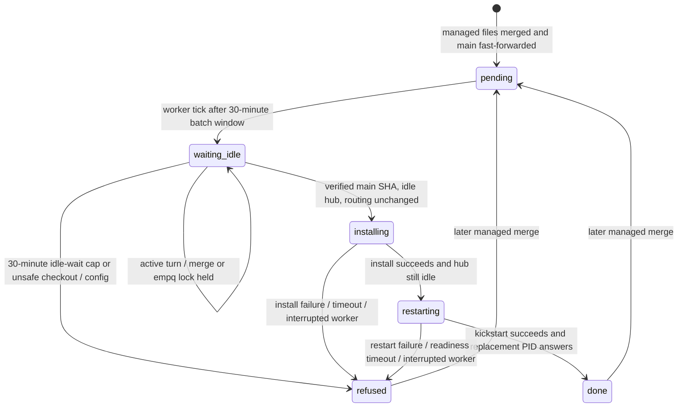

# Empryo task hub

The Empryo task system runs coding tasks for the coordinator agent. mac-ops
holds its source so changes have history. `./install.sh empryo` copies the
files to the live paths.

## What it is

- `emp-hub` is a long-running Python service. It owns task threads, starts one
  `empryo acp` engine per running turn, and serves a local socket
  at `~/.empryo-hub/hub.sock`.
- `emp` is the client for that socket (`emp call`, `emp follow`, `emp drain`,
  `emp drain --cancel`). `emp show <thread or terminal>` opens a task or terminal
  over the current Herdr tab.
- `empq` is the coordinator's work queue. It keeps a cap on live threads.
- `emp-health` checks the hub, the queue and the coordinator's context size
  every two minutes. `coordinator-refresh` restarts the coordinator when its
  context is full. `coordstart` resumes the coordinator session.
- `routing.json` maps each task type to a model and mode. The `taskRouter`,
  `modelFallback` and watchdog keys in Empryo's `config.json` set the engine's
  own routing and timeouts.
- The Herdr mods `cockpit`, `coordinator`, `ops` and `git-graph` show the hub
  in the Herdr app.

## Deferred installs after mac-ops merges (MO-170)

MO-158 fast-forwards the clean `~/Code/mac-ops` main checkout and records
`hubInstall` in the merge result. With `deferEmpryo` enabled in
`post-merge.json`, the installer manifest decides whether changed files
(including removed mod files) need an Empryo install. The existing mac-ops
install step remains separate; it does not install or restart the hub.

`~/.empryo-hub/install.json` holds the pending SHA, the original wait start,
state, and a fixed, configuration-free refusal reason. New managed merges
coalesce into the pending SHA; unrelated fast-forwards advance that SHA without
resetting the 30-minute batching window. During that window empq and the hub
continue admitting work and merges; the worker performs no install or restart.
After 30 minutes, admission stops so existing work can finish. The worker has
a further 30 minutes to observe idle before refusing, without restarting.
Repeated processing of one SHA never rearms it.

`dev.coordinator.emp-hub-install` runs once per minute. Only this external
job runs `./install.sh empryo --preserve-routing` and
`launchctl kickstart -k gui/<uid>/dev.coordinator.emp-hub`. The worker installs
from the persistent checkout `~/.local/share/mac-ops-install`, never the
development checkout `~/Code/mac-ops`, so the receipt always names the
persistent source.



The persisted state spells `waiting idle` with a space. The hub gates all
new turns (including sends, scheduled and delegated starts) through its existing
pending-turn queue after the batching window, and immediately during installing
or restarting. Invalid wait timestamps fail closed. Running or starting turns
and merge operations prevent installation. New merges are refused after the
batching window, under the same admission lock, so they cannot race the final idle
check and restart. Pending turns are saved, not counted as
running, and resume after restart or refusal via the scheduler (within 20 seconds).
empq retains queued items and does not consume attempts during a deployment.

The worker holds the post-merge/worker lock across deployment and the existing
empq lock across idle checks, install and restart. The hub checks the marker
under the same in-process lock that reserves starting turns, and reports idle
under that lock. Thus an admitted start is visible to the worker, while a later
start queues behind the marker. The job refuses a dirty, non-main or unexpected
checkout SHA. An old hub lacking the admission/idle contract cannot trigger an
install and eventually reaches the wait cap.

Before any copy, the installer compares repo and live hub primary model
selections (including the reviewer selection), and compares the *actual merged*
`modelFallback` with live. Missing, malformed or different protected config
refuses deployment. The automatic installer repeats this guard immediately
before planning writes. Child output and config values never enter logs,
markers or notices. Local-only fallback keys which the recursive overlay retains
are not differences. No routing is changed as part of this feature.

Failures, the 30 minute wait cap and interrupted installing/restarting states
record `refused` and send a desktop notice; they never automatically retry
side effects. The wait cap releases queued launches instead of forcing a restart.
The cap bounds draining; install and replacement-readiness have separate bounded
timeouts. A successful restart remains gated until a different hub PID responds.
A corrupt marker fails closed and needs manual inspection.

### Activation and rollback

Nothing in a merge bootstraps launchd jobs. After the review gate, Shyam's next
manual `./install.sh empryo` copies the worker and renders its plist; the
hub must be restarted once to load the admission gate. Then Shyam can load the
new job with:

```sh
launchctl bootstrap gui/$(id -u) ~/Library/LaunchAgents/dev.coordinator.emp-hub-install.plist
```

Agents never run the hub or install this job. The installer does not load or
restart any launchd service itself. Subsequent automatic installs copy changed
plists but do not reload those jobs; only the hub is kickstarted.

Inspect `install.json` and `install.log` for results. A refused deployment
requires inspection and either a later managed merge or a manual install and
restart; do not delete an active marker to bypass its gate. For a corrupt marker,
unload the worker first, verify no install/restart is in flight, and repair the
state to `refused` before resuming launches.

Rollback: unload the job below, finish/inspect any deployment already in flight,
then revert the PR. Reverting alone does not unload an already loaded job.

```sh
launchctl bootout gui/$(id -u)/dev.coordinator.emp-hub-install
```

Proof: `python3 -m unittest tests.test_hub_install tests.test_post_merge tests.test_post_merge_wiring`.
The new proof uses a fake Unix-socket hub and fake installer/launchctl commands;
it never starts `emp-hub`, installs live files or contacts a model provider.

## What a rebuild needs first

The installer does not create these: `~/.local/bin/hc`, `~/.local/bin/herdr-app`,
`gh` on the path, and `~/Code/coordinator/queue/config.json` holding `{"cap": N}`.
Without that queue file, `dev.coordinator.dispatch` fails every 30 seconds.

## How a task flows

1. The coordinator adds an item to the queue with `empq`.
2. `dev.coordinator.dispatch` runs `empq dispatch` every 30 seconds. It starts
   queued items while live threads are under the cap.
3. `empq` calls `emp`, which sends the request to `emp-hub` over the socket.
4. `emp-hub` picks a model from `routing.json`, creates a worktree, and runs
   the turn through `empryo acp`.
5. The result lands in the thread transcript. The coordinator reads it and
   reports.

## Where files live

Source in this repository, under `empryo/`:

| Path | Installed to |
| --- | --- |
| `bin/*` | `~/.local/bin/` |
| `launchd/*.plist` | `~/Library/LaunchAgents/` (`@HOME@` becomes your home) |
| `hub/routing.json` | `~/.empryo-hub/routing.json` |
| `config/EMPRYO.md`, `hooks.json`, `agents/code-reviewer.md` | `~/.empryo/` |
| `config/routing-config.json` | merged into `~/.empryo/config.json` (only these keys) |
| `mods/*` | `~/.config/herdr-app/mods/` |

State stays outside the repository and the installer never touches it: thread
state, transcripts, `projects.json`, `schedules.json` (all in `~/.empryo-hub`),
the queue under `~/Code/coordinator/queue`, and Empryo's databases and keys.
The Herdr mod files `gpui-kit.d.ts` and `jsconfig.json` are generated by Herdr
and are not copied. `git-graph` is from rabeeh-ta/herdr-git-graph (MIT) with
local edits; its MIT notice is committed in `empryo/mods/git-graph/LICENSE`
and installed alongside the mod (the icons have a separate ISC notice).

## Install

```sh
./install.sh empryo --dry-run
./install.sh empryo
./install.sh empryo-status
```

The installer runs from any checkout. It merges managed config leaves while
preserving unrelated nested settings. It writes only files whose bytes or modes
differ; an in-sync install makes no writes, including to its receipt. Symlinks
in destination chains are rejected and replacements use exclusive temporary
files and atomic rename. Each install saves its pre-install state under a unique
`~/.local/state/mac-ops/empryo-backups/<timestamp>-<transaction-id>/`.
It never restarts the hub or launchd jobs.

## Single-instance startup

Start `emp-hub` with no arguments. Any argument, including `--help`, prints
usage and exits zero without touching hub state or binding the socket. A
nonblocking lock on `~/.empryo-hub/hub.lock` is acquired before reading stores
or changing the socket; a second start exits nonzero with `already running`.
The descriptor stays open for the process lifetime. Never unlink this lock
file: all starters must use the same inode. The previous unlocked binary
must be drained before starting this version.

## Restart safely

Run `emp drain --restart`. The hub stops starting new turns, waits for running
turns to finish, and exits. launchd (`KeepAlive`) starts the new `emp-hub`.
After a plist change, reload it with `launchctl bootout gui/$(id -u)/<label>`
and `launchctl bootstrap gui/$(id -u) ~/Library/LaunchAgents/<label>.plist`.

## Roll back

Choose the transaction printed by the install (also recorded in its receipt),
not just the newest directory: a failed install can leave a partial transaction.
Read its `manifest.json`: each entry records the absolute destination `path`
and the relative `backup` filename. A null `backup` means the destination was
absent before the install; remove that newly installed file when rolling back.
Otherwise copy the backup bytes to `path`, restore its recorded octal `mode`
(the JSON stores the integer), and restore `atime_ns` and `mtime_ns` with
`os.utime(path, ns=(atime_ns, mtime_ns))`. Backup files themselves preserve
original permission bits. The manifest includes the old receipt and records
each file before replacement; newly created empty directories may remain.
Do not follow symlinks during rollback. Review the manifest before restoring;
rollback is a deliberate manual operation, not part of installation.
Only after an approved live rollback, run `emp drain --restart` if needed.
To install an earlier source version, check out that commit and run
`./install.sh empryo` again.

## Turn budgets and review provenance

`routing.json` owns the turn budget: `turnLimits.turnSeconds` is the default
(600) and `turnLimits.taskTypeSeconds` is the per-task-type budget (600 for
the builder types, 1200 for `review`). A launch may
set integer `turnSeconds` >= 600, which is how a promotion thread asks for a
longer budget; the effective value is stored on the thread
and retained on sends, resumed turns, and drain/restart. Each turn gets a fresh
execution clock when its prompt starts. The hub has no per-provider concurrency
gate; the coordinator's `empq` cap is enforced in `empryo/bin/empq:96-98`.
Drain queue time is excluded;
tool-internal queues and tool execution count. Threads created
before this field existed use the routing default (600, or 900 when the
routing file carries no `turnSeconds`).

The reaper checks the budget on its existing 60-second tick. Expiry uses the
existing stalled cancellation and 20-second kill grace: the run finishes
`failed` with `turn budget exceeded: N min`, with normal run recording and
engine release, so the coordinator can re-cut the work. With the 600-second
budget the no-progress (1200) and tool (10800) limits sit above it, so a stuck
turn fails on the budget.
Pending permission questions defer all stall cancellation, including while an
answer is being sent. The permission wait still counts: after the answer is
sent and removed from pending, an expired turn is cancelled on the next check.
An unanswered question can therefore defer the deadline indefinitely. No
automatic resume is added; retries remain coordinator policy.

Merge dry-run `evidence.reviewGate` includes the last review run
`model` and `runId`. Model comes from the persisted run (including a reported
fallback), not launch `modelSelection`; it is evidence, not model approval or
part of `revision_inputs`. It cannot prove a model switch that the engine did
not report.

Every manual merge-gate evaluation appends one JSON line to
`~/.empryo-hub/merges.jsonl`: the time, the task thread, the pull request
number, the head commit, the checks state, the review thread, the verdict
word, the review model and run, whether the merge happened, whether the call
was a dry run, and the id of the record. The record never holds message text.
A write that fails is logged and the merge continues. A refusal before the
gate (a review thread, a live run) is not a merge-gate evaluation and writes
no record.

Run `python3 verification/check_hub_single_instance.py` for isolated startup
proofs and `python3 verification/check_hub_turn_budget.py` for the slot-free
second-socket proof (synthetic elapsed time, real sleep subprocesses, fake
ACP/GitHub I/O). Add `--wall-clock` to the latter for a real 601-second
concurrent-turn proof. `python3 verification/check_hub_merge_evidence.py`
proves the merge-gate record: a dry run and a real merge each append one
record, a refused merge records the gate it read, and a record that cannot be
written does not fail the merge. None installs or restarts production or
calls a paid provider. The ticket-approved proof migration preserves the
other MO-147 assertions and checks drain queueing separately from uncapped
provider turns. See `evidence/mo-149-hub-proof.md`.

## Personal-repository merge train (MO-159)

A completed review enqueues its task in a durable, FIFO queue in the task's
`autoMerge` field. One head item per repository is evaluated per tick (20 seconds),
with an immediate wake on review completion. Repository locks also serialize
manual `emp_thread_merge` calls. Tasks and their selected reviews cannot start
new runs during evaluation. Repeat completion events and hub restarts do not
repeat a merge; GitHub's open-PR state remains authoritative after a crash.

Only `shyamsivakumar/*` repositories qualify. Ascend task keys AUH, MCP, OPS,
DBT and OMN are denied as well. The selected, independent review must pass the
existing provenance and verdict gates, be strictly newer than the task's latest
run, and use an allowed persisted run model. `routing.json` defaults to Opus;
`autoMergeReviewerModels` is the explicit allowlist. The operator must enable
the train with `{"autoMerge": true}` in `~/.empryo-hub/config.json`; absent,
malformed or false means disabled. Set `autoMerge: false` in that same file to
pause queued work without reinstalling or restarting. This state file is not
managed by the installer, so an install cannot undo a pause. The flag is reread
before updates and merges.

The train calls the same merge tool with `dryRun`, then `expectedRevision`.
It fetches main and the PR head without changing a worktree or force-pushing,
and computes `git merge-tree --write-tree` for the queue head. Current checks
are still PR-head checks (CI or a status such as `srw/agent-check`), read through
`merge_checks`, with a head-SHA race check. That function is the seam for future
tree-keyed receipts (SRW-854); no tree receipt is accepted today.

When main is not an ancestor of the PR head, GitHub's update-branch API is
called with `expected_head_sha`. The update intent is persisted before the call.
The train waits for a new head, verifies it is a two-parent merge of the recorded
old head, verifies the second parent is an ancestor of freshly fetched main,
and compares `git patch-id --stable` of the PR's own diff against each
head's merge base. A clean update carries the review only when the patch-id is
unchanged (Shyam approved, 2026-11-11 02:50 PT); new task/review runs or unrelated
head changes invalidate that carry. The original head/date remain the review
and CHECK target for no-check PRs, while the five-minute registration wait is
still applied to the new head. Green checks must belong to the new head.
An unchanged local worktree at the original reviewed head is allowed only for
this recorded carry. Changed patch-id requests a new review through
`emp_thread_send`; conflicts go back to the builder through that same path.
Neither case can merge automatically without a subsequent review completion.
Red/cancelled checks and requested changes also return the item to the builder,
without updating its branch. An update with no new head times out after five
minutes; other stalled items return after one hour so they cannot hold the repo
queue forever. Local ancestry determines whether an update is needed; GitHub
must report CLEAN, UNSTABLE, HAS_HOOKS or BEHIND to authorize update-branch.
This also handles repositories without an up-to-date branch-protection rule,
where a behind branch can still report CLEAN.

Every changed wait/skip reason, clean-update receipt, and successful automatic
merge is recorded in `merges.jsonl` and as a hub transcript notice. Unchanged
polling reasons are deduplicated. The queue state and update receipt survive a
restart; no batching or GitHub merge-queue service is used. Automatic dry-run
polls do not append duplicate gate records; manual dry runs retain their existing
one-record-per-evaluation behavior.

Run `python3 verification/check_hub_auto_merge.py` for fake-gh/git acceptance
proofs. It extracts selected function definitions with AST, not the hub module,
and never starts the hub, engines, sockets, or providers.

## Merged is live: post-merge fast-forward and install (MO-158)

After `emp_thread_merge` merges a pull request, the hub syncs the repository's
live checkout, so a merge is live on this machine: it fast-forwards the local
main checkout under `~/Code` (`git fetch` then `git merge --ff-only
origin/main`) and runs the repository's declared install step. The checkout is
only fast-forwarded when it is on `main`, clean, and its `origin` remote is the
merged repository; otherwise the step is skipped and the reason is named. The
hub never forces, resets or stashes a checkout, so local work is never lost.

The checkout may be a linked git worktree: its `.git` is a file that points at
the metadata the clone shares, and the fast-forward runs in it. A repository
that keeps its own clone on another branch can therefore declare a dedicated
clean main worktree, and the clone it shares the metadata with keeps its branch
and its local files. `shyamsivakumar/strategy-replay-workbench` declares
`~/Code/strategy-replay-workbench-main`, a worktree of the clone in
`~/Code/strategy-replay-workbench`, and declares no install step, so a merge
only fast-forwards it.

The steps are declared per repository in `~/.empryo/post-merge.json`, installed
from `empryo/config/post-merge.json`: the checkout name, the install command,
its timeout, and the config files a merge may copy into `~/.empryo`. A file
the merge did not change is left alone, and the file it replaces is kept next
to it as `<name>.before-<shortsha>`. The copy lands on a fresh exclusive
temporary file in the destination directory and is then moved into place, and
a config file that is a link is left alone, so nothing is ever written
through. The hub installer itself is never run from here.

The fast-forward runs `git merge --ff-only --no-overwrite-ignore`, so git
refuses a merge that would overwrite an ignored local file the incoming commit
starts tracking. The checkout then stays behind and the skip is reported; the
local file is never lost.

Each outcome (the fast-forward done or skipped with its reason, the install
ok, deferred or failed, the config files copied) is written to the same merge
record the merge gate wrote, under `postMerge`, and is returned in the merge
reply. One merge-gate evaluation still leaves exactly one record: the record
is written before the post-merge step runs, so a hub that restarts during a
long install keeps the evidence that the pull request merged, and the
post-merge outcome completes that same line afterwards. A failed fast-forward
or install never fails or undoes the merge.

`empryo/bin/emp_post_merge.py` holds the step, `tests/test_post_merge.py`
covers it with temporary checkouts, and `tests/test_post_merge_wiring.py`
proves that one merge leaves one record.

## Model order and merge rules (2026-11-04)

- Model order: MiniMax and GLM 5.3 first, then GPT 6.1 and Cursor, and Claude last. Risky, design, large and review tasks stay on GPT 6.1 Sol.
- `emp_thread_merge` refuses review threads and any PR whose head branch is not the task's own branch.
- A PR with no checks can merge only in a `shyamsivakumar` repo. It needs a coordinator-launched review ending in `CHECK: PASS <head sha>` and `VERDICT: PASS`, and a head commit at least five minutes old. A failing check is never overridden.
- A thread reopens only its own conversation tab. If that tab cannot open, it gets a new tab, and the send result carries `contextLost`.
- Install mod changes one mod at a time and check Herdr's response time after each. A combined hot reload froze the app on 2026-11-04, and the cause is not proven.
- `emp_thread_merge` takes an optional `expectedRevision`. A dry run returns `revision`, a short hash of the pull request number, head commit, merge state, checks state, and the review thread, verdict and commit. If it differs at merge time, the merge is refused before `gh pr merge` and the reply names what changed. The board sends it on every merge. The hub keeps issued revisions in memory only, so after a restart read the task again with a dry run.
- A thread with its own worktree gets a block of 10 ports from 40000 to 49099, kept on the thread as `portBase`. The hub sets `EMP_PORT_BASE` on the engine, but Empryo passes only an allowlist of variable names to agent shells, so each turn sent to the engine ends with the line `Your port block: A-B`. The transcript keeps the original message.
- On the board, a click or Enter on a Needs you or Ready card opens a decision pop-up. Merge needs an arming press and a separate confirming press, and it re-checks the pull request first.
- The status bar shows `Worktrees · N stale`, and clicking it opens a pop-up over the worktree cleaner. `Clean N safe` needs two presses and runs `cleaner.py --apply --prune`. It removes only worktrees the cleaner proves safe, and never forces. SRW, dbt and omni repos are listed read-only. The cleaner's launchd job is not installed.
- A bar above the board has Worktrees, Models, Queue and Hub buttons, each showing its problem on the button and opening a pop-up. They are read-only apart from Clean and Cancel drain. The `ops-panels` mod serves Models, Queue and Hub.
