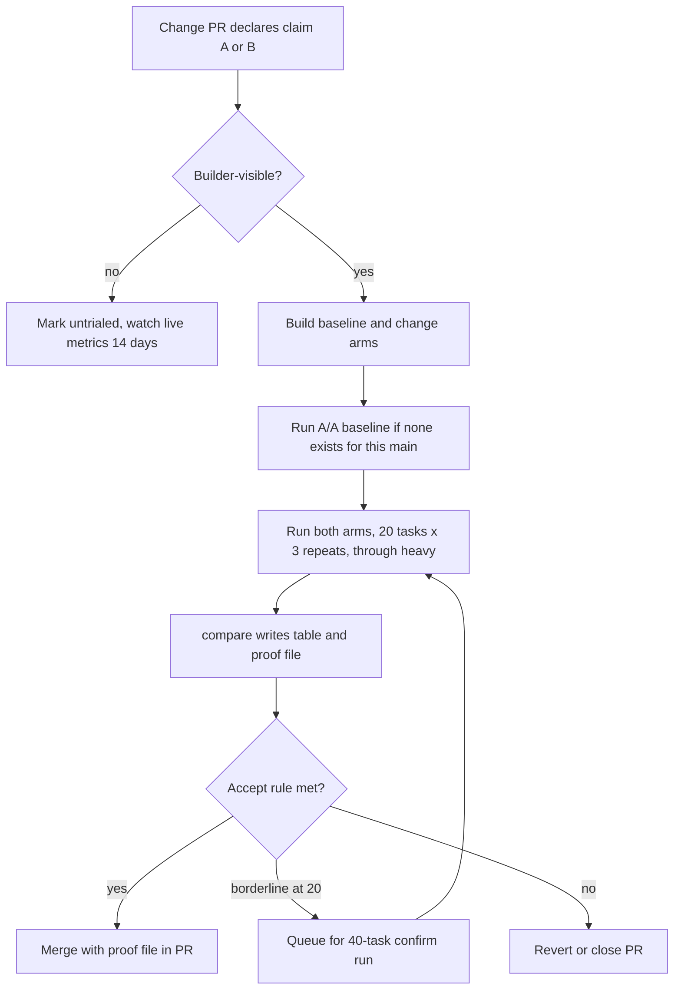

# With-and-without trials for loop, prompt and skill changes

Status: design proposal for [#505](https://github.com/shyamsivakumar/mac-ops/issues/505)
(MO-1069), written 2026-11-18. Nothing here is built. Every threshold is a
proposal until a first trial confirms it. Building is a later ticket after
Shyam reviews this note.

## Problem

Today a change to the loop, a prompt or a skill is judged by how many PRs
merged afterward. That count can rise while the code gets worse. A shorter
rule file can make builders finish faster and skip work. A new skill can add
cost and change nothing. Merge counts cannot tell those cases apart, and they
are noisy: mac-ops alone merged 100 PRs in the 2.5 days from 2026-11-16 to
2026-11-19, with no record of which change each PR ran under.

The fix is a with-and-without trial. Run the same tickets under the current
setup and under the changed setup, compare outcomes, and keep the change only
when the comparison says it helps.

## What counts as a change

A change is any diff to text that steers an agent.

| Kind | Where it lives |
| --- | --- |
| Builder rules and prompts | `coordinator/config/AGENT-RULES.md`, `coordinator/config/agents/`, the brief template in `coordinator/config/tickets.json` |
| Skills | `runtime/codex/skills/<name>/SKILL.md` in llmwiki |
| Loop policy | `coordinator/bin/gate_policy.py`, `coordinator/bin/gate_reviewers.py`, `coordinator/models.json`, the turn caps |

The first two kinds are builder inputs. A single builder agent can run them
inside a container against one ticket, so the trial below can measure them.
The third kind changes how the Coordinator routes and gates work across many
tickets. A single-ticket trial cannot see that, so it gets the live metrics in
the last section instead.

## Design fit

The trial reuses the harness from [#507](https://github.com/shyamsivakumar/mac-ops/issues/507)
(MO-1071), which lives in `evals/harbor/` and runs the pi agent against a task
in a Linux container with hidden tests. Nothing in it is replaced. The trial
adds three things on top.

1. An **arm**: a named overlay that swaps the prompt, rules and skills the
   agent sees. The baseline arm is the current `main`. The change arm is the
   same tree with the proposed diff applied.
2. A **comparison step** that reads the Harbor result files of two arms and
   writes one table.
3. A **proof file** under `evidence/` that the PR carries.

The trial ships as a script beside the harness, not as a new service. No
permission, guard, sandbox or live-service change is needed, because trials
run in disposable containers on the model endpoint the harness already uses.

How the overlay reaches the agent depends on how the pi adapter in Harbor
loads its rules and skills. That has not been read for this note, so the build
ticket starts by confirming it. If pi can only read rules from a fixed path,
the arm mounts the overlay at that path.

## Sample

**Tasks.** The #507 set: about 20 merged PRs, each with a ticket and a
test-backed fix, filtered to the tasks the oracle agent passes. Tasks do not
change between arms, so every comparison is paired by task. mac-ops tasks
whose check needs macOS cannot run in the container and are left out.

**Repeats.** 3 runs per task per arm. One run says little because the same
agent can pass and fail the same task.

**Trials per arm.** 20 tasks × 3 repeats = 60.

**Controls.** Each baseline version also gets an A/A run, which is the
baseline run twice. The gap between the two baseline runs is the noise floor.
A change has to beat that gap.

**Why 20 tasks is a screen and 40 is a decision.** The decision unit is the
task. For each task, count the runs that passed under each arm and call the
task "up" if the change arm passed more, "down" if fewer, and drop ties. A
sign test on up against down gives the p-value. The table lists what the test
can and cannot see, from an exact calculation and a simulation of 20 and 40
tasks with 3 repeats and task difficulty spread from easy to hard.

| Up / down | One-sided p |
| --- | --- |
| 4 / 0 | 0.062 |
| 5 / 0 | 0.031 |
| 6 / 1 | 0.062 |
| 7 / 2 | 0.090 |
| 6 / 2 | 0.145 |

| Tasks | True effect on the odds of passing | Chance the test accepts |
| --- | --- | --- |
| 20 | none | 5% |
| 20 | modest (+0.5 log-odds, about 50% to 62%) | 27% |
| 20 | large (+1.0 log-odds, about 50% to 73%) | 63% |
| 40 | none | 7% |
| 40 | modest | 46% |
| 40 | large | 89% |

Twenty tasks catch only large effects, and miss one in three even then. Forty
tasks catch large effects nine times in ten. A change that shows a modest
gain at 20 tasks is not accepted; it is queued for the 40-task confirm run.
The build ticket grows the task set from 20 to 40 once the first 20 work.

## Metrics

Per arm, over all trials.

**Outcome counts** (the decision metrics). Passed, failed, timed out and
errored, as counts out of 60. Timed out and errored are kept apart from
failed, because a change that breaks the agent's start-up looks like a mass
of errors, not a mass of wrong answers.

**Cost and time.** `cost_usd` per run (needs a priced provider, since the
custom MiniMax endpoint reports `null` today), tokens, and wall-clock seconds.
Report the median and the 90th percentile.

**Quality guards.** The reward is 1 or 0, so it cannot see code that passes
and is worse. Three guards, recorded for every trial.

- Diff size ratio: lines changed by the agent divided by lines in the merged
  PR diff. A change that passes with 3× the diff is not equal.
- Out-of-scope files: files the agent touched that the merged diff did not.
- Repo check: the repo's own lint or check, where it runs on Linux.

Guards are scorecards in the sense of the [eval scorecard](evals.md). They
are reported and they steer the next fix. Only the accept rule below acts on
them, and only through the limits it names.

## How a change is accepted

A change PR declares one claim before the trial runs.

**Claim A, it helps pass rate.** Accept when all of these hold.

1. Up exceeds down, and the one-sided sign test gives p ≤ 0.10. At 20 tasks
   that means 5 / 0, 6 / 1 or better.
2. Up minus down is larger than the A/A gap on the same tasks.
3. Timed out plus errored rises by at most 2 runs.
4. Median cost and median wall-clock time are each no more than 25% above
   baseline.
5. Median diff size ratio is no more than 1.5× baseline.

**Claim B, it does no harm and cuts cost or time.** This is the claim for
trimming a rule file or a skill. Accept when all of these hold.

1. Down minus up is at most 2 tasks.
2. Median cost or median wall-clock time falls by at least 15%.
3. Conditions 3 to 5 of claim A hold.

At 20 tasks "at most 2 down" cannot rule out a small real loss. That is the
reason claim B also asks for a measured saving, so a change is only kept when
it buys something in return for the risk.

A change that fails its claim is reverted or not merged. A change that cannot
be trialed because it has no builder-visible effect (a loop-policy change, see
above) is marked `untrialed` in the PR and watched on the live metrics for 14
days, then kept or reverted on those.

The [eval scorecard](evals.md) says scorecards never block a
merge, and that holds for the governor and controller. Loop, prompt and skill
changes are a different decision, and the ticket asks for a keep-only-if-it-
helps rule, so the accept rule above does block these changes. Shyam should
confirm that split when he reviews this note.

## Process

## Cost and time

These numbers are estimates and the first trial replaces them. A full trial is
120 runs (60 per arm) plus 60 for a fresh A/A baseline. The #507 example run
took 32 seconds, but a real fix will take far longer; at 8 minutes a run, one
arm is about 8 hours one run at a time, and Docker runs go through `heavy`,
one at a time, on this Mac. A trial is therefore an overnight job, and a
change that has no claim worth that time should not be trialed. Per-run
dollar cost needs a priced provider, as noted above.

Mitigation, in order of effort. Reuse the A/A baseline across changes made on
the same `main`. Run the change arm first on 10 tasks and stop on 4 or more
down. Raise Docker concurrency only if `heavy` allows it.

## What the trial cannot measure

- Anything that needs macOS. The harness runs Linux containers.
- Coordinator behavior across tickets: ordering, gate rounds, model routing.
  These changes are watched live instead, on rework rate (a PR followed by a
  revert or a fix that references it within 7 days), gate rounds per PR, and
  the share of builder turns over 10 minutes from `loop/caps.log`. Merge count
  stays on the dashboard but is not a decision input.
- Whether 20 or 40 old tickets represent the next ticket. Refresh the task
  set from newly merged PRs each quarter, and keep the A/A control so drift in
  the task set shows up as noise, not as a false win.

## Not in this ticket

Everything above is a proposal. This ticket writes the note only. The build
ticket should cover the arm overlay, the compare script, the proof file
format, and the first A/A run, in that order, after Shyam's review and after
ticket 507 has its 20 tasks.
