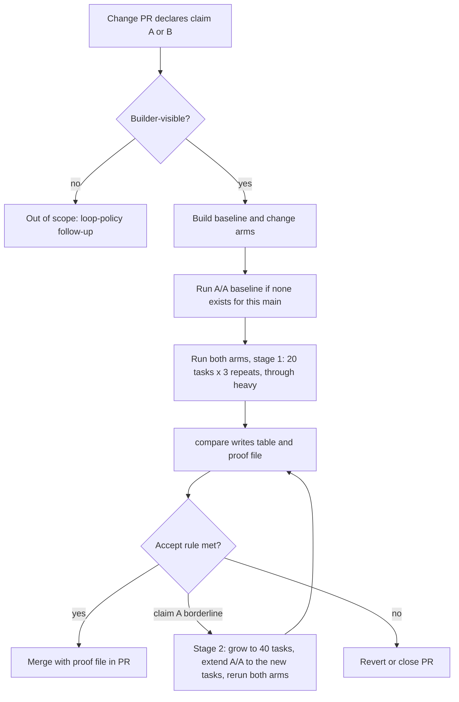

# With-and-without trials for loop, prompt and skill changes

Status: design proposal for [#505](https://github.com/shyamsivakumar/mac-ops/issues/505)
(MO-1069), written 2026-11-18. Nothing here is built. Every threshold is a
proposal until a first trial confirms it. Building is a later ticket after
Shyam reviews this note. Until that build exists and the #507 task set has its
20 tasks, loop, prompt and skill changes ship under the ship-and-score rule in
[evals.md](evals.md), and each gets a trial after the fact once the harness can
run one.

## Problem

Today a change to the loop, a prompt or a skill is judged by how many PRs
merged afterward. That count can rise while the code gets worse. A shorter
rule file can make builders finish faster and skip work. A new skill can add
cost and change nothing. Merge counts cannot tell those cases apart, and they
are noisy. The last 100 merged mac-ops PRs (from `gh pr list --state merged`)
span 2026-11-16 08:22 UTC to 2026-11-19 02:53 UTC, and nothing records which
change each PR ran under.

The fix is a with-and-without trial. Run the same tickets under the current
setup and under the changed setup, compare outcomes, and keep the change only
when the comparison says it helps.

## What counts as a change

A change is any diff to text or config that steers an agent.

| Kind | Where it lives |
| --- | --- |
| Builder rules and prompts | `coordinator/config/AGENT-RULES.md` and the `template` key of `coordinator/config/tickets.json` |
| Skills | `runtime/codex/skills/<name>/SKILL.md` in llmwiki |

Both kinds are builder inputs. A single builder agent can read them inside a
container against one ticket, so a trial can compare them.

Loop-policy changes (gate policy, reviewer selection, model routing, turn caps)
are out of scope for this note. They change how the Coordinator routes and
gates work across many tickets, and a single-ticket trial cannot see that. Their
decision rule is left for a follow-up.

## Design fit

The trial reuses the harness from [#507](https://github.com/shyamsivakumar/mac-ops/issues/507)
(MO-1071), which lives in `evals/harbor/` and runs the pi agent against a task
in a Linux container with hidden tests. Nothing in it is replaced. The trial
adds three things on top.

1. An **arm**: a named overlay that swaps the rules and skills the agent sees.
   Each trial pins the two arms to git revisions and records both SHAs in the
   proof file. For a change that is still a PR, "without" is the `main` revision
   the PR branches from and "with" is that revision plus the PR diff. For a
   change already merged into `main`, "without" is the revision just before
   the change landed and "with" is the revision that contains it, never the
   current `main`, whose baseline would already include the change. Only the
   builder inputs listed above differ between the two overlays.
2. A **comparison step** that reads the Harbor result files of two arms and
   writes one table.
3. A **proof file** under `evidence/` that the PR carries.

The trial ships as a script beside the harness, not as a new service. No
permission, guard, sandbox or live-service change is needed, because trials
run in disposable containers on the model endpoint the harness already uses.

Two facts are not yet established, and the build ticket settles both before
anything else. First, how the pi adapter in Harbor loads rules and skills. Its
source was not read for this note. If pi reads rules only from a fixed path,
the arm mounts the overlay at that path. Second, what the agent is told. The
#507 tasks give the agent the ticket text only, so a trial measures the rules
and skills against bare tickets. It does not exercise the Coordinator brief,
hooks or reviewer. The build ticket decides whether to build each task
instruction from the brief template so the trial is closer to production.

## Sample

**Tasks.** The #507 set: about 20 merged PRs, each with a ticket and a
test-backed fix, filtered to the tasks the oracle agent passes. Tasks do not
change between arms, so every comparison is paired by task. mac-ops tasks
whose check needs macOS cannot run in the container and are left out.

**Repeats.** 3 runs per task per arm. One run says little because the same
agent can pass and fail the same task.

**Trials per arm.** 20 tasks x 3 repeats = 60.

**Decision unit.** The task. For each task, count the runs that passed under
each arm. The task is "up" if the change arm passed more runs, "down" if fewer,
and dropped if equal. A one-sided sign test on up against down gives the
p-value, which is the exact binomial chance of at least that many ups out of
up plus down if the change did nothing.

**A/A control.** Each baseline version also gets an A/A run, which is the
baseline arm run a second time over the same tasks. Counting up and down
between the two baseline runs gives the A/A net, the absolute value of up minus
down. It measures how far the arm moves with no change at all.

**Two stages.**

- Stage 1, screen: 20 tasks. Accept the pass-rate claim when p is at most 0.10.
- Stage 2, confirm: 40 tasks, which are the original 20 plus 20 new ones. The
  stage 2 decision uses all 40 and requires p of at most 0.05, because the
  second look at the same data raises the chance of a false accept. Before
  the stage 2 decision, the A/A run is extended to the 20 new tasks (3 runs
  each of the baseline arm, a second time). Every stage 2 comparison against
  A/A, in claims A and B, then uses A/A numbers over the same 40 tasks.

Smallest accepting number of ups for each number of downs, from the exact
calculation.

| Downs | Ups needed at 20 tasks (p <= 0.10) | Ups needed at 40 tasks (p <= 0.05) |
| --- | --- | --- |
| 0 | 4 | 5 |
| 1 | 6 | 7 |
| 2 | 7 | 9 |
| 3 | 9 | 10 |
| 4 | 10 | 12 |
| 5 | 12 | 13 |

For claim A, a stage 1 result is **borderline** when up exceeds down and p is
above 0.10 and at most 0.25 (for example 5 / 1 or 6 / 2). Borderline results go
to stage 2. A claim A result with p above 0.25 is rejected. Claim B does not use
the sign-test p-value or the borderline route. It is decided on its own
conditions below, so a trial with one task up and one down, and median tokens
down 20%, is judged by claim B's conditions only.

How often each stage accepts, by simulation. Each task gets a baseline pass
probability drawn from a Beta(0.8, 0.8) spread (some tasks easy, some hard,
which fits a mix of merged fixes). The change adds a fixed shift on the
log-odds scale to every task. Each row is 3,000 simulated trials, so figures
carry about two points of noise. These figures model the sign test only. The
real rule below also needs the other conditions, so the real chance of
accepting is lower.

| Stage | True effect | Chance the sign test accepts |
| --- | --- | --- |
| 1 (20 tasks, p <= 0.10) | none | 6% |
| 1 | modest (+0.5, about 50% to 62% pass) | 27% |
| 1 | large (+1.0, about 50% to 73% pass) | 63% |
| 2 (40 tasks, p <= 0.05) | none | 3% |
| 2 | modest | 31% |
| 2 | large | 82% |

Twenty tasks catch only large effects and miss more than a third of those.
Forty tasks at the stricter bar still miss about one large effect in five, and
most modest effects. This design finds big changes and cannot reliably find
small ones. A change worth less than the modest row is not worth trialing.

## Metrics

Per arm, over all trials.

**Outcome counts** (the decision metrics). Passed, failed, timed out and
errored, as counts out of 60. Timed out and errored are kept apart from
failed, because a change that breaks the agent's start-up looks like a mass
of errors, not a mass of wrong answers.

**Cost and time.** `cost_usd` per run, total tokens, and wall-clock seconds,
each as a median and a 90th percentile. The custom MiniMax endpoint reports
`cost_usd` as `null` today (see `evals/harbor/README.md`). While it is `null`,
every cost condition below uses total tokens instead. The cost conditions
switch back to dollars once a priced provider is in use.

**Quality guards.** The reward is 1 or 0, so it cannot see code that passes
and is worse. Three guards, recorded for every trial.

- Diff size ratio: lines changed by the agent divided by lines in the merged
  PR diff. A change that passes with 3x the diff is not equal.
- Out-of-scope files: files the agent touched that the merged diff did not.
- Repo check: the repo's own lint or check, where it runs on Linux.

The [eval scorecard](evals.md) reports its metrics and does not block on them.
The guards are reported the same way for every trial. Only the diff size
ratio also acts as a limit in the accept rule below.

## How a change is accepted

A change PR declares one claim before the trial runs.

**Claim A, it helps pass rate.** Accept when all of these hold.

1. The sign test passes the stage bar: p of at most 0.10 at stage 1, or at most
   0.05 at stage 2, using the tables above.
2. Up minus down is larger than the A/A net on the same tasks.
3. Timed out plus errored rises by at most 2 runs.
4. Median cost and median wall-clock time are each no more than 25% above
   baseline.
5. Median diff size ratio is no more than 1.5x baseline.
6. Total passed runs under the change arm exceed the baseline's, and the rise
   is larger than the absolute difference in total passed runs between the two
   A/A runs. The sign test counts tasks and ignores how many runs each task
   moved, so this condition stops a few large losses hiding behind many small
   gains.

**Claim B, it does no harm and cuts cost or time.** This is the claim for
trimming a rule file or a skill. Accept when all of these hold.

1. Total passed runs fall by at most 5% of the runs in an arm (3 of 60 at
   stage 1, 6 of 120 at stage 2). That is the allowed pass-rate loss, and it is
   tested directly on run counts.
2. Down minus up is at most 2, and down is at most 4.
3. Down is no more than the A/A run's down count plus 2.
4. Median cost or median wall-clock time falls by at least 15%, and neither
   one rises by more than 5%.
5. Conditions 3 and 5 of claim A hold.

Claim B is decided at stage 1. The stage 2 limits above apply only when the
author chooses to confirm a claim B result on 40 tasks.

The 5% allowance is a stated cost, not a proof of no harm. At 20 tasks the
test cannot rule out a real loss of that size or a little more. Rule 4 is the
reason claim B asks for a measured saving, so a change is only kept when it
buys something in return for the risk.

A change that fails its claim is reverted or not merged.

The [eval scorecard](evals.md) says scorecards never block a merge, and that
holds for the governor and controller. Loop, prompt and skill changes are a
different decision, and the ticket asks for a keep-only-if-it-helps rule, so
the accept rule above blocks these changes once the harness exists. Shyam should
confirm that split when he reviews this note.

## Process

## Cost and time

These numbers are estimates and the first trial replaces them. Take 8 minutes
per run as the working figure; the #507 example run took 32 seconds, but a real
fix will take far longer. Docker work goes through `heavy`, one command at a
time on this Mac. If Harbor runs several containers inside one `heavy` job, the
times divide by that concurrency, and the build ticket measures it.

| Trial | Runs | Serial time at 8 minutes a run |
| --- | --- | --- |
| Stage 1, both arms | 120 | 16 hours |
| A/A baseline over the first 20 tasks | 60 | 8 hours |
| Stage 2, both arms over 40 tasks | 240 | 32 hours |
| Stage 2, A/A extension over the 20 new tasks | 60 | 8 hours |

A stage 1 trial with a fresh A/A is about 24 hours serial, so it is a
multi-night job, not an overnight one. A stage 2 confirmation adds 40 hours
(300 runs). A change with no claim worth that time
should not be trialed. Reuse one A/A baseline across all changes made on the
same `main`.

## What the trial cannot measure

- Anything that needs macOS. The harness runs Linux containers.
- Coordinator behavior across tickets, such as ordering, gate rounds and model
  routing. These are loop-policy changes, covered by the follow-up. Merge count
  is not a decision input for them or for anything else in this note.
- Whether 20 or 40 old tickets represent the next ticket. Refresh the task
  set from newly merged PRs each quarter, and keep the A/A control so drift in
  the task set shows up as noise, not as a false win.

## Not in this ticket

Everything above is a proposal. This ticket writes the note only. The
keep-or-revert rule for loop-policy changes is a follow-up, listed under `Left
for later` in the PR. The build
ticket should cover, in order, the two open facts under Design fit, the arm
overlay, the compare script, the proof file format, and the first A/A run,
after Shyam's review and after ticket 507 has its 20 tasks.
