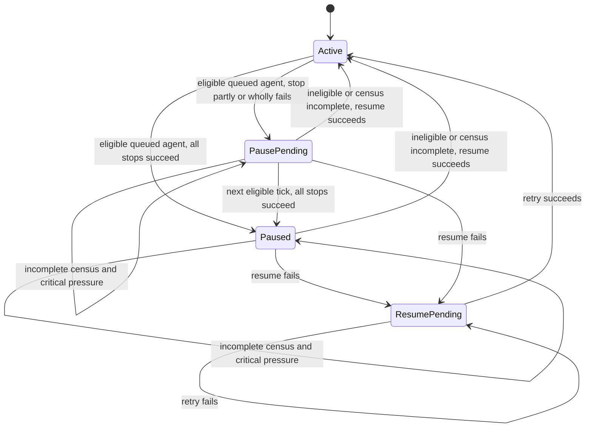

# Idle agent pause lifecycle

The controller can pause an idle board agent while its heavy command waits for admission. The heavy supervisor and its descendants remain excluded from the signal targets. The feature is controlled by `agent_heavy_wait_pause`.

The diagram projects each identity onto its current pause or resume outcome. The stored `paused` task entry and `resume_pending` identity list are separate and can overlap; the diagram does not assert that they are mutually exclusive.

| State | Event and guard | Side effect |
| --- | --- | --- |
| Active | Complete census; active board task has a verified queue supervisor, no live heavy workload, idle foreground, and verified agent identities. | `tick` sends `SIGSTOP` to verified agent processes, excluding the supervisor subtree. |
| PausePending | At least one stop fails, or no stop succeeds. | The task and its process identities remain in pause state. The controller retries on an eligible tick. |
| Paused | All stop signals succeed. | Queue records receive pause status where registry updates succeed. Unchanged identities are not stopped again. |
| ResumePending | A resume signal fails. | The failed identity remains in `resume_pending` for a later retry. |
| Active | The task is no longer eligible, or the census is incomplete without critical pressure. | The controller attempts verified `SIGCONT`, clears task pause state, and retains failed identities. |
| Paused or PausePending | The census is incomplete and critical pressure is present. | Existing pause entries are held. Previously pending resumes are still retried. |

`board_governor.py` persists the returned state after a tick. On controller startup it attempts to resume recorded identities. A process restart can occur between signalling and writing state, so this chart does not claim atomicity between those operations. Boot changes reset pause state after a resume attempt. See `agent_heavy_wait_pause.py` for eligibility and signal handling, and `board_governor.py` for persistence and startup recovery.
