# Board agent parity install

```mermaid
stateDiagram-v2
    [*] --> Missing: no agents-installation.json receipt
    Missing --> Linking: install.sh agents starts
    Linking --> Linking: backup and replace pi/omp links, settings, MCP
    Linking --> Gates: links and merges succeed
    Linking --> Failed: missing reference path or merge error
    Gates --> Gates: install pi then omp first-message gates
    Gates --> OptionalRefresh: both gates exit 0
    Gates --> Failed: either gate exits non-zero
    OptionalRefresh --> Proving: proofs on by default, or refresh finished
    OptionalRefresh --> OptionalRefresh: --model-refresh (failure not fatal)
    Proving --> Receipt: --no-prove skips proofs, or both Terra proofs ok
    Proving --> Failed: a required Terra proof fails
    Receipt --> Installed: agents-installation.json written atomically
    Installed --> Linking: install.sh agents again (idempotent)
    Installed --> Missing: receipt removed by hand
    Failed --> [*]: no new receipt; prior receipt unchanged
    Installed --> [*]
```

`install_agents.py` is the parity path for pi and omp board workers. It does
not touch heavy wrappers or board worker instruction strings. Links and merges
back up the previous file under `~/.local/state/mac-ops/agents-backups/<ns>/`
before replace. The pi and omp input gates run as subprocesses and must both
exit 0 before a receipt is written. Optional `pi update --models` failures are
recorded in the report and do not block the receipt. Proofs run by default;
pass `--no-prove` to skip them. When proving, both harnesses must return their
exact Terra token or the install raises and leaves the previous receipt in
place.

| State | Entered by | Guard to leave | Side effect |
| --- | --- | --- | --- |
| Missing | no receipt, or receipt deleted | caller runs install | none |
| Linking | install starts | ref dirs exist | backups in `agents-backups` |
| Gates | links/merges done | both gates exit 0 | pi/omp wrappers updated |
| OptionalRefresh | gates ok | refresh done or skipped | may note failure |
| Proving | refresh step done | proofs skipped or ok | one-line Terra calls |
| Receipt/Installed | write succeeds | reinstall | `agents-installation.json` |
| Failed | path/gate/proof error | caller retries | prior receipt kept |
