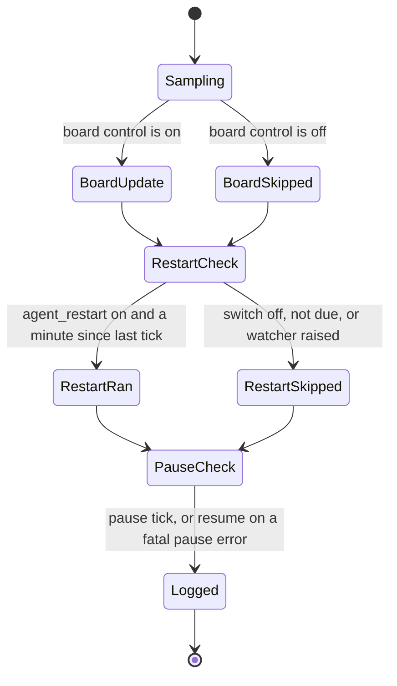

# Controller lifecycle

Capacity, board floor, growth, and admission live in the
[Governor state chart](governor.md). Each tick also runs the restart watcher
and the idle-agent pause, in that order, after the board limit update.

| State | Event | Guard | Side effect |
| --- | --- | --- | --- |
| RestartRan | controller tick | `agent_restart` is true and monotonic time is at least 60 seconds past `_last_restart_tick` (`board_governor.py`, `_board_restart_tick`) | `board_restart.tick()`. The in-memory minute clock resets if the controller process starts again; the watcher file still keeps its own 60 second clock. See [restart](restart.md). |
| RestartSkipped | tick | off, not due, or raised | log `not_due` or error |
| PauseCheck | controller tick | `agent_heavy_wait_pause` | pause or resume idle agents. See [agent heavy wait](agent-heavy-wait-pause.md). A pause error resumes agents before the tick returns. |

The status file and controller log are written at tick end.
A restart error does not skip the pause check.
