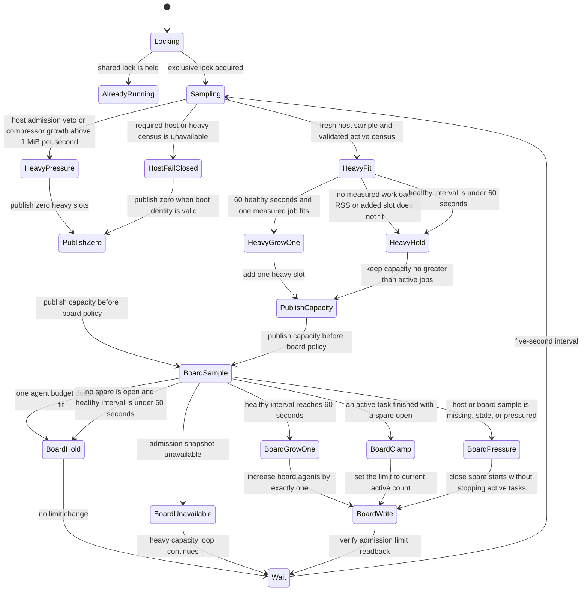

# Capacity controller

The runtime state is stored under `~/.local/state/mac-ops`. The controller publishes `capacity.json` with exactly `heavy_slots`, Unix `updated_at`, and the current kernel `boot_id`. The heavy helper accepts the contract only when owner and mode are safe, the timestamp is no more than 30 seconds old, and the boot identity matches.

The heavy ceiling is the smaller of physical cores and total memory divided by 6 GiB. Incremental heavy memory cost is the greater of a 2 GiB startup budget and the largest validated workload process-group RSS multiplied by a 1.5 margin. The largest observed cost is retained between samples. The controller leaves the greater of 6 GiB or 20 percent of physical memory free, and keeps 20 percent of CPU capacity available. It counts validated live or reserved registry records and validated legacy slots. Missing or corrupt census data is never treated as zero. If a workload is active but its RSS cannot be measured, capacity does not grow.

Host pressure, CPU at or above 95 percent, or compressor growth above 1 MiB per second cuts heavy capacity to zero and clears its healthy timer. Compressor usage is a gauge: decreases count as zero growth, not a counter reset. The controller samples every five seconds so recovery can be observed. A missing or stale host sample also publishes zero when a valid boot identity is available.

Board policy uses the same fresh host sample and a bounded admission snapshot; it does not call the pane census. A new board setting is allowed after 60 continuous healthy seconds, only when one additional agent budget of 2 GiB fits after the memory and CPU reserves. Each increase is exactly one above the current `board.agents` value, including when that value is below the current active count. The limit never exceeds active tasks plus one. If an active task finishes while a spare is open, the controller closes the spare to the current active count and starts a new healthy interval. A warning pressure episode halves the current board limit once; critical kernel pressure or load sets it to zero. Missing or stale readings close spare starts to the current active count. These limit changes do not signal or stop active tasks.

Board growth is enabled by default. Pass `--no-board-control` to keep host capacity publication while skipping board limit changes. If the board admission command is unavailable, the controller records the board error and continues the heavy capacity loop.

Both service entrypoints use the same exclusive `controller.lock`, so only one runtime loop can publish capacity or change the board limit. The controller never signals or kills workload process groups; heavy supervisors own their process groups and signals.
