# Cursor input lifecycle

```mermaid
stateDiagram-v2
    [*] --> Original: Not a supported interactive board launch
    Original --> [*]: Vendor exit
    [*] --> Starting: Board launch with full access or explicit trust
    Starting --> Starting: Queue keyboard input and relay terminal replies
    Starting --> Ready: Composer marker and raw input stable for 250 ms
    Ready --> Ready: Wait for one complete bracketed paste
    Ready --> Writing: Queue preserved first paste
    Writing --> Writing: Drain partial PTY writes
    Writing --> Acknowledgement: Last paste byte written; clear old echo
    Acknowledgement --> Separation: Draft suffix or matching paste receipt observed
    Separation --> Transparent: 300 ms after acknowledgement; release held input and parser tail
    Transparent --> Transparent: Forward raw bytes without parsing in the same session
    Transparent --> Closed: Vendor exits or terminal closes
    Starting --> Closed: Deadline, cancellation, signal or I/O failure
    Ready --> Closed: Partial input deadline or invalid framing
    Writing --> Closed: Deadline, buffer limit, cancellation or I/O failure
    Acknowledgement --> Closed: Deadline, cancellation or I/O failure
    Separation --> Closed: Cancellation or I/O failure
    Closed --> [*]: Restore terminal and close PTY before bounded child cleanup
```

At release, any incomplete parser tail is queued after the already parsed held input. Subsequent reads bypass the parser entirely, so a standalone Escape does not wait for another byte.

Terminal replies can pass during every buffered phase. A cancellation byte inside a bracketed paste stays part of that paste. Cancellation outside the paste closes a delivery that has not yet been released. The wrapper does not forward any first-paste bytes before readiness and complete framing, and Enter cannot leave the held buffer before the full write, fresh draft observation and separation delay.

The bounded TLA+ model maps `Ready` to the marker/raw-mode guard in `main`, `Queue` to `route`, `Write` to the `paste_left` counter, `Echo` to `written_at` and a fresh draft suffix or counted paste receipt, `Tick` to the monotonic delay, and `Release` to the transition to `transparent`. `SendEnter` abstracts the subsequent PTY write. `Cancel` and `Timeout` cover exits before release. Idle is an intentional stuttering transition; progress is not proved.

Readiness and draft observations are assumptions about the external Cursor program. The model checks ordering in the wrapper and does not establish those assumptions. Run the live flow in the [operating guide](../cursor-input-gate.md) when changing markers, terminal handling, launch arguments or child process setup.
