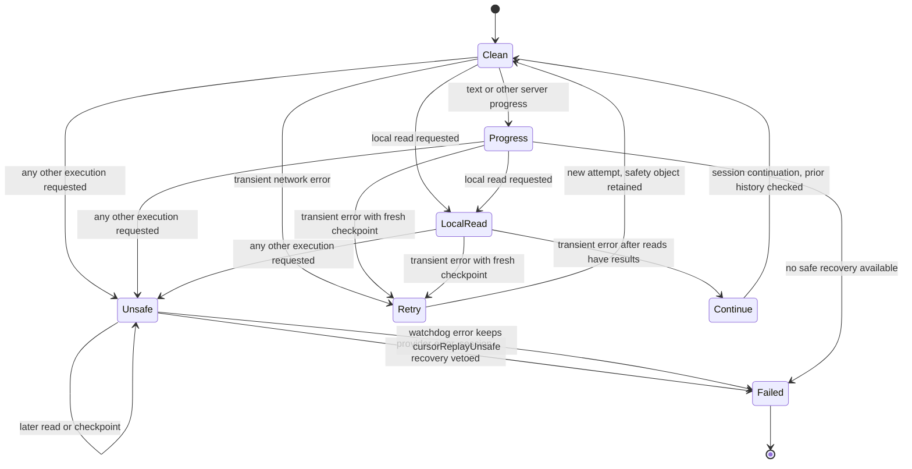
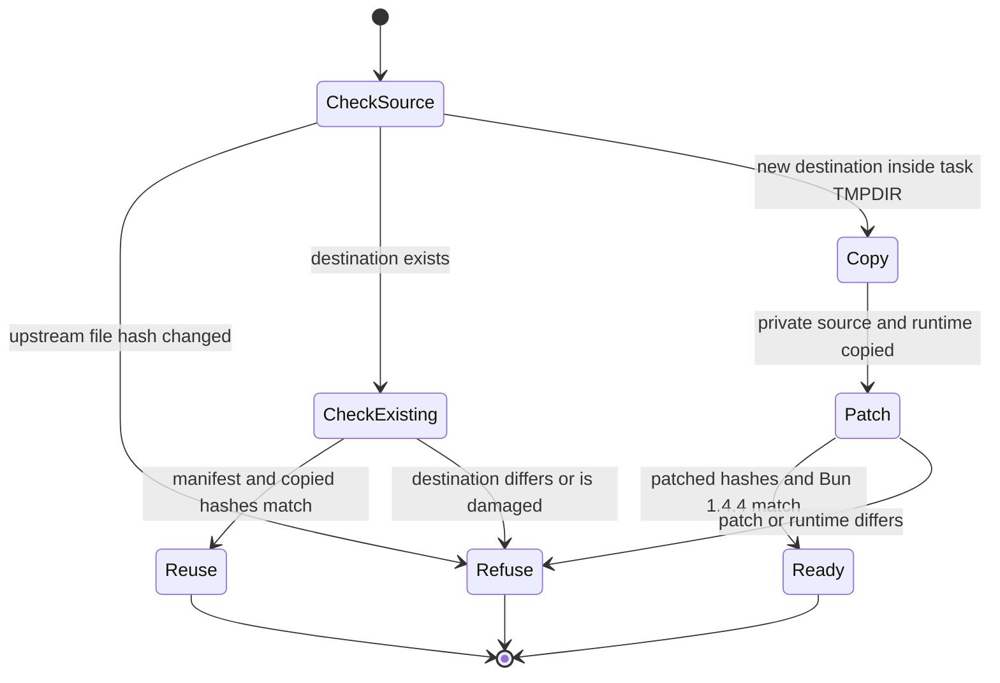

# Omp Cursor turn retry

The charts cover `scripts/omp_cursor_retry.patch` and the task-local copy
prepared by `scripts/omp_cursor_retry.py`.

## One user turn

The provider sets `safety.unsafe` and `cursorReplayUnsafe` before
dispatching any execution other than local `readArgs`, `piReadArgs` or the
request context exchange. MCP, shell, write, delete, edit, grep, ls and
unknown execution frames are unsafe. A read path containing `://` is unsafe
too.

The checkpoint retry, HTTP/1 fallback and model id fallback receive the same
object. The next provider call also scans tool calls and message flags since
the most recent non-synthetic user message. Prior non-read calls keep the
turn unsafe.

Unsafe terminal errors carry `[Cursor retry blocked after non-read
execution]` and `cursorReplayUnsafe` into `agent-session.ts`. When the outer
watchdog in `register-builtins.ts` replaces a stalled stream's error, it
copies both from the last partial message. The agent-end handler stops a
flagged error or abort before credential handling, compaction or automatic
recovery, and the main `TurnRecovery` retry and continuation methods refuse
flagged messages. Safe completed-read
failures can continue through `turn-recovery.ts`.

## Task-local proof copy

There is no installed launcher or automatic update hook. A later installation
needs separate approval. The [verification skill](../../.agents/skills/verify-omp-cursor-retry/SKILL.md)
checks all eight combinations of the provider gate's three boolean inputs,
rejects a removed-unsafe-guard mutation, and names the runtime proofs for the
watchdog and the shared classifiers.
