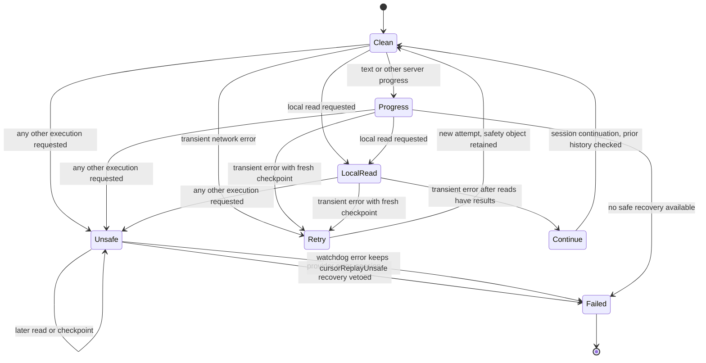
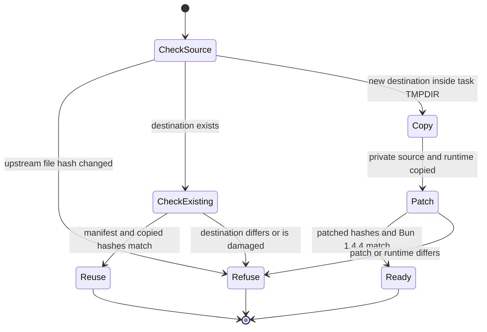
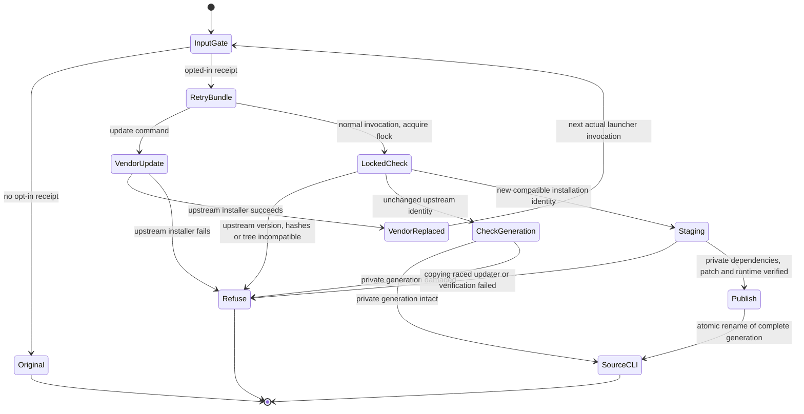
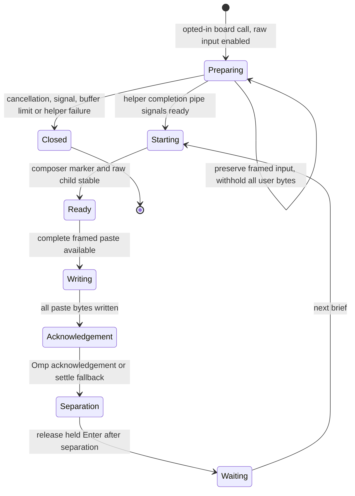

# Omp Cursor turn retry

The charts cover `scripts/omp_cursor_retry.patch`, its task-local proof copy
and the explicitly opted-in durable runner installed behind the input gate.

## One user turn

The provider sets `safety.unsafe` and `cursorReplayUnsafe` before
dispatching any execution other than local `readArgs`, `piReadArgs` or the
request context exchange. MCP, shell, write, delete, edit, grep, ls and
unknown execution frames are unsafe. A read path containing `://` is unsafe
too.

The checkpoint retry, HTTP/1 fallback and model id fallback receive the same
object. The next provider call also scans tool calls and message flags since
the most recent non-synthetic user message. Prior non-read calls keep the
turn unsafe.

Unsafe terminal errors carry `[Cursor retry blocked after non-read
execution]` and `cursorReplayUnsafe` into `agent-session.ts`. When the outer
watchdog in `register-builtins.ts` replaces a stalled stream's error, it
copies both from the last partial message. The agent-end handler stops a
flagged error or abort before credential handling, compaction or automatic
recovery, and the main `TurnRecovery` retry and continuation methods refuse
flagged messages. Safe completed-read
failures can continue through `turn-recovery.ts`.

## Task-local proof copy

## Durable launcher and upstream replacement

For opted-in interactive board calls, the outer gate creates its PTY and
enters raw input buffering while its child prepares the private generation.
The child helper signals a dedicated inherited pipe only after validation
and publication. The signal starts/rebases the existing startup and pending
input deadlines; only then can normal composer readiness advance delivery.
Bracketed-paste support is advertised after raw mode is established.
No opt-in still executes the original program through the ordinary gate.

`Preparing` uses the existing `startup`/parser buffers rather than a second
input path. Its completion signal is not composer readiness and does not
release Enter. The existing Cursor ordering model does not model this
preparation pipe, Omp's timed acknowledgement fallback or alias generation;
these boundaries require real task-local PTY and process-execution checks.

The bundle lives beside the managed gate, outside the vendor install. It
contains its own helper, patch and recorded source/runtime paths. Its
`update` branch delegates to the configured vendor binary with that
binary's directory first on PATH only for maintenance, avoiding the
upstream updater's PATH-based selection of the managed gate as its target.
Normal invocations preserve PATH. External reinstalls need no hook: the next
gate call detects changed tree identities and prepares a generation.

Preparation is serialized and publication is atomic, but the external
updater does not take the launcher lock. Changed upstream identity during
copying refuses rather than publishing a mixed snapshot. Complete old
generations remain available to already-running processes; new invocations
never fall back to them when upstream is incompatible. Uninstall restores
the original symlink and leaves inactive bundles and receipts.

The [verification skill](../../.agents/skills/verify-omp-cursor-retry/SKILL.md)
checks all eight combinations of the provider gate's three boolean inputs,
rejects a removed-unsafe-guard mutation, and names the runtime proofs for the
watchdog and the shared classifiers.
