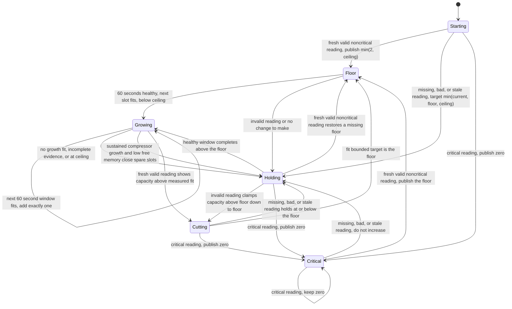
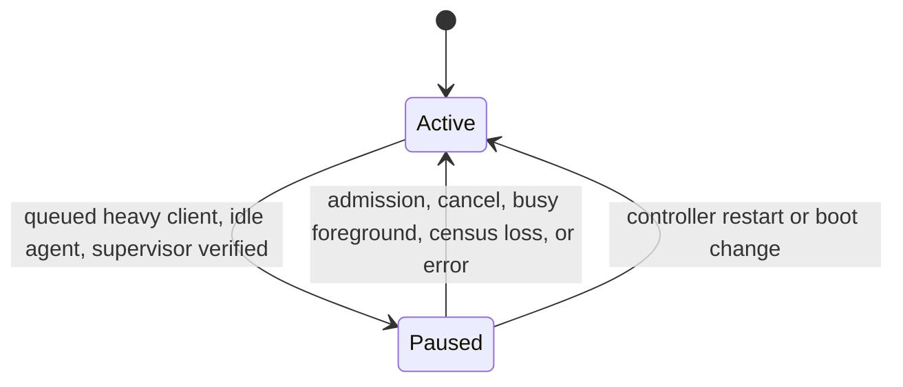
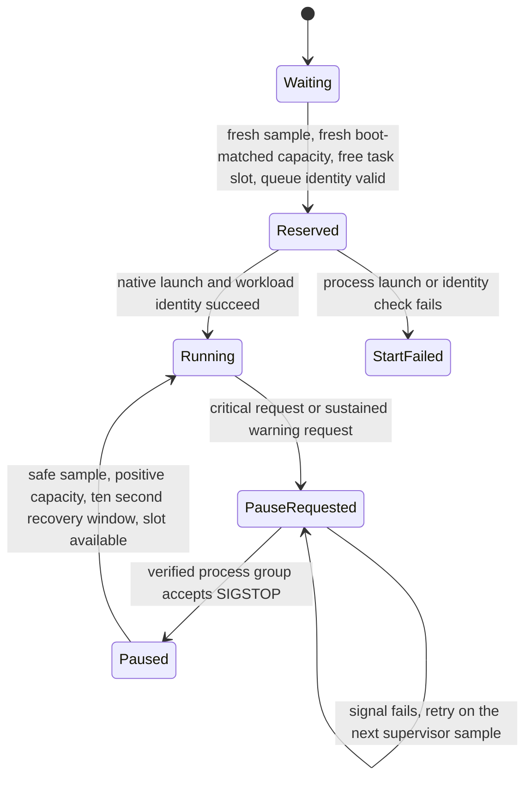

# Governor state chart

The controller publishes heavy capacity and updates the board admission limit on each five second tick. A fresh, noncritical sample restores the heavy floor of two slots in that tick. Separately, valid noncritical board readings restore a board floor of `min(board ceiling, max(6, active tasks + 1))`. Heavy capacity above two grows one slot after a 60 second healthy window and only when the next slot fits the CPU and memory budgets. Compressor growth vetoes heavy growth only after three consecutive high-growth samples when free memory is at or below the warning threshold. Board capacity above its floor grows one slot after a continuous healthy window and only when all pending board slots fit.

Each tick first calls the heavy registry reap. A job whose supervisor is gone is logged as `job-dead` and its slot is freed before the census runs.

The tick then checks for orphaned `CI-iPhone` simulators: any with simulator runtime processes and no live heavy `xcodebuild` job and no `xcodebuild` or `xctest` process naming them. An orphan seen on two consecutive ticks is cleaned up under the heavy registry lock, after the same check runs again. A booted orphan is shut down with `simctl shutdown`. An orphan with runtime processes but no `launchd_sim` process has those processes sent SIGTERM. The result is reported as `orphan_simulators_shutdown`. Other simulators are never touched.

## Heavy capacity



The heavy floor is restored to `min(2, ceiling)` on a fresh, valid, noncritical reading, even before the growth window completes. For a bad, missing, or stale reading, the controller targets `min(current, floor, ceiling)`: it cannot raise capacity and it can reduce capacity above the floor to the floor. The machine ceiling is the lower of physical CPU cores and physical memory divided by 6 GiB per heavy slot. The model bounds the ceiling to 2, 3, or 4 so TLC can explore every value in a small state space. The production controller uses the machine's measured ceiling.

The critical classifier is kernel pressure level 4, memory use at least 95 percent, or smoothed CPU busy at least 95 percent. The controller smooths CPU busy as the mean of its last three samples. Smoothed CPU busy at least 80 percent is a board warning. Load average is logged. Load per core at least 2 is critical only when the CPU reading is missing. Heavy admission still waits on raw CPU busy at or above 95 percent. Once the capacity file write succeeds, a critical tick writes urgent pause requests for all running heavy jobs before it queries or changes the board limit. The controller does not claim that the operating system has paused a process yet. The strict publication-failure model shows why the one-tick request guarantee depends on that write succeeding.

## Queued heavy work and idle agents

When a board agent's heavy client is in the admission queue, the agent process tree is idle, and no heavy job is running for that task, the controller pauses agent-side processes with `SIGSTOP` while leaving the verified heavy supervisor subtree running. Pauses resume with `SIGCONT` when the task leaves the queue, starts running heavy work, becomes busy with another foreground command, or when the controller restarts or hits an error. The pause is off by default (config `agent_heavy_wait_pause`); a disabled controller only records the disabled state and sends no signal, and controller startup still resumes anything an older version left paused. Pause state lives in `agent-heavy-wait-pause.json` and retries like workload pause requests.



## Queued heavy work



`StartFailed` is terminal for that invocation. The queue reservation has already been removed, so a failed native start cannot count as a job that eventually starts. The model keeps this outcome separate from admission and reports it as a liveness counterexample.

One CPU warning does not pause a job. Noncritical warnings must persist for 15 seconds before the supervisor asks to pause one running job, and warning pause requests are spaced by five seconds. Critical pressure bypasses both delays and requests pauses for all running jobs. A failed `SIGSTOP` keeps the pause request available for retry. The workload is paused, not killed, when native identity and signaling checks succeed.

## Board admission limit

On a critical tick with a successful capacity write, the controller records urgent heavy pause requests before querying or changing the board count. The local board setting itself is independent of the heavy worker signal path.

The model assumes the controller's default `board_control=True`. `--no-board-control` leaves heavy capacity publication enabled but skips board limit changes; that mode is outside the board policy checks below.

| Reading or event | Board limit target | Guard |
| --- | --- | --- |
| Fresh, valid, noncritical sample below floor | `min(ceiling, max(6, active + 1))` | May raise by more than one; this floor takes precedence over the above-floor step rule. |
| Limit below active tasks with ready floor and no host veto | `min(active, floor)` | Catch-up in one step. Raising the limit to the number of agents already running adds no load, so it needs no growth window or fit check. |
| Critical kernel pressure, memory use, or CPU | 0 | Kernel pressure level 4, memory use at least 95 percent, or smoothed CPU busy at least 95 percent takes precedence over every floor. Load per core at least 2 is critical only when the CPU reading is missing. |
| Missing `cpu_busy_pct` | Apply a fresh cached CPU reading to the critical and veto checks | Use the previous finite CPU reading when its age is at most `max_sample_age_seconds`. Load remains eligible as a critical fallback whenever the current CPU reading is missing. Without a fresh cache, CPU does not block, the decision records `cpu_busy_pct missing`, and memory, swap, and compressor vetoes still apply. |
| First warning in an episode | `max(floor, min(current // 2, active))` | A warning cannot cut below a ready floor. |
| Repeated warning in the episode | `max(floor, min(current, active))` | Hold the warning cut while the episode persists, but preserve the ready floor. |
| Healthy growth above floor | Current limit plus one | Fresh valid noncritical sample, 60 second healthy window, and memory/CPU fit for every pending board slot. |
| Missing, stale, unsafe, or slow sample | At most the current active task count | Never raise on incomplete evidence. |
| Task finishes | At most `max(active, floor)` when floor is ready | Close freed spare capacity and reset the healthy window. |

The board ceiling is the smaller of memory capacity after reserve divided by the per-agent budget (90th percentile of measured agent RSS times the configured cost margin, capped at 2 GiB), and CPU capacity after reserve divided by the 0.8 core agent budget. The floor may create several spare slots when it first restores from a low limit. Above the active count, each raise is exactly one and the fit check covers all slots pending between the current active count and the proposed limit. There is no one-spare cap that can override the floor.

Before writing a larger board limit, the controller rereads the limit and active task identities and checks that the sample remains fresh and the board response stays inside its time budget. A floor restoration may jump directly to the floor, and a catch-up may jump directly to the active count. Growth above the active count must be exactly one. The controller reads the setting back after each write.

`replay_controller.py --boardfloor` selects the captured controller row near Unix time `1793150983.444375` with board limit 0, six active tasks, and `await_healthy_window`. It replays the exact logged host, compressor, census, and board fields through `controller_tick()` with board commands mocked. The expected production result is a board floor of 7 in that tick. The output record preserves the source row under `source_fields`.

The bounded replay command is:

```bash
heavy /usr/bin/python3 -I replay_controller.py \
  --boardfloor ~/.local/state/mac-ops/controller.jsonl \
  --output /Users/shyamsivakumar/.herdr-projects/reports/mac-ops/2/controller-replays
```

## Transition guards in code

| Transition | Guard in the source |
| --- | --- |
| Capture the host reading | `sample_host()` requires all native readings to complete, parses the required fields, and rejects a sample that took more than three seconds to collect. The heavy admission path rejects samples older than 4.5 seconds. |
| Capture heavy census | A process identity change between the process table and RSS snapshots retries the entire census at most twice. Every attempt revalidates the registry and process identities. A persistent mismatch still fails closed, and a sample that ages out during retries cannot authorize growth. |
| Model boundary | The bounded governor model treats census validity as an input. It does not model process churn, RSS snapshots, or the bounded census retry. |
| Restore the heavy floor | `_capacity_decision()` requires a fresh valid sample before it applies `max(floor, adaptive_target)`. A bad or stale sample holds at most the current capacity and floor. The tick exception path (for example a census race) publishes 2 when the host sample is fresh, valid and noncritical, so a prior 0 cannot persist through repeated census failures. With a missing, partial or stale sample it republishes only the prior boot-matched capacity, capped at two. |
| Grow above two | `_adaptive_capacity_decision()` requires a 60 second healthy sample window, a valid compressor delta, measured active-job RSS when jobs are active, and candidate fit under CPU, memory reserve, and machine ceiling. Three consecutive above-threshold compressor deltas veto growth when free memory is at or below the warning threshold. An isolated burst does not reset the healthy window. |
| Cut or enter critical | A candidate that exceeds fit is reduced. The critical classifier sets the heavy target to zero regardless of the adaptive result. |
| Partial sample on failure | `sample_with_emergency()` attaches a partial sample only for kernel pressure level 4 or memory use of at least 95%. The load-average stand-in for a missing CPU reading does not apply to a partial sample, so a slow or stale collection holds capacity instead of writing 0. |
| Count board agents | `_admission()` drops a board task from `active` when its `task.json` has `archivedAt` set, has stage `done`, or its linked herdr socket is absent or refuses connections. Unreadable metadata keeps the task counted. |
| Request critical pauses | After a successful capacity write, `controller_tick()` calls `request_critical_pauses()`. The urgent registry update requests pauses for all running records with verified workload identities before the board control call. |
| Restore the board floor | `_board_control_tick()` requires a fresh valid noncritical reading and targets `min(ceiling, max(6, active + 1))`. This may exceed the current limit by more than one. With a ready floor and no host veto it also raises a limit below the active count to `min(active, floor)` in one step. |
| Update board limit above floor | `_board_control_tick()` checks warning episode, task identities, host and resource fit for all pending slots, 60 second growth window, sample age, board response time, and readback. Growth above the active count is exactly one. Catch-up to the active count is one step. |
| Admit a queued job | `_reserve_job()` requires the first eligible queue after deploy and review priority, ten-minute aging, same-task-active filtering, and the one-active-deploy limit, plus matching supervisor identity, positive boot-matched capacity, a fresh safe sample, and a free heavy slot. |
| Open the workload gate | `_launch_job()` starts the process behind a closed gate, verifies the workload identity, starts its watchdog, then opens the gate. Spawn or identity errors remain a separate failed outcome. |
| Apply a pause request | The supervisor checks the stored workload identity and process group before sending `SIGSTOP`. It retries if the signal cannot be confirmed. |

## Restart and failure events

| Event | Guard and effect | Model outcome |
| --- | --- | --- |
| Controller restart | At a tick boundary, discard the in-memory sample and start the next tick. The boot-matched capacity file and same-boot growth state remain. | `ControllerRestart` keeps published capacity and growth counters while resetting the volatile reading. |
| Mac reboot | Boot identity changes. Capacity from the previous boot becomes ineffective, and growth windows reset. | `HostReboot` changes boot identity and clears both growth counters. The bounded model allows reboot between job invocations. |
| Capacity expires | A missing, malformed, stale, or wrong-boot contract cannot authorize admission. | `ExpireCapacity` makes `CurrentSlots` zero while the last published slot value remains in the file. |
| Native start fails | Reservation and external process start are separate. A spawn, identity, watchdog, or gate failure is not successful liveness progress. | `ExternalStartFailure` reaches `failed`; `GovernorStrictStart.cfg` shows the queue liveness failure when this outcome is enabled. |
| Critical capacity write fails | Without the zero-capacity write, the controller does not reach the batch pause request action in that tick. | `GovernorStrictPublish.cfg` produces a critical-tick counterexample. |
| `SIGSTOP` fails | The recorded request remains pending and the supervisor retries. OS-level pause depends on verified identity and successful signaling. | `SignalDenied` and `RetrySignal` are distinct transitions. A permanent signal denial cannot satisfy paused-state liveness. |

The supervisor's 15-second warning hold and five-second spacing for warning pause requests are linked to source above but are not part of the TLC temporal model. Critical batch requests are modeled separately from supervisor sampling and signal outcomes.

The heavy decision and floor wrapper are in [board_governor.py](../../board_governor.py#L605) and [board_governor.py](../../board_governor.py#L761). The board policy is in [board_governor.py](../../board_governor.py#L814). Admission and native start outcomes are in [heavy.py](../../heavy.py#L1480) and [heavy.py](../../heavy.py#L2140). Critical pressure classification is in [heavy.py](../../heavy.py#L1452); batch requests and supervisor signaling are in [heavy.py](../../heavy.py#L1795), [heavy.py](../../heavy.py#L1904), and [heavy.py](../../heavy.py#L1914).

## TLA+ model and evidence

`formal/governor/Governor.tla` checks the decision and lifecycle guards. It initializes from the reported boot-matched zero-slot state, then captures fresh noncritical readings with candidate capacity available. `Policy = "legacy"` is a deliberate mutation that returns the adaptive target without the floor wrapper. Its floor invariant trace shows zero slots and a waiting job before the healthy window completes. A separate liveness trace alternates valid warning and healthy samples, all noncritical: the old window never completes, so the queued job never starts. This models the reported no-start mechanism; it is not a replay of the historical log. `Policy = "fixed"` applies the floor only to fresh valid noncritical readings, and the matching queue liveness configuration passes.

The model separates capacity publication, job admission, native start success or failure, critical pause requests, and operating-system pause outcomes. A process restart clears the volatile sample but retains the capacity file and same-boot growth state. A Mac reboot changes the boot identity, so the old capacity file is not effective and the growth window resets.

The model uses two abstract healthy steps for the 60 second growth window. Each healthy step represents six consecutive five second controller samples. This abstraction does not explore the placement of invalid readings inside those six samples. `DecidedGrowthStep` checks that every target above the current floor is exactly one slot higher and has a healthy sample, a complete window, and enough resource fit. In adversarial runs, the memory/CPU fit input uses the guard-equivalent representatives `0`, the current slot count, the next slot count capped at the machine ceiling, and the ceiling. These cover no fit, an exact-current fit, enough fit for one-slot growth, and full fit without enumerating every numeric measurement. The model does not verify the production conversion from raw memory and CPU readings into those fit classes.

The model treats compressor noise as an abstract veto and does not model the three-sample counter, the free-memory threshold, raw compressor rates, or elapsed time within an abstract step. It does not prove the new compressor guard. Captured-log replay and a sustained-growth scenario exercise the concrete controller separately.

The one modeled heavy job is preselected as the first eligible queue entry after production filtering and priority ordering; queue competition and the reviewer-priority ordering itself are not explored. The older `Governor.tla` board submodel is historical and uses two active tasks. `BoardFloor.tla` owns current board claims: it begins with six active tasks and a zero limit, checks same-tick restoration to seven, warning/healthy alternation liveness, critical zero, invalid no-raise, and one-step growth above the floor. It separates pre-write recheck, setter success or failure, and the scheduler starting one queued agent. Successful starts increment the active count; competing task races remain outside the bound. The board-floor replay exercises the current production code against the captured incident row. The model also uses one host reading for both controller publication and heavy admission, although the production processes sample independently. At a new controller tick, the model clears completed-cycle proof snapshots and pending targets after their invariants have been checked; it retains installed capacity, freshness, growth counters, board state, and queued-job state.

Queued-job liveness is conditional. The passing configuration assumes stable fresh healthy readings, candidate resource fit, a successful capacity write, valid native identity, an available task slot, no restart, and a successful native launch. Admission is strongly fair because the runner retries reservation on each sample while the job stays queued. The strict start configuration deliberately permits a native launch or identity failure and must show that an eligible job can fail instead of starting. The strict publication configuration permits the capacity write to fail on a critical sample and must show the matching failure of the one-tick critical guarantee.

The literal claim “no critical signal for one tick implies floor capacity and a queued job starts” is false when the reading is missing. A missing sample is not fresh and valid, so the fail-closed rule holds the zero-slot state and heavy admission cannot start a job. `GovernorStrictNoCriticalFloor.cfg` and `GovernorStrictNoCriticalStart.cfg` preserve this counterexample. The strongest useful liveness result assumes recurring fresh healthy samples, successful capacity publication, eligible identity, an available task slot, and a successful native launch. `GovernorLegacyNoStart.cfg`/`GovernorFixedNoStart.cfg` exercise the old/fixed queue-start liveness difference with alternating fresh noncritical warnings and healthy readings. A denied `SIGSTOP` does not erase the request, but a permanently denied signal cannot prove that the job reaches the paused state.

The rerun command is:

```bash
heavy /bin/bash formal/governor/check.sh
```

The checked controller chart is the Mermaid source in this page. TLC stdout, counterexamples, and state directories stay under the task `TMPDIR`; the runner does not copy model receipts into the repository. The PNG renderer is not installed, so this chart is provided as Mermaid source.
