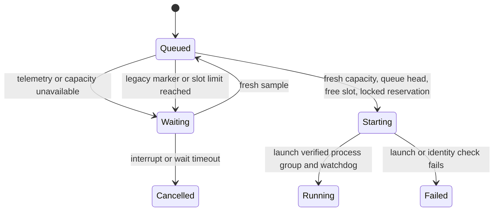
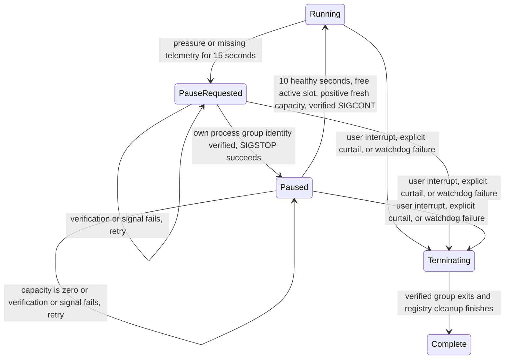

# Heavy workload state chart

## Admission

Review jobs sort ahead of ordinary queued jobs. Each queue entry stores the waiting process identity and is removed when that process exits or changes identity. Reservation and queue removal use the same registry lock. A new job cannot start while `legacy-registry.json` exists.

The first queued reviewer gets the next available admission. Existing workloads are not preempted to serve a reviewer.

The slot limit is the minimum of fresh controller `heavy_slots`, physical CPU cores, and whole 6 GiB units of physical memory. The controller contract must have an integer `heavy_slots`, a current Unix `updated_at`, and the current kernel `boot_id`. Missing, malformed, stale, or cross-boot capacity holds admission. The project lock is acquired after the global reservation, and the supervisor refreshes the registry heartbeat while waiting for it.

## Running and pause recovery

Only the registered workload's own isolated process group receives pause, resume, or termination signals. The supervisor stays outside that group and keeps the watchdog heartbeat current while the workload is paused. Host pressure and missing telemetry never trigger termination. Capacity zero blocks admission and resume, and capacity zero alone does not trigger a pause. Paused jobs remain in admission accounting. A resume also waits until the verified count of active nonpaused jobs is below the fresh slot limit.

While pressure continues, the registry permits one new pause request every 5 seconds. An unconfirmed request blocks duplicates until its owner retries. A paused ordinary job does not block selection of another running ordinary job, and reviewers are selected only after no ordinary workload remains running.

Ordinary direct `xcodebuild` commands keep the shared DerivedData rewrite and run through `/usr/sbin/taskpolicy -b`. Review commands keep the same project protections but do not receive background scheduling.
