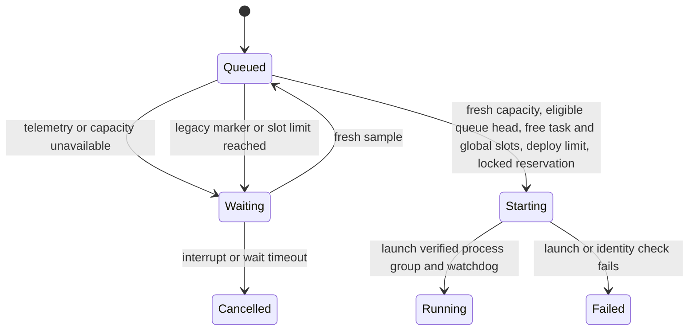
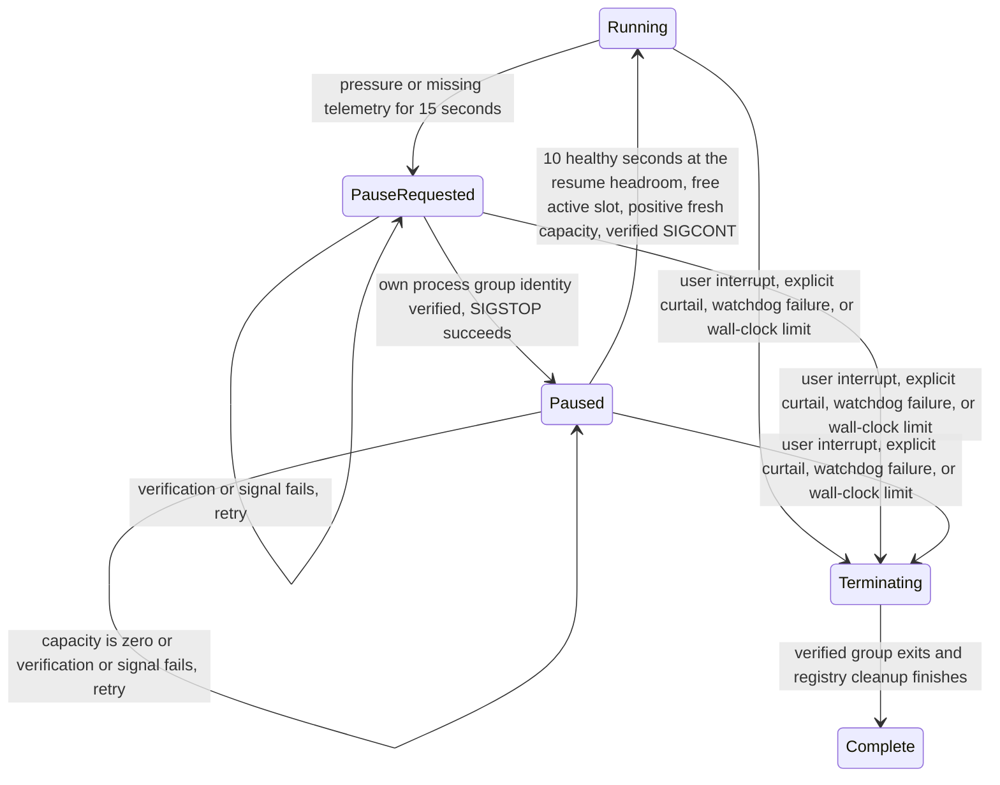
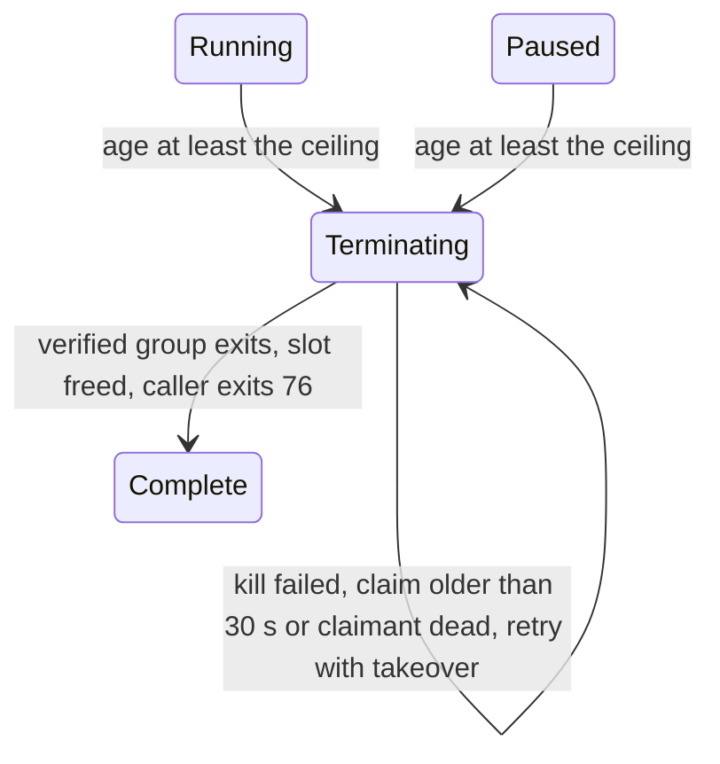

# Heavy workload state chart

## Admission

Deploy jobs sort ahead of reviews, and reviews sort ahead of ordinary jobs. After ten minutes in the queue, any job moves ahead of newer unaged jobs; aged jobs are ordered by arrival time. At most one deploy job may be active, including a paused or starting deploy. Another deploy waits without blocking eligible non-deploy work. Existing workloads are not preempted.

Each queue entry stores the waiting process identity and is removed when that process exits or changes identity. Reservation and queue removal use the same registry lock. A new job cannot start while `legacy-registry.json` exists.

The governor tick calls the registry reap on every sample, under the registry lock and only for records from the current boot. A running or starting job whose supervisor identity (pid, uid, start time) is gone, and whose workload group has no live members, is logged once as `job-dead` and its slot is freed in that tick. A live job or a reused pid is never reaped.

Before submitting deploy gates after installation, drain all queued supervisors from the previous release. Older supervisors reject deploy queue records and can fail their own waiting commands if a deploy is queued.

The slot limit is the minimum of fresh controller `heavy_slots`, physical CPU cores, and whole 6 GiB units of physical memory. The controller contract must have an integer `heavy_slots`, a current Unix `updated_at`, and the current kernel `boot_id`. Missing, malformed, stale, or cross-boot capacity holds admission. The project lock is acquired after the global reservation, and the supervisor refreshes the registry heartbeat while waiting for it.

## Running and pause recovery

## Runtime limit

Every job has a wall-clock ceiling of 45 minutes for every role, stored in its registry record when it is admitted. `HEAVY_MAX_RUNTIME_SECONDS` may lower the ceiling and never raises it. The ceiling counts from the moment the workload starts and includes time spent paused and time the Mac spends asleep, because it is measured on `CLOCK_MONOTONIC`, which keeps counting during sleep on Darwin. A record without a stored ceiling or start time uses 45 minutes from its creation. After install, any heavy call therefore ends builds already past the ceiling, and records created before the change get the 45-minute default counted from their creation. A job whose workload boot identity differs from the current boot is skipped.

Two independent processes enforce the ceiling. Each job's own watchdog enforces its job, so a wedged supervisor cannot hold a slot. Every `heavy` command, including `status` and `request-curtail`, also enforces it for all records. A supervisor never terminates other jobs inline, because the SIGTERM grace period would stall its own heartbeat and the watchdog would then kill a healthy job. Enforcement is best effort: a bad or vanished record, a failed `ps`, or a lock timeout is skipped and never fails the heavy command.

The enforcer claims the termination under the registry lock with `_claim_termination` (reason `wall-clock limit`), signals the verified process group with SIGTERM and then SIGKILL after the grace period, and marks the record complete only after the kill is confirmed, which frees the slot. A job left `terminating` by a failed kill is retried with takeover when its claim is older than 30 seconds or its claimant process is dead. A second enforcer that finds a fresh claim does nothing, and takeover is a compare-and-swap on the claimant and claim times it observed. The watchdog's stale-heartbeat recovery, and its fallback kill, also defer to a limit claim whose claimant is alive and younger than 30 seconds, and exit once the record is complete.

The supervisor of a terminated job prints `heavy: terminated: wall-clock limit 45m` and exits with code 76. Other heavy codes are 75 (refused or timed out waiting), 74 (local state failure), 125 (curtailed) and 130 (interrupted).

Memory headroom (free, inactive and speculative pages) has a dead band so a job does not flip near one line. A running job counts headroom as low only below `max(host headroom, 12.5% RAM)`. A paused job resumes only at `max(host headroom, 15% RAM)` or more. The host headroom is 6 GiB unless the installed `board_governor.json` names this host in `min_headroom_bytes_by_host`: the 16 GB MacBook Pro uses 2 GiB, so it needs 2.4 GiB to start or resume and pauses below 2 GiB, while the 48 GB Mac keeps the 6 GiB floor. Host names in that map are matched without regard to case, and two names that differ only by case are ambiguous and rejected, so that host keeps the default floor. A short-name fallback is allowed only when either the configured name or the observed hostname is unqualified, so `builder.lab` never lowers the floor of `builder.office`. On this 48 GB Mac that is 6.0 GiB to pause and 7.2 GiB to resume; the previous single line was 9.6 GiB, and measured headroom at normal load was 7.8 to 9.8 GiB, so jobs flipped. Critical kernel pressure, swap growth and a level 2 reading at or below 30% free still count as pressure at either state, and critical pressure still pauses at once.

Only the registered workload's own isolated process group receives pause, resume, or termination signals. The supervisor stays outside that group and keeps the watchdog heartbeat current while the workload is paused. Host pressure and missing telemetry never trigger termination. Capacity zero blocks admission and resume, and capacity zero alone does not trigger a pause. Paused jobs remain in admission accounting. A resume also waits until the verified count of active nonpaused jobs is below the fresh slot limit.

While pressure continues, the registry permits one new pause request every 5 seconds. An unconfirmed request blocks duplicates until its owner retries. A paused ordinary job does not block selection of another running ordinary job, and reviewers are selected only after no ordinary workload remains running.

Ordinary direct `xcodebuild` commands keep the shared DerivedData rewrite and run through `/usr/sbin/taskpolicy -b`, unless the installed `board_governor.json` lists this host in `foreground_build_hosts`. A listed host (the build-only 16 GB MacBook Pro) launches ordinary `xcodebuild` at normal priority so builds can use the performance cores; macOS can't lift a running job out of background mode, so the choice applies at launch. Host names in that list use the same matching as `min_headroom_bytes_by_host`: case-insensitive, names that differ only by case are rejected, and short-name fallback only when the configured or observed name is unqualified. A missing or invalid config, or an unlisted host, keeps `taskpolicy -b`. Review commands keep the same project protections but do not receive background scheduling.

Critical kernel pressure, memory use at least 95%, or load per core at least 2 with a missing CPU reading requests pauses for all registered running workloads immediately. The controller writes those requests before board queries, and each supervisor retries its own verified group signal. Raw CPU busy at or above 95% is a noncritical warning for a supervisor: it must persist for the 15-second sustained window before a pause request. The controller's smoothed CPU busy at or above 95% is critical.

A partial sample from a failed collection (`sample_with_emergency`) counts as critical only for pressure level 4 or memory use of at least 95%. The load-average stand-in for a missing CPU reading does not apply to that partial path (`critical_pressure(..., load_proxy=False)`), so a slow or stale collection holds capacity instead of writing 0 slots. The tick exception path republishes 2 when a fresh valid noncritical sample is available, so a prior 0 cannot stick through repeated census races.
