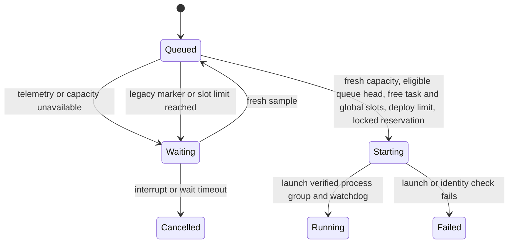
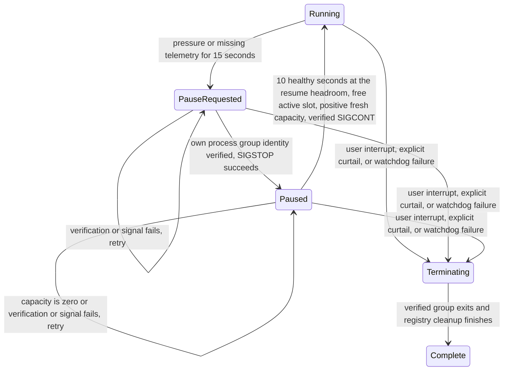
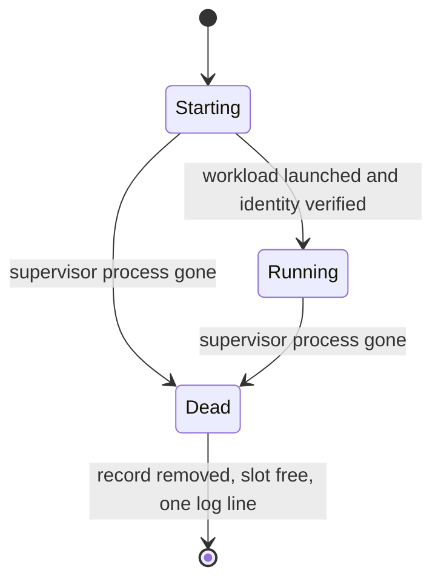

# Heavy workload state chart

## Admission

Deploy jobs sort ahead of reviews, and reviews sort ahead of ordinary jobs. After ten minutes in the queue, any job moves ahead of newer unaged jobs; aged jobs are ordered by arrival time. At most one deploy job may be active, including a paused or starting deploy. Another deploy waits without blocking eligible non-deploy work. Existing workloads are not preempted.

Each queue entry stores the waiting process identity and is removed when that process exits or changes identity. Reservation and queue removal use the same registry lock. A new job cannot start while `legacy-registry.json` exists.

Before submitting deploy gates after installation, drain all queued supervisors from the previous release. Older supervisors reject deploy queue records and can fail their own waiting commands if a deploy is queued.

The slot limit is the minimum of fresh controller `heavy_slots`, physical CPU cores, and whole 6 GiB units of physical memory. The controller contract must have an integer `heavy_slots`, a current Unix `updated_at`, and the current kernel `boot_id`. Missing, malformed, stale, or cross-boot capacity holds admission. The project lock is acquired after the global reservation, and the supervisor refreshes the registry heartbeat while waiting for it.

## Running and pause recovery

Memory headroom (free, inactive and speculative pages) has a dead band so a job does not flip near one line. A running job counts headroom as low only below `max(host headroom, 12.5% RAM)`. A paused job resumes only at `max(host headroom, 15% RAM)` or more. The host headroom is 6 GiB unless the installed `board_governor.json` names this host in `min_headroom_bytes_by_host`: the 16 GB MacBook Pro uses 2 GiB, so it needs 2.4 GiB to start or resume and pauses below 2 GiB, while the 48 GB Mac keeps the 6 GiB floor. Host names in that map are matched without regard to case, and two names that differ only by case are ambiguous and rejected, so that host keeps the default floor. A short-name fallback is allowed only when either the configured name or the observed hostname is unqualified, so `builder.lab` never lowers the floor of `builder.office`. On this 48 GB Mac that is 6.0 GiB to pause and 7.2 GiB to resume; the previous single line was 9.6 GiB, and measured headroom at normal load was 7.8 to 9.8 GiB, so jobs flipped. Critical kernel pressure, swap growth and a level 2 reading at or below 30% free still count as pressure at either state, and critical pressure still pauses at once.

Only the registered workload's own isolated process group receives pause, resume, or termination signals. The supervisor stays outside that group and keeps the watchdog heartbeat current while the workload is paused. Host pressure and missing telemetry never trigger termination. Capacity zero blocks admission and resume, and capacity zero alone does not trigger a pause. Paused jobs remain in admission accounting. A resume also waits until the verified count of active nonpaused jobs is below the fresh slot limit.

While pressure continues, the registry permits one new pause request every 5 seconds. An unconfirmed request blocks duplicates until its owner retries. A paused ordinary job does not block selection of another running ordinary job, and reviewers are selected only after no ordinary workload remains running.

Ordinary direct `xcodebuild` commands keep the shared DerivedData rewrite and run through `/usr/sbin/taskpolicy -b`. Review commands keep the same project protections but do not receive background scheduling.

Critical kernel pressure, memory use at least 95%, or load per core at least 2 with a missing CPU reading requests pauses for all registered running workloads immediately. The controller writes those requests before board queries, and each supervisor retries its own verified group signal. Raw CPU busy at or above 95% is a noncritical warning for a supervisor: it must persist for the 15-second sustained window before a pause request. The controller's smoothed CPU busy at or above 95% is critical.

A partial sample from a failed collection (`sample_with_emergency`) counts as critical only for pressure level 4 or memory use of at least 95%. The load-average stand-in for a missing CPU reading does not apply to that partial path (`critical_pressure(..., load_proxy=False)`), so a slow or stale collection holds capacity instead of writing 0 slots. The tick exception path republishes 2 when a fresh valid noncritical sample is available, so a prior 0 cannot stick through repeated census races.

## Dead jobs and simulator cleanup

A supervisor is gone when its recorded pid, uid, and start token no longer match the process table for the current boot. The governor checks this on every tick, removes the record so the slot is free on the next admission decision, and logs one `job-dead` line. A live supervisor is never removed, and the check uses the recorded boot id so a pid from another boot cannot match.

A simulator job records the booted simulator devices before it starts, and the devices its arguments name (a `-destination` that names a device by `id` or by name, or a device identifier or device name given to `simctl boot` or `simctl bootstatus -b`; any other `simctl` subcommand names nothing, and a device identifier anywhere else, such as in an output path, names nothing). When the job ends on any outcome, heavy shuts down the devices that the job booted, which are the devices the job named, that were not booted when the job started, and whose launchd process started while the job ran. A device the job did not name, such as a simulator a person booted during the build, is never shut down. A device with a live process outside the simulator infrastructure that names its identifier, such as Simulator.app with `-CurrentDeviceUDID` or a person's `simctl` command, is in use by someone else and is never shut down. Heavy reads the process table again right before each shutdown for this check, and the cleanup process and its parents do not count. A job whose device list could not be read records its booted baseline as unknown, shuts nothing down, and keeps every device on for any other job's cleanup while it runs. A device that another running job may use is left alone, so a job never shuts down a simulator another job holds. A simulator job reads the booted devices and writes them to its record under the simulator lock, and job-end cleanup holds the same lock from its check of competing jobs through the shutdown, so a job cannot take a device between the check and the shutdown. A device the job booted that another running job may still use stays on and is recorded in the registry's pending file (`simulators-pending.json`, with the boot time of the device); every simulator job that ends checks that file, and the last job to release a pending device shuts it down, unless the device is no longer booted, booted again since it was recorded, or has a live process outside the simulator infrastructure that names it. A device whose shutdown fails while it stays booted keeps its pending entry (or gets one), so the next simulator job that ends retries it; the entry leaves the file only when the shutdown succeeds or a fresh device read shows the device is no longer booted. A job is a simulator job only when it runs `xcodebuild` or `simctl` as its executable or as the tool `xcrun` runs after its own options, so a script that only receives `xcodebuild` as an argument is not one. A job whose arguments show it may use simulators, including `xcrun simctl`, is marked as a simulator job on its record before it waits for its project lock or launches. A competing simulator job that has no record of booted devices, whether it has not recorded yet or the simulator lock timed out, keeps every device on. On every governor tick heavy also stops the simulator processes that belong to no booted device. A process counts as a simulator process only when its own executable is the simulator launchd, lives in a device data directory, or lives in a simulator runtime, so a process that merely names a simulator path in its arguments is never stopped. A runtime process below a simulator launchd whose executable cannot be read has an unknown owner and is never stopped. It is an orphan when its owning device is not booted, or when it is a runtime process with no simulator launchd above it and a parent chain that ends at pid 1. The process table and the booted devices are read again right before the first signal and right before SIGKILL, and the process identity and its device state are checked again immediately before each single signal, and every signal goes only to a process whose uid and start token were read with its classification and that started before the process listing, so a reused pid is never hit. A signal that fails is not counted as a stopped process. A process of a booted device is never stopped.

