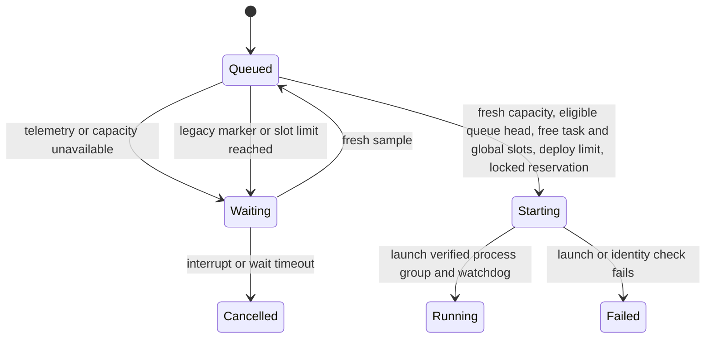
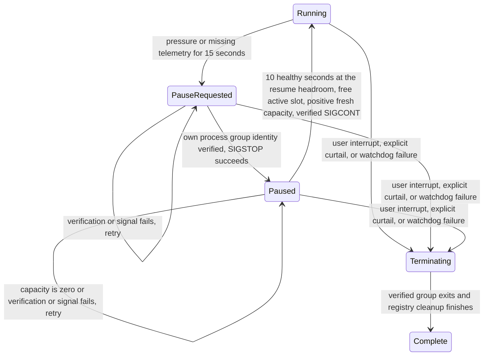

# Heavy workload state chart

## Admission

Deploy jobs sort ahead of reviews, and reviews sort ahead of ordinary jobs. After ten minutes in the queue, any job moves ahead of newer unaged jobs; aged jobs are ordered by arrival time. At most one deploy job may be active, including a paused or starting deploy. Another deploy waits without blocking eligible non-deploy work. Existing workloads are not preempted.

Each queue entry stores the waiting process identity and is removed when that process exits or changes identity. Reservation and queue removal use the same registry lock. A new job cannot start while `legacy-registry.json` exists.

Before submitting deploy gates after installation, drain all queued supervisors from the previous release. Older supervisors reject deploy queue records and can fail their own waiting commands if a deploy is queued.

The slot limit is the minimum of fresh controller `heavy_slots`, physical CPU cores, and whole 6 GiB units of physical memory, so a 16 GiB host keeps the same two job limit as before. The controller contract must have an integer `heavy_slots`, a current Unix `updated_at`, and the current kernel `boot_id`. Missing, malformed, stale, or cross-boot capacity holds admission. The project lock is acquired after the global reservation, and the supervisor refreshes the registry heartbeat while waiting for it.

A sample the governor cannot read holds the capacity it already published (`min(current, ceiling)`), and the tick exception path republishes `min(prior_capacity, 2)`, so a telemetry error does not write zero slots and the next good sample restores the slots. The load-average stand-in for a missing CPU reading still applies to the capacity decision, the running-workload pause and the critical curtailment.

## Headroom a job needs

A job needs headroom to start: `max(6 GiB, 15% of RAM)` on a host with 24 GiB or more of memory, and 15% of the host's memory with a 2 GiB floor on a smaller host. A 16 GiB host therefore needs 2.4 GiB instead of 6 GiB, so one iOS build fits beside the simulator it drives. On a smaller host the simulator a job drives is that job's own memory: the resident bytes of that simulator's own processes count towards the headroom the job needs to start, capped at an eighth of the host's memory. A running job pauses below `max(6 GiB, 12.5% of RAM)` and resumes above `max(6 GiB, 15% of RAM)` on every host, so the 16 GiB host pauses at 6 GiB as it did before. The 2.4 GiB figure is the admission threshold on a 16 GiB host only.

The simulator credit and the one-build-at-a-time rule read the same executable: the one the command actually runs, which is the command the supervisor was given, before `heavy` wraps it in `taskpolicy`. A wrapper that runs `xcodebuild`, such as `env xcodebuild` or `env -S "xcodebuild build"`, is that build: it claims the simulator credit and is excluded from starting beside another build. A program that only mentions `xcodebuild` as an argument is an ordinary workload, claims no simulator credit, and is not excluded from a running build. How a command is executed does not change: only a command that runs `xcodebuild` directly is a project build and only that one is wrapped in `taskpolicy`.

## Running and pause recovery

Memory headroom (free, inactive and speculative pages) has a dead band so a job does not flip near one line. A running job counts headroom as low below `max(6 GiB, 12.5% RAM)` on every host, and a paused job resumes only at `max(6 GiB, 15% RAM)` or more, so the running thresholds are the same as before on every host. On this 48 GB Mac that is 6.0 GiB to pause and 7.2 GiB to resume; the previous single line was 9.6 GiB, and measured headroom at normal load was 7.8 to 9.8 GiB, so jobs flipped. Critical kernel pressure, swap growth and a level 2 reading at or below 30% free still count as pressure at either state, and critical pressure still pauses at once.

Only the registered workload's own isolated process group receives pause, resume, or termination signals. The supervisor stays outside that group and keeps the watchdog heartbeat current while the workload is paused. Host pressure and missing telemetry never trigger termination. Capacity zero blocks admission and resume, and capacity zero alone does not trigger a pause. Paused jobs remain in admission accounting. A resume also waits until the verified count of active nonpaused jobs is below the fresh slot limit.

While pressure continues, the registry permits one new pause request every 5 seconds. An unconfirmed request blocks duplicates until its owner retries. A paused ordinary job does not block selection of another running ordinary job, and reviewers are selected only after no ordinary workload remains running.

Ordinary direct `xcodebuild` commands keep the shared DerivedData rewrite and run through `/usr/sbin/taskpolicy -b`. Review commands keep the same project protections but do not receive background scheduling.

Critical kernel pressure, memory use at least 95%, or load per core at least 2 with a missing CPU reading requests pauses for all registered running workloads immediately. The controller writes those requests before board queries, and each supervisor retries its own verified group signal. Raw CPU busy at or above 95% is a noncritical warning for a supervisor: it must persist for the 15-second sustained window before a pause request. The controller's smoothed CPU busy at or above 95% is critical.

A partial sample from a failed collection (`sample_with_emergency`) counts as critical only for pressure level 4 or memory use of at least 95%. The load-average stand-in for a missing CPU reading does not apply to that partial path (`critical_pressure(..., load_proxy=False)`), so a slow or stale collection holds capacity instead of writing 0 slots. The tick exception path republishes 2 when a fresh valid noncritical sample is available, so a prior 0 cannot stick through repeated census races.
