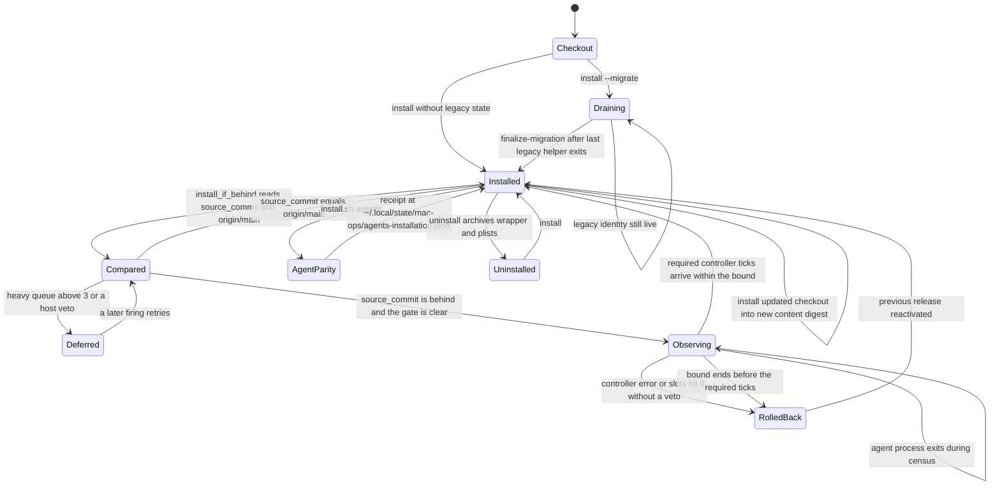

# Installation and migration

`scripts/install_if_behind.py` is the install automation's decision. It treats
the receipt `source_commit` as behind only when that full commit is an ancestor
of `origin/main`. A matching checkout HEAD does not count. A heavy queue above
3 or a host veto defers. After install it watches the controller until the
required ticks arrive or the bound ends. The bound is three minutes from the
start of observation (twelve ticks at one per fifteen seconds). An agent whose
foreground process exits during the census is normal churn and stays in
observation. A controller error, a heavy error, any other census error, or
board slots at 0 without a veto reactivates the previous release. The same
rollback happens when the bound ends without enough ticks or the controller
status is stale.

Installation copies an explicit source allowlist into a private runtime
directory and writes each file atomically. It does not replace files used
by existing runtime versions. Migration blocks new admission before
changing old entry points. Old private bootstrap and watchdog calls keep
the original implementation until its supervisors finish.

Finalization requires no surviving legacy supervisor, workload or helper
identity. It retains old job state as history before moving the admission
marker aside. The caller must verify reference inventory and board worker
instructions separately before archiving the old folder. Uninstall
preserves runtime files and state.
