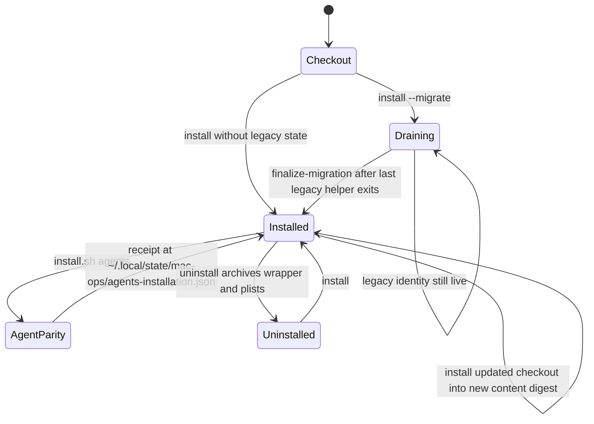

# Installation and migration

Installation copies an explicit source allowlist into a private runtime
directory and writes each file atomically. It does not replace files used
by existing runtime versions. Migration blocks new admission before
changing old entry points. Old private bootstrap and watchdog calls keep
the original implementation until its supervisors finish.

Finalization requires no surviving legacy supervisor, workload or helper
identity. It retains old job state as history before moving the admission
marker aside. The caller must verify reference inventory and board worker
instructions separately before archiving the old folder. Uninstall
preserves runtime files and state.
