# Omp input lifecycle

```mermaid
stateDiagram-v2
    [*] --> Original: Not a supported interactive board launch
    Original --> [*]: Vendor exit
    [*] --> Preparing: Opted-in board launch, raw input enabled
    Preparing --> Preparing: Buffer input while child validates private generation
    Preparing --> Starting: Dedicated helper pipe signals completion; start deadlines
    Preparing --> Closed: Cancellation, signal, buffer limit or helper failure
    [*] --> Starting: Non-opted-in board launch in task temp with HERDR_ENV
    Starting --> Starting: Queue keyboard input and relay terminal replies
    Starting --> Ready: Omp footer model marker and raw input stable 250 ms
    Ready --> Ready: Wait for one complete bracketed paste
    Ready --> Writing: Queue preserved first paste
    Writing --> Writing: Drain partial PTY writes
    Writing --> Acknowledgement: Last paste byte written
    Acknowledgement --> Separation: Draft suffix, paste receipt, or settle timeout
    Separation --> Waiting: 300 ms after ack; release held input
    Waiting --> Starting: Re-arm composer readiness for next paste
    Starting --> Ready: Footer model marker and raw input stable 250 ms
    Ready --> Ready: Wait for one complete bracketed paste
    Ready --> Writing: Queue preserved first paste
    Writing --> Writing: Drain partial PTY writes
    Writing --> Acknowledgement: Last paste byte written
    Acknowledgement --> Separation: Draft suffix, paste receipt, or settle timeout
    Separation --> Waiting: 300 ms after ack; release held input
    Waiting --> Closed: Vendor exits or terminal closes
    Starting --> Closed: Deadline, cancellation, signal or I/O failure
    Ready --> Closed: Partial input deadline or invalid framing
    Writing --> Closed: Deadline, buffer limit, cancellation or I/O failure
    Acknowledgement --> Closed: Deadline, cancellation or I/O failure
    Separation --> Closed: Cancellation or I/O failure
    Closed --> [*]: Restore terminal and close PTY before bounded child cleanup
```

The gate advertises bracketed-paste support only after entering raw mode.
Opted-in preparation reuses the same startup/parser buffers; a completion
pipe starts the existing deadlines but is not composer readiness. See the
[durable retry chart](cursor-retry.md#durable-launcher-and-upstream-replacement).

Readiness markers are assumptions about Omp's TUI output. Run the live
board smoke flow in [omp-input-gate.md](../omp-input-gate.md) when
changing markers or launch arguments.
