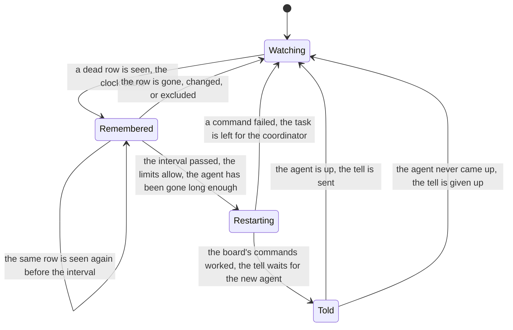

# Board restart state chart

The controller watches the board once a minute. A row whose agent is gone is remembered; the same row seen again a minute later is handed to the next agent of the cycle and told what happened. The board keeps the branch, the worktree and the wait the task had.

## What the watcher reads

| Source | What it answers |
| --- | --- |
| `herdr-projects list --json` | the row's state, stage and message |
| `data/tasks/<repo>/<n>/task.json` | the agent that failed, the wait the task has, the time the agent went, the failure the board saved |
| `herdr pane list` | the agent running in a pane, and which conversation it is |

## Dead agent signatures

| The row says | Signature | What the watcher runs |
| --- | --- | --- |
| `The agent has exited` (stage `working`) | `agent_exited` | `stop`, then `delegate --worker.agent <next>` |
| `Could not start: ...` (stage `failed`, failure `start` or `setup`) | `could_not_start` | `stop`, then `delegate --worker.agent <next>` |
| `Not started: its instructions sit unsent in its box` (stage `failed`, failure `send`) | `not_started` | `set worker.agent <next> --task <id>`, then `retry` |
| `Has not started yet: pressing enter again` (stage `working`) | `has_not_started_yet` | `stop`, then `delegate --worker.agent <next>` |

The unsent row is the board's own restart: the program that never took the text is ended and started again with the same text, on the agent the cycle names. The other three stop the dead agent first, because the board refuses a delegate while an agent stage is set.

## The cycle

`omp/openai-codex/gpt-6.1-terra`, `codex/gpt-6.1-terra`, `claude`. The agent that failed is skipped. When the failed agent is not in the cycle, the watcher's cursor names the agent to use, and the cursor moves on with every restart.

## What is never touched

A task that is archived, research only, blocked on a question, in review, finishing, or in any stage that is not the agent's own turn. A `Could not start` whose cause is the machine rather than the agent (`herdr did not answer`, the shell was not ready, the start was cut off, the terminal was not at its prompt, the agent did not come up within a minute, the folder is not a git repository).

## Limits

| Limit | Value |
| --- | --- |
| The same row seen again before it is restarted | 60 seconds |
| An agent that has been gone for less than | 90 seconds |
| Restarts of one task in an hour | 3 |
| Restarts on the whole board in an hour | 6 |
| The tell waits for the new agent to be up | 20 seconds |
| The tell is given up after | 15 minutes |

The watcher keeps its own state in `board-restart.state.json`: the signature and the time each dead row was first seen, the restarts of each task in the last hour, the cursor of the cycle and the tell that is waiting for its agent.

The config switch `agent_restart` (on by default) turns the watcher off. With it off, the controller records the disabled state and touches no task.
