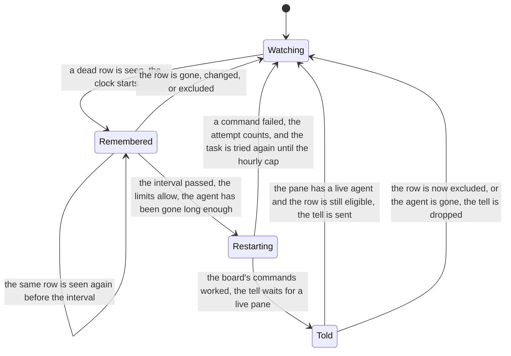

# Board restart state chart

The controller watches the board once a minute. A row whose agent is gone is remembered; the same row seen again a minute later is handed to the next model in the board's order and told what happened. The branch and the worktree stay. A wait the task had is put back after the new agent is started.

## What the watcher reads

| Source | What it answers |
| --- | --- |
| `herdr-projects list --json` | the row's state, stage and message |
| `herdr-projects show --json` | the order: `worker.agent`, then each `worker.fallback` |
| `data/tasks/<repo>/<n>/task.json` | the model that failed, the wait the task has, the time the agent went, the failure the board saved |
| `herdr pane list` | the agent running in a pane, and which conversation it is |

## Dead agent signatures

| The row says | Signature | What the watcher runs |
| --- | --- | --- |
| `The agent has exited` (stage `working`) | `agent_exited` | `stop`, `archive`, `restore`, `delegate --worker.agent <next>`, then `after` if the task had a wait |
| `Could not start: ...` (stage `failed`, failure `start` or `setup`) | `could_not_start` | the same commands |
| `Not started: its instructions sit unsent in its box` (stage `failed`, failure `send`) | `not_started` | the same commands |
| `Has not started yet: pressing enter again` (stage `working`) | `has_not_started_yet` | the same commands |

`stop` on its own leaves the old omp process and its model. Archive and restore clear that, and the delegate starts a fresh agent on the next model. The wait is read before those commands and, when the task had one, put back with `after`.

## The order

Read each pass from `herdr-projects show --json`: `worker.agent`, then `worker.fallback`, in that order. Nothing in the watcher hardcodes the list. The model that failed is skipped. When the failed model is not in the order, the watcher's cursor names the model to use, and the cursor moves on with every restart.

## What is never touched

A task that is archived, research only, blocked on a question, in review, finishing, or in any stage that is not the agent's own turn. A `Could not start` whose cause is the machine rather than the agent (`herdr did not answer`, the shell was not ready, the start was cut off, the terminal was not at its prompt, the agent did not come up within a minute, the folder is not a git repository).

## Limits

| Limit | Value |
| --- | --- |
| The same row seen again before it is restarted | 60 seconds |
| An agent that has been gone for less than | 90 seconds |
| Restarts of one task in an hour | 3, and a restart whose command failed counts |
| Restarts on the whole board in an hour | 6, and a restart whose command failed counts |
| The tell waits for a live agent in the task's pane | 20 seconds |
| The tell is given up after | 15 minutes |

The watcher keeps its own state in `board-restart.state.json`: the signature and the time each dead row was first seen, the restarts of each task in the last hour, the cursor of the cycle and the tell that is waiting for its agent.

The config switch `agent_restart` (on by default) turns the watcher off. With it off, the controller records the disabled state and touches no task.
