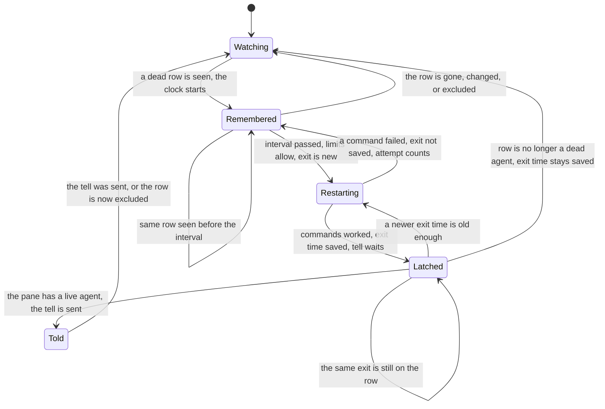

# Board restart state chart

The controller watches the board once a minute. A row whose agent is gone
is remembered. The same row seen a minute later goes to the next model in
the board's order, and that model is told what happened. The branch and
the worktree stay. A wait the task had is put back after the new agent
starts.

## What the watcher reads

| Source | What it answers |
| --- | --- |
| `herdr-projects list --json` | row state, stage, message |
| `herdr-projects show --json` | order: `worker.agent`, `worker.fallback` |
| `data/tasks/<repo>/<n>/task.json` | failed model, wait, exit time, failure |
| `herdr pane list` | the agent in a pane, and its conversation |

## Dead agent signatures

| The row says | Signature |
| --- | --- |
| `The agent has exited` or `...is gone` (working, error) | `agent_exited` |
| `Could not start: ...` (failed: `start`, `setup`) | `could_not_start` |
| `Not started: ...unsent in its box` (failed: `send`) | `not_started` |
| `Has not started yet: ...` (working) | `has_not_started_yet` |

Every signature runs `stop`, `archive`, `restore`,
`delegate --worker.agent <next>`, then `after` if the task had a wait.

`stop` on its own leaves the old omp process and its model. Archive and
restore clear that, and the delegate starts a fresh agent on the next
model. The wait is read before those commands and, when the task had one,
put back with `after`.

## The order

Read for each restart from `herdr-projects show --json`: `worker.agent`,
then `worker.fallback`, in that order. Nothing in the watcher hardcodes
the list. The model that failed is skipped. When the failed model is not
in the order, the watcher's cursor names the model to use, and the cursor
moves on with every restart.

## What is never touched

A task that is archived, research only, blocked on a question, in review,
finishing, or in any stage that is not the agent's own turn. A
`Could not start` whose cause is the machine rather than the agent
(`herdr did not answer`, the shell was not ready, the start was cut off,
the terminal was not at its prompt, the agent did not come up within a
minute, the folder is not a git repository).

## Limits

| Limit | Value |
| --- | --- |
| The same row seen again before it is restarted | 60 seconds |
| An agent that has been gone for less than | 90 seconds |
| Restarts of one task per hour | 3, failed commands count |
| Restarts on the whole board per hour | 6, failed commands count |
| The tell waits for a live agent in the pane | 20 seconds |
| The tell is given up after | 15 minutes |

| State | Event | Guard | Side effect |
| --- | --- | --- | --- |
| Remembered | minute tick | same signature, under 60 seconds | none |
| Restarting | minute tick | see below | the restart commands |
| Latched | commands succeeded | signature is `agent_exited` | save exit |
| Remembered | a command failed | any step not ok | count attempt |
| Told | pane is live | see below | `herdr-projects tell` |
| Latched | same exit again | `restarted_exit` is this `exitedAt` | none |

Restarting guard: 60 seconds have passed, the exit is at least 90 seconds
old, both hourly caps allow it, and `restarted_exit` is not this
`exitedAt`. The side effect is `stop`, `archive`, `restore`, `delegate`,
then `after` if the task had a wait.

Latched side effect: save `exitedAt` as `restarted_exit`, reset the 60
second clock, hold the tell. Failed command side effect: do not save the
exit, retry on a later tick until the cap.

Told guard: 20 seconds since the restart, and the session changed or
`startedAgentAt` is newer.

A failed restart does not save the exit, so the next minute can try
again. A newer `exitedAt` is a new death and can be restarted, up to
three attempts an hour for that task. The tell can still be sent for an
exit that will not be restarted again.

The watcher keeps its own state in `board-restart.state.json`: the
signature and the time each dead row was first seen, the exit time
already restarted, the restarts of each task in the last hour, the cursor
of the cycle and the tell that is waiting for its agent. The file is
replaced in one step. A crash after the board commands and before that
replace leaves the old file, so the next minute can restart the same
death again. The saved exit time does not close that window.

The config switch `agent_restart` (on by default) turns the watcher off.
With it off, the controller records the disabled state and touches no
task.
