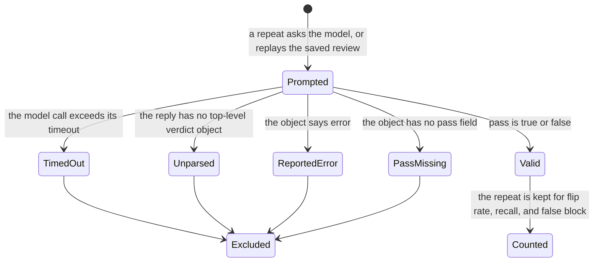

# Shadow verdict

A repeat asks a model for one JSON verdict. A non-verdict reply is an error,
excluded from flip and false-block rates. The scorecard never blocks a merge.

| State | Event | Guard | Side effect |
| --- | --- | --- | --- |
| Unparsed | model text | no verdict object | error, raw kept to 800 chars |
| ReportedError | parsed object | `error` set | error verdict |
| PassMissing | parsed object | `pass` is null | error verdict |
| TimedOut | subprocess | `TimeoutExpired` | error verdict, raw `timeout` |
| Counted | metrics | `error` is false | enters flip rate, recall, false block |
| Excluded | metrics | `error` is true | in `error_repeats`, not in rates |

Repeats run together, sorted by repeat number. Replays parse the saved review.
