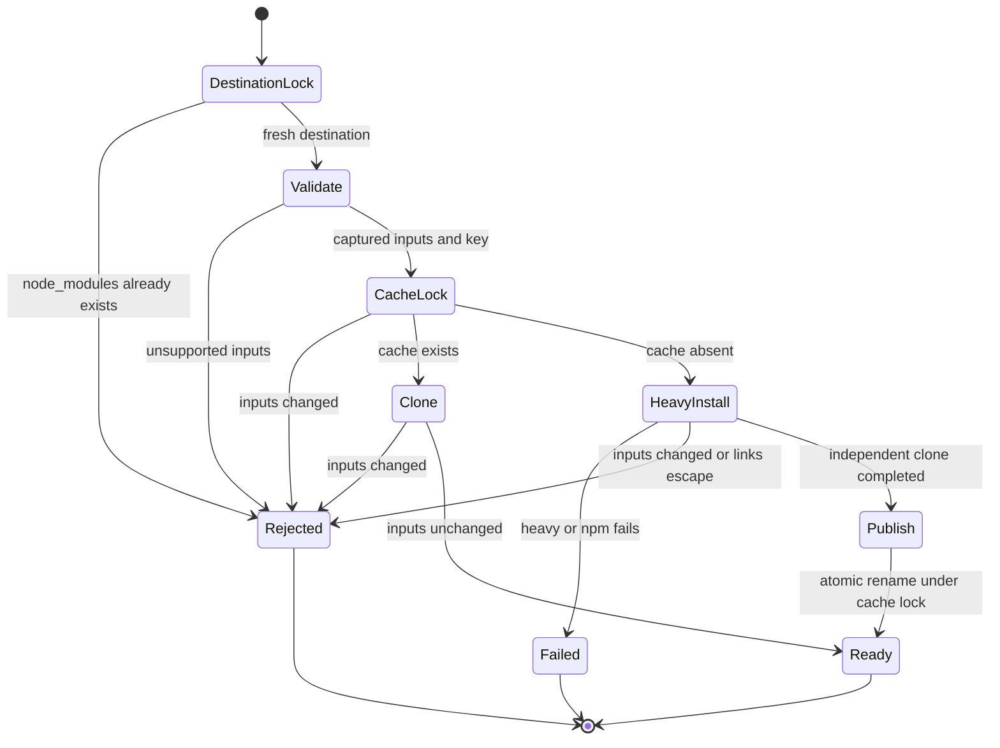

# Shared npm setup

Owner: `scripts/shared_npm_install.py`, `main`, `locked`, `validate`, and `unchanged`.

The destination lock remains held through the cache lock, install or clone, and completion. Cache-key locks prevent concurrent publication. Publication uses rename within one filesystem after cp exits successfully. The source node_modules is never a symlink to the cache. Failures release locks, do not publish a cache, and can leave npm's partial files in the calling worktree. No automatic deletion or repair occurs.

The filesystem and cooperating callers are assumed trustworthy. External mutation of node_modules or the cache is outside the locking protocol. A cache hit does not establish repository check results. Runtime proof must exercise the repository's checks using the cloned dependencies.

## Package manager selection

`detect` runs before either installer. One JavaScript lockfile, one Python lockfile, or one native lockfile is required. Mixed lockfiles are rejected. npm then follows the states above. pnpm, Bun, uv, pip, Swift, and CocoaPods take the destination lock, reject an existing dependency directory (except Swift, which only resolves), and run that manager through heavy. Their package caches are not installed-tree clones. A failure can leave a partial dependency directory.
