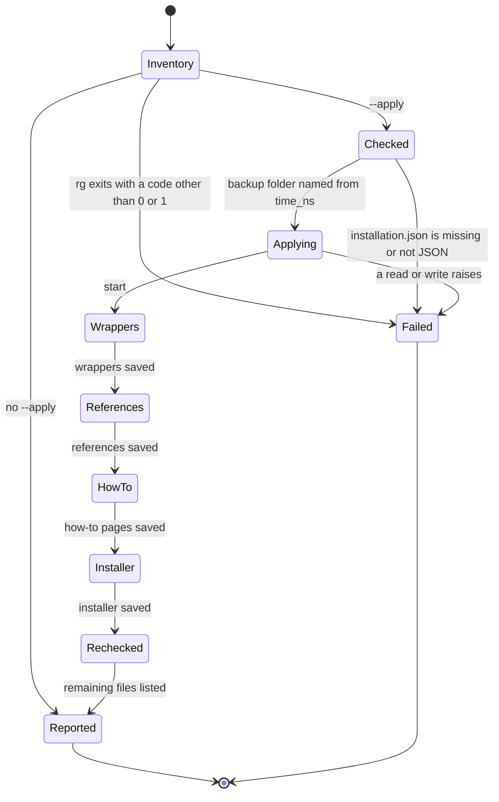
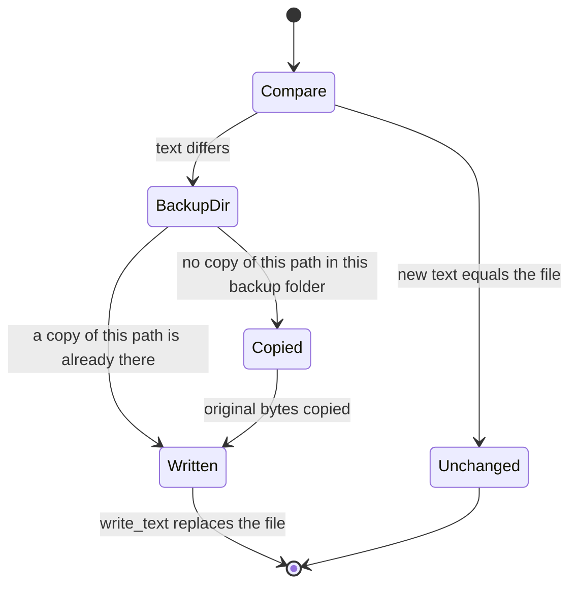

# Load-tool reference update and backups

Owner: `update_references.py`, `main`, `candidates`, `apply`, and `save`.

The script lists files that still mention `.multica-codex`. With `--apply`
it also rewrites the wrappers, the reference text, and two how-to pages to
point at mac-ops. Every file it changes is copied into a backup folder
first. It runs once by hand and keeps no state between runs.

A failure in `Applying` stops the run with a traceback. Files saved before
the failure keep their new text and have a backup. Nothing is rolled back,
and no JSON report is printed.

## Save and backup

## States, events, guards and side effects

| State | Event | Guard | Side effect | Source |
| --- | --- | --- | --- | --- |
| Inventory | script starts | none | `rg -l` over the wiki, `~/.claude`, `~/.codex` and shell profiles, with noisy folders excluded | `update_references.py:21-31` |
| Inventory | `rg` fails | exit code not 0 or 1 | `RuntimeError` with 200 characters of stderr | `update_references.py:29-30` |
| Reported | no `--apply` | none | prints `active_reference_files` | `update_references.py:124,131` |
| Checked | `--apply` | `installation.json` parses | none | `update_references.py:125-126` |
| Applying | backup folder chosen | none | folder is `reference-backups/<time_ns>`, created on the first save | `update_references.py:127,37` |
| Wrappers | each of `heavy.py`, `load_backstop.py`, `board_governor.py` | file exists | replaced with a stub that runs the installed release | `update_references.py:47-62` |
| References | each file in the list | is a file | text replaced, longest specific paths first | `update_references.py:63-89` |
| References | file path holds `/reference/`, `/explanation/` or `/skills/` | historical | `~/.multica-codex/` maps to `~/_archive/multica-codex-20261027/` | `update_references.py:80-83` |
| References | text changed | `save` returns True | `save` | `update_references.py:87-89` |
| HowTo | the two how-to pages | file exists | whole page replaced with fixed text | `update_references.py:90-109` |
| Installer | `install_heavy.py` | file exists | replaced with an `execv` into `install.sh install` | `update_references.py:110-116` |
| Rechecked | apply done | none | prints `changed`, `backup`, `remaining_reference_files` | `update_references.py:129-131` |
| Compare | `save` called | text equals the file | return, no backup, no write | `update_references.py:35-36` |
| BackupDir | text differs | none | folder made with mode 0700 | `update_references.py:37` |
| Copied | first save of a path in this folder | target absent | original bytes copied to `<hash>-<name>` | `update_references.py:38-41` |
| Written | backup is in place | none | `write_text` replaces the file | `update_references.py:42` |

The file list in `References` is the wiki docs outside `how-to`,
`replay_memory_gate.py`, and the search hits that sit directly in the home
folder or are named `settings.json` or `config.toml`
(`update_references.py:72-74`). The two how-to pages are excluded here and
rewritten whole in `HowTo`.

## Backups on a rerun

Each run makes a new backup folder, so a rerun does not overwrite the
backup of an earlier run. The first run holds the true originals. A second
run that still finds changes backs up the already rewritten text in its own
folder. A file whose new text equals what is on disk is skipped before any
backup is made. Inside one run a path is copied once, because the copy is
skipped when the target exists (`update_references.py:40`).

## Suspected problems

These are read from the code. The first was reproduced and fixed in MO-113; the rest are open.

| Finding | Where | Why it matters |
| --- | --- | --- |
| `changed` lists files that were not changed | `update_references.py:61-62`, `115-116` | `save` returns early when the text is equal, but the caller appends the path anyway. A rerun reports the three wrappers and the installer as changed. The how-to pages are the same at `108-109`. The report cannot be used to tell whether anything was written. Fixed in MO-113: `save` returns whether it wrote, and callers append only then. A rerun on an unchanged sandbox HOME now reports 0 changed instead of 2. |
| The file write is not atomic | `update_references.py:42` | `write_text` truncates then writes. A crash or full disk mid-write leaves a half file, such as `~/.zshrc`. The backup exists, but nothing restores it. |
| The backup copy is not atomic | `update_references.py:40-41` | A crash after the file is created and before the bytes land leaves a short backup. The folder name is new each run, so a retry makes a fresh folder and the short copy is never reused. The real original is lost only if the first run also wrote the file, which it cannot do before the copy returns. |
| A failure mid-run leaves a mixed state with no report | `update_references.py:128` | `changed` and `backup` are only printed after `apply` returns. After an exception the user sees a traceback and has to find the backup folder by hand. |
| Backups lose file modes | `update_references.py:41` | `write_bytes` makes new files with default permissions. The folder is 0700, but the parents created by `parents=True` use the default mode. Restoring by `cp` does not bring back an executable bit. |
| Substring replacement can hit longer paths | `update_references.py:84-86` | `str.replace` on `~/.multica-codex/` also changes any longer text that contains it, such as a path under a different prefix. The historical split depends on the file path text, not on the content. |
| The how-to pages are replaced whole | `update_references.py:90-109` | Any local edit to those two pages is dropped. The backup keeps it. |
| `rg` must be installed | `update_references.py:28` | A missing `rg` raises `FileNotFoundError`, not the `RuntimeError` at line 30. |
