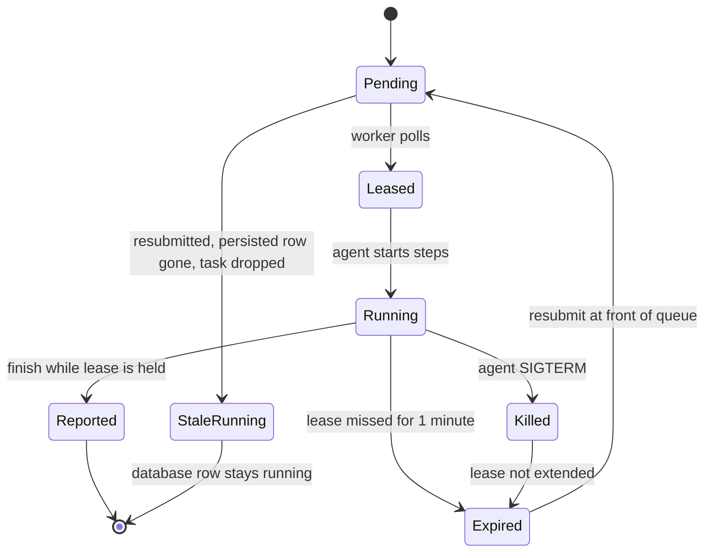
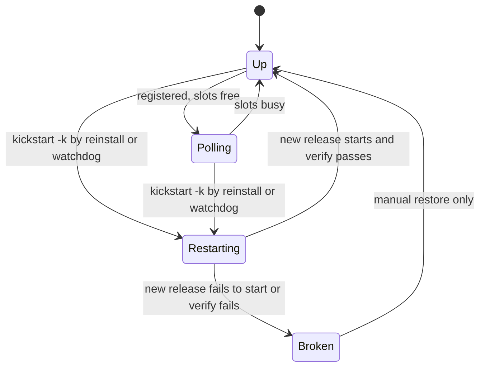

# Woodpecker runner job and install lifecycle

## One workflow

The server queue in Woodpecker v3.16.0 `server/queue/fifo.go` records the worker and a lease deadline when a worker polls a task. The agent renews the lease while it runs. If the agent is killed or partitioned, `resubmitExpiredPipelines` puts the task at the front of pending and another worker can take it. The first agent only learns of this through its Wait stream, so a partitioned agent can still be running the same job. A report from the stale agent is lost.

The native agent `shyams-macbook-pro-ios` runs from the LaunchAgent `org.woodpecker.agent`. MO-72 added a second slot by setting `WOODPECKER_MAX_WORKFLOWS=2`, so one SIGTERM kills both in-flight workflows. Workflow 4254 followed the Killed, Expired, StaleRunning path and is still `running` in the database.

## Agent install

`~/Code/woodpecker-ci/scripts/bootstrap.sh` runs `compose up -d --force-recreate` and then `scripts/verify.sh` under `set -eu`. A failure exits with the new release in place and no automatic rollback. The native agent plist edit and `launchctl kickstart -k` are also manual, with a `.before-max2` copy as the only revert. `scripts/watchdog.sh` on the M1 restarts the agent the same way, without changing the release.

The TLA+ model in [formal/woodpecker-runner](../../formal/woodpecker-runner/README.md) reproduces the double run, the stale drop, the install gap (both MO-72 slots live in one agent process, so every install leaves darwin jobs with no runner; the model treats a watchdog restart as instant, so it does not check that gap) and the missing rollback as counterexamples.
