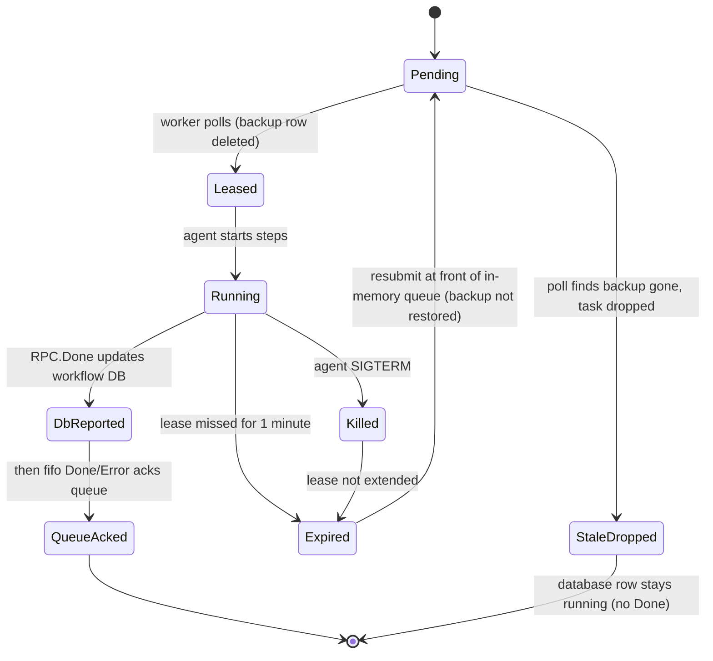
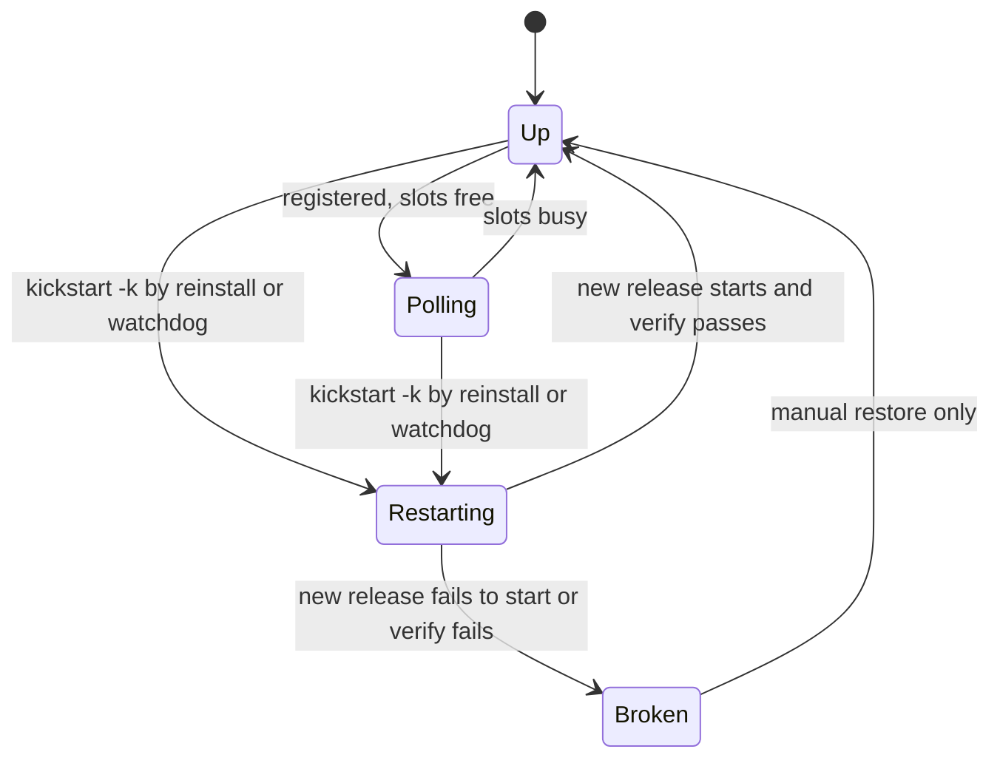

# Woodpecker runner job and install lifecycle

## One workflow

The server queue in Woodpecker v3.16.0 `server/queue/fifo.go` records the
worker and a lease deadline when a worker polls a task. The agent renews the
lease while it runs. If the agent is killed or partitioned,
`resubmitExpiredPipelines` puts the task at the front of pending without
restoring the TaskStore backup. With the production `persistentQueue`
(`server/queue/persistent.go`), a later poll deletes that backup on first
assign and, when the row is already gone, drops the task as stale instead of
handing it to another worker. Bare in-memory FIFO (no persistence) would allow
a second worker to take the same job while the first is still executing; that
path is not how the M1 server is configured.

`RPC.Done` (`server/rpc/rpc.go`) updates the workflow database status before
acknowledging the queue. Queue `fifo.finished` does not check which worker
still holds the lease. Database reporting and queue acknowledgment are
therefore separate steps: a finished agent writes the DB even when the lease
has moved; a killed agent that never calls Done leaves the row `running`.

The native agent `shyams-macbook-pro-ios` runs from the LaunchAgent
`org.woodpecker.agent`. MO-72 added a second slot by setting
`WOODPECKER_MAX_WORKFLOWS=2`, so one SIGTERM kills both in-flight workflows.
Workflow 4254 followed the Killed, Expired, StaleDropped path and stayed
`running` until the MO-117 reaper cleared it. MO-116 returned the live plist
to `WOODPECKER_MAX_WORKFLOWS=1`. MO-117 made the M1 a dedicated CI box: Colima
at 10 GiB with `ci-linux` capacity 4 and `ci-deploy` capacity 1
(`role=deploy`), native still capacity 1 (see [M1 CI lanes](../m1-ci-lanes.md)).

## Agent install

`~/Code/woodpecker-ci/scripts/bootstrap.sh` runs
`compose up -d --force-recreate` and then `scripts/verify.sh` under `set -eu`.
A failure exits with the new release in place and no automatic rollback. The
native agent plist edit and `launchctl kickstart -k` are also manual, with a
`.before-max2` copy as the only revert. Prefer
`scripts/safe-restart.sh` (MO-121) for any agent force-recreate so drain runs
first. `scripts/watchdog.sh` recovers a down Colima with drain-before
`kickstart -k` when Docker still answers, then `compose up --no-recreate`
only — it does not force-recreate agents or change the release.

The TLA+ model in
[formal/woodpecker-runner](../../formal/woodpecker-runner/README.md)
reproduces the bare-FIFO double-run hazard (StaleDrop off), the production
stale drop (StaleDrop on), the install gap (both MO-72 slots live in one agent
process, so every install leaves darwin jobs with no runner; the model treats
a watchdog restart as instant, so it does not check that gap) and the missing
rollback as counterexamples.
